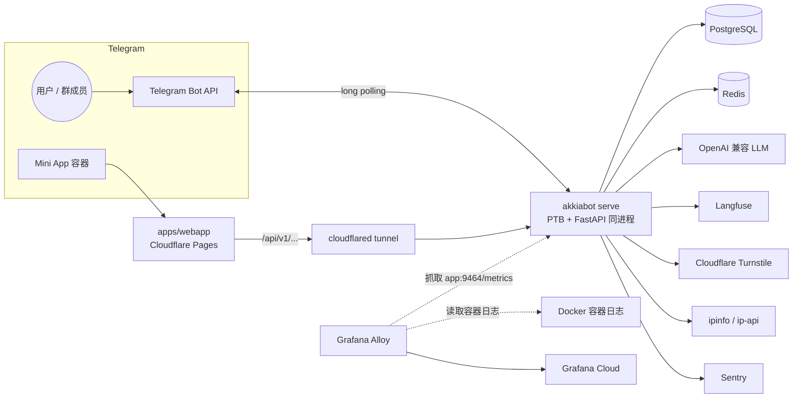
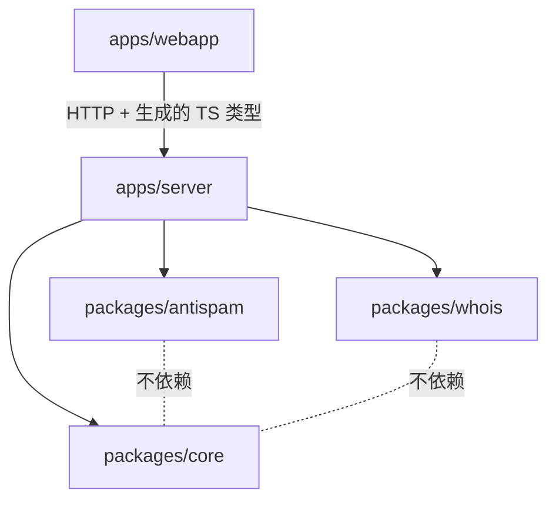

# AkkiaBot 架构设计

本文档说明 AkkiaBot 的核心设计决策、运行时组成、功能清单、技术栈、目录结构与模块边界。

## 1. 核心设计决策

| 领域 | 决策 |
| --- | --- |
| 后端语言 | Python，bot、HTTP API 与 LLM 判定运行在同一个进程 |
| 生产数据库 | PostgreSQL；本地开发和单测可用 SQLite |
| 消息存储 | 默认只存消息 ID（用于封禁时批量删除），只在命中反垃圾时保存正文用于审计，并按保留期定时清理 |
| 群配置交互 | 用 `/config` 在私聊中通过 inline 按钮切换；Mini App 配置面板是后续可选优化 |
| 入群验证 | 新成员入群后禁言，在 Mini App 中完成 Cloudflare Turnstile 后解除；时限 5 分钟，超时后维持禁言 |
| 反垃圾 | 只在进程内调用，不提供对外的反垃圾 HTTP API |
| LLM | 使用 OpenAI 兼容 client 调用模型；LLM 调用记录到 Langfuse |
| 可观测性 | Sentry（异常）、Langfuse（LLM）、Grafana Cloud（日志、指标、告警），见 §5.5 |
| whois | 只用在线 API，provider 链为 ipinfo → ip-api，不使用离线库 |
| 前端托管与域名 | 前端（纯静态 SPA）部署到 Cloudflare Pages：`bot.akkia.moe`；后端 API 使用 `bot-api.akkia.moe` |

## 2. 运行时组成与调用关系



## 3. 功能清单

| 功能 | 说明 |
| --- | --- |
| 入群验证（Turnstile + Mini App） | 校验 initData 的 `auth_date` 是否过期，验证记录与群绑定，验证消息自动清理；超时 5 分钟，超时后维持禁言 |
| LLM 反垃圾 | 进程内调用，使用结构化输出；发言超过 N 条的成员豁免；记录判定结果 |
| `/spam` 举报 | 管理员举报直接封禁；成员举报交给 LLM 判定，不是垃圾则通知管理员 |
| `/warn` 警告 | 达到上限后封禁，上限可按群配置 |
| `/ban` + 清理历史消息 | 封禁并批量删除记录过的消息 |
| `/config` 群配置 | 群内发起，跳转私聊后用 inline 按钮切换开关 |
| `/id`、`/help`、`/start` 分发 | `/start` 按一次性 payload 分发到验证或配置流程 |
| `/ip` whois | provider 链（ipinfo → ip-api）加缓存 |
| 删除系统消息 | 可按群配置 |
| 消息记录 | 只存 ID，命中反垃圾时保存正文；保留期到期后定时清理 |
| 加群申请提示 | 收到加群申请时私聊提示申请人等待管理员批准，bot 不自行审批 |
| 可观测性 | 结构化日志、Prometheus 指标、Sentry、Langfuse，见 §5.5 |

## 4. 技术栈

**一句话**：Python 3.13 单体后端（python-telegram-bot + FastAPI + SQLAlchemy 2 async + PostgreSQL），用 uv workspace 管理；前端是 Vite + React 的 Telegram Mini App（纯静态），用 pnpm 管理并部署到 Cloudflare Pages；用 ruff / pyright / pytest / Biome / Vitest 和 GitHub Actions 保证质量；后端以 Docker 镜像加 docker compose 部署；可观测性由 Sentry（错误）、Langfuse（LLM）和 Grafana（日志、指标）三部分组成。

| 领域 | 选择 | 理由 | 主要备选与取舍 |
| --- | --- | --- | --- |
| 后端语言 | **Python 3.13** | LLM、Langfuse 生态以 Python 为主；bot 和 LLM 判定在同一个进程，不需要跨语言 HTTP 调用和 service token | **Go**：性能和单文件部署更好，但 LLM 部分仍要另起一个 Python 服务，形成双语言、双服务；群管机器人的流量对性能没有要求 |
| Telegram 框架 | **python-telegram-bot 22** | 官方 API 覆盖及时；自带 JobQueue（可用于定时清理、captcha 超时）；支持 webhook 和长轮询 | **aiogram 3**：Router / 中间件 / 依赖注入更现代，但团队对它没有积累。如果后续中间件需求变复杂，可以再评估 |
| HTTP API | **FastAPI** | 与 PTB 同在一个 asyncio 事件循环；可以自动生成 OpenAPI，前端据此生成类型 | Litestar：差别不大，生态更小 |
| ORM / 迁移 | **SQLAlchemy 2.0（async）+ Alembic** | async Session 不阻塞事件循环；所有 Telegram ID 统一用 `BigInteger` | SQLModel：对 async 和复杂类型的支持仍然别扭 |
| 数据库 | **PostgreSQL 17**（生产）/ SQLite（本地开发、单测） | JSONB 适合存群配置（模型层使用可移植 JSON 类型，见 §5.3）；支持并发写；docker compose 一键拉起 | MySQL：没有必须选它的理由；纯 SQLite：单实例也够用，但不利于以后扩展 |
| 缓存 / 临时状态 | **Redis 7**（可选），接口抽象 + 内存实现作为后备 | start payload、captcha 状态需要 TTL；本地开发和测试不依赖 Redis | 只用数据库表加过期字段：可以少一个组件，但 TTL 清理要自己实现 |
| 配置 | **pydantic-settings**（环境变量 + `.env`） | 带类型校验，启动时一次性失败；配置只读，运行时不写回文件 | YAML 文件：容器化部署时不如环境变量方便 |
| LLM | **openai SDK（OpenAI 兼容端点）** + 可选 **Langfuse** | 豆包、OpenAI、DeepSeek 等都兼容这套接口；使用 JSON / 结构化输出 | LiteLLM：多一层依赖，但目前只调用一个模型，用不上 |
| HTTP 客户端 | **httpx（async）** | 不阻塞事件循环 | aiohttp |
| Python monorepo | **uv workspace** | 一个 lock 文件；成员包可以相互依赖；速度快 | Pants / Bazel：对这个规模过重；Poetry：不支持 workspace |
| 前端 | **Vite + React 19 + TypeScript + Tailwind 4 + @telegram-apps/sdk-react 3** | Mini App 是纯静态页面，用不上 Next 的服务端能力；Vite 构建更简单，产物可以直接由 CDN 托管 | **Next.js（static export）**：为纯静态页面背负了框架复杂度；**Svelte**：更轻，但会多一套技术栈 |
| 前端 monorepo | **pnpm workspace** | 安装快、磁盘占用小；以后增加配置面板等页面时可以平滑扩展 | npm / bun workspace |
| 前后端契约 | **OpenAPI → openapi-typescript** 生成 TS 类型，CI 检查生成结果是否过期 | 避免前端与后端的字段名、路径不一致 | 手写类型 |
| Python lint / format / 类型 | **ruff**（lint + format）、**pyright**（standard 模式） | ruff 一个工具即可取代 black、isort、flake8、pyupgrade | mypy：更慢，对 PTB 和 SQLAlchemy 的类型推断不如 pyright |
| Python 测试 | **pytest + pytest-asyncio**、respx（模拟 HTTP）、testcontainers 或 compose 中的 PostgreSQL（集成测试） | Telegram 交互通过伪造 `Update` 加 Bot mock 测试 | — |
| 前端 lint / 测试 | **Biome**、**Vitest** | 一个工具完成 lint 和 format，配置少 | ESLint + Prettier |
| 任务入口 | **just**（`justfile`） | `just lint` / `just test` / `just dev` 统一调度 Python 与前端两侧命令 | Makefile：可以用，但跨平台和变量处理差一些 |
| Git hooks | **pre-commit**（ruff、biome、gitleaks、基础检查） | 提交前统一检查，并做密钥扫描 | lefthook |
| CI | **GitHub Actions**：按路径触发 lint、type、test；构建镜像并推送 GHCR；Renovate 自动升级依赖 | 代码、CI 与镜像仓库在同一平台，权限配置简单 | — |
| 部署 | **后端**：Docker 镜像 + **docker compose**（app、postgres、redis、cloudflared、alloy），通过 cloudflared tunnel 暴露为 `bot-api.akkia.moe`；**前端**：构建产物部署到 **Cloudflare Pages**，自定义域名 `bot.akkia.moe` | 单机 compose 足够当前规模，tunnel 不需要开放公网入站端口；前端走 CDN 边缘缓存，加载最快。Mini App 是纯静态 SPA，所有数据都通过调用后端 API 获取，满足 Pages 只托管静态文件的前提 | 前端随后端镜像托管：同源、不需要 CORS，但每次加载都要回源到后端服务器，速度更慢 |
| 可观测性 | **Sentry**（异常与性能）、**Langfuse**（LLM 调用、提示词、耗时、token 用量）、**Grafana**：日志 → Loki，指标 → Prometheus 格式的 `/metrics`，由 **Grafana Alloy** 统一采集并推送 | 三者各管一块，互不重叠；Alloy 一个 agent 同时采集容器日志和指标；后端使用 **Grafana Cloud**，免运维，免费额度足够当前规模 | 全量 OpenTelemetry（traces → Tempo）：后续需要分布式追踪时再加，目前是单进程，收益不大 |

## 5. Monorepo 结构

```text
AkkiaBot/
├── apps/
│   ├── server/                  # 可部署的后端服务（Python 包 akkiabot_server）
│   │   ├── src/akkiabot_server/
│   │   │   ├── main.py          # 入口：同一事件循环中启动 PTB 与 uvicorn，处理生命周期
│   │   │   ├── bot/             # Telegram 适配层：handler 注册、命令、中间件、按钮回调
│   │   │   │   ├── commands/    # start / help / id / ip / ban / warn / spam / config
│   │   │   │   ├── handlers/    # 群消息、成员变更、系统消息
│   │   │   │   └── jobs.py      # JobQueue 定时任务（消息保留期清理、captcha 超时）
│   │   │   ├── api/             # FastAPI 路由（/api/v1/...），Mini App 鉴权依赖
│   │   │   └── services/        # 业务用例：captcha、moderation、antispam_guard、chat_settings
│   │   └── tests/
│   └── webapp/                  # Telegram Mini App（Vite + React）
│       ├── src/
│       │   ├── pages/captcha/
│       │   └── api/             # openapi-typescript 生成的类型 + fetch 封装
│       └── tests/
├── packages/
│   ├── core/                    # akkiabot_core：配置、日志、数据库、缓存、领域模型
│   │   ├── src/akkiabot_core/
│   │   │   ├── config.py        # pydantic-settings
│   │   │   ├── logging.py
│   │   │   ├── db/              # engine、session、ORM 模型、repository
│   │   │   ├── cache/           # Cache 协议 + Redis / 内存实现
│   │   │   └── telegram/        # 与框架无关的 Telegram 工具：initData 校验、MarkdownV2 转义等
│   │   ├── migrations/          # Alembic
│   │   └── tests/
│   ├── antispam/                # akkiabot_antispam：LLM 分类器、提示词、结果模型
│   └── whois/                   # akkiabot_whois：IP 查询 provider 链 + 缓存
├── deploy/
│   ├── Dockerfile               # 后端镜像：多阶段构建，安装 uv 依赖 → 运行镜像（不含前端）
│   ├── compose.yaml             # 生产：app + postgres + redis + cloudflared + alloy
│   ├── compose.dev.yaml         # 本地：postgres + redis（可选 grafana/otel-lgtm 一体化观测栈）
│   └── observability/           # Alloy 采集配置、Grafana dashboard JSON、告警规则
├── docs/
├── .github/workflows/           # ci.yml、release.yml
├── pyproject.toml               # uv workspace 根配置 + ruff / pyright / pytest 配置
├── uv.lock
├── package.json · pnpm-workspace.yaml · pnpm-lock.yaml · biome.json
├── justfile
├── .pre-commit-config.yaml
├── .env.example
└── README.md
```

### 5.1 模块边界与依赖方向



规则（由 CI 中的 import-linter 强制执行）：

1. **`packages/*` 不依赖 Telegram 框架和 FastAPI。** `antispam`、`whois` 是纯库，只依赖 httpx / openai / pydantic，可以独立测试；`core` 只依赖 SQLAlchemy、pydantic-settings、redis。
2. **`antispam` 和 `whois` 不依赖 `core`。** 它们需要的配置由调用方以参数传入（例如 `AntiSpamClassifier(settings=...)`），不读取全局配置。
3. **只有 `apps/server` 接触 PTB 与 FastAPI。** `bot/` 和 `api/` 是很薄的适配层，只负责把 Telegram Update 或 HTTP 请求转换为 `services/` 中用例的调用；业务规则写在 `services/`，从而可以脱离 Telegram 做单元测试。
4. **数据库访问只通过 `core.db` 的 repository 进行**，不在 handler 中直接写 SQL。
5. **前后端只通过 OpenAPI 契约交互。** 后端改动 schema 后运行 `just gen-api` 重新生成前端类型，CI 会检查生成结果是否过期。

### 5.2 模块之间的关键接口（草案）

```python
# packages/antispam
class SpamVerdict(BaseModel):
    is_spam: bool
    category: Literal["ad", "gambling", "fraud", "other", "none"]
    confidence: float

class AntiSpamClassifier:
    async def classify(self, text: str, *, context: SpamContext | None = None) -> SpamVerdict: ...

# packages/whois
class IpInfo(BaseModel): ip: str; location: str; asn: str; org: str; isp: str
class WhoisService:
    def __init__(self, providers: Sequence[IpProvider], cache: TTLCache | None = None): ...
    async def lookup(self, ip: IPv4Address | IPv6Address) -> IpInfo | None: ...

# packages/core
class Cache(Protocol):
    async def get(self, key: str) -> str | None: ...
    async def set(self, key: str, value: str, ttl: int) -> None: ...
    async def pop(self, key: str) -> str | None: ...   # 一次性 payload
def verify_init_data(raw: str, bot_token: str, *, max_age: timedelta) -> WebAppInitData | None: ...
```

### 5.3 数据模型（初版）

| 表 | 主要字段 | 说明 |
| --- | --- | --- |
| `chat` | `id BIGINT PK`（Telegram chat id）、`type`、`title`、`settings JSON`（通用 `sa.JSON` 类型，在 PostgreSQL 上通过 `with_variant(JSONB)` 使用 JSONB，在 SQLite 上为普通 JSON；Alembic 迁移使用同一可移植类型）、`created_at`、`updated_at` | 群配置合并为一个 JSONB 字段（`antispam`、`captcha`、`warn`、`max_warn_count`、`delete_service_messages` 等），由 pydantic 模型校验 |
| `chat_member` | `(chat_id, user_id) UNIQUE`、`restriction`（enum：none / captcha_mute / spam_mute / admin_ban …）、`restricted_by`、`restricted_until`、`warn_count`、`message_count`、`joined_at`、`last_message_at` | 成员的限制状态、警告数与发言统计 |
| `message_log` | `chat_id`、`message_id`、`user_id`、`created_at`、`spam_verdict`（nullable）、`text`（nullable，默认不写入） | 用于封禁时批量删除和反垃圾审计；定时清理 |
| `captcha_challenge` | `id UUID`、`chat_id`、`user_id`、`status`、`created_at`、`expires_at`、`group_message_id` | 把 start payload、Mini App 回调和超时处理绑定到同一条记录 |

所有 Telegram ID 一律使用 `BIGINT`。

### 5.4 运行时形态

- **一个进程**：`main.py` 构建 PTB `Application` 和 FastAPI app，在同一个事件循环中运行 PTB（默认长轮询，可配置为 webhook）和 uvicorn；FastAPI lifespan 负责初始化和关闭数据库、缓存、HTTP 客户端。
- **数据库迁移**：通过独立命令 `akkiabot migrate`（容器启动前执行）完成，不在应用进程内用 subprocess 调用 alembic。
- **域名与前端**：
  - `bot.akkia.moe` → Cloudflare Pages（Mini App 静态文件）。生产只发布经 staging 验收并打正式 tag 的版本（`docs/release.md`、`docs/webapp.md`），PR 生成预览地址。
  - `bot-api.akkia.moe` → cloudflared tunnel → 后端容器，提供 `/api/v1/...`。
  - 前端在构建时通过 `VITE_API_BASE_URL` 注入 API 地址；后端的 CORS 只放行 `https://bot.akkia.moe`（以及配置里列出的预览域名）。
  - Mini App 的鉴权依赖请求中携带的 Telegram initData，而不是 Cookie，所以跨域不涉及凭据共享，配置很简单。
  - 备选：也可以用 Cloudflare Worker 把 `bot.akkia.moe/api/*` 转发给 tunnel，做到同源，但多一层需要维护，目前不需要。
- **健康检查**：`/healthz`（存活）与 `/readyz`（数据库和缓存连通；polling 模式下还检查 `polling`，即 PTB 的 `getUpdates` 循环是否仍在运行）。
- **polling 中止后退出**：Telegram 对 `getUpdates` 返回 401/404 时，PTB 会抛出 `InvalidToken` 并永久停止 polling，但进程和 HTTP API 仍在运行。为此做了两层处理。第一层：先间隔 1、2、4 秒重试 `getUpdates`，吸收 Telegram 的瞬时误报。第二层：重试后仍被拒绝时，`/readyz` 的 `polling` 变为 `false`，`akkiabot serve` 优雅停止并以退出码 1 结束，由 `restart: unless-stopped` 重启。只让 healthcheck 变红不够，因为 Docker 不会重启 unhealthy 的容器。PTB 中止时记录的错误是这次事件唯一的一次 error 上报；停止 updater 时会再次抛出同一个异常，这次只记 info，不会重复上报 Sentry。

### 5.5 可观测性

| 信号 | 实现 | 去向 |
| --- | --- | --- |
| 异常、慢请求 | `sentry-sdk`（FastAPI 集成 + logging 集成），PTB handler 的异常统一上报；显式禁用自动启用的 OpenAI 集成（它会把业务已 fail-open 处理的 LLM 错误记成 unhandled，并把 `chat <model>` 串到无关事件的 transaction 上），LLM 故障由 warning 日志和 `antispam_llm_errors_total` 告警覆盖。事件不采集帧局部变量（Bot API 请求 URL 内含 bot token），并在 `before_send` / `before_breadcrumb` 中把所有已配置的密钥值（`SecretStr` 与数据库密码）替换为 `***`，因为第三方异常的消息里也可能带出密钥 | Sentry |
| LLM 调用 | `langfuse` 包装的 OpenAI 客户端：记录提示词版本、输入输出、耗时、token 用量和判定结果 | Langfuse |
| 日志 | 结构化 JSON 日志输出到 stdout，字段包含 `chat_id`、`user_id`、`update_id`、`handler`、`trace_id` 等；Alloy 采集 Docker 日志并推送 | Grafana Cloud（Loki） |
| 指标 / 埋点 | `prometheus-client` 暴露 `/metrics`（只在内网可访问，不经 tunnel 暴露）；Alloy 抓取后推送 | Grafana Cloud（Prometheus） |

首批业务指标（命名前缀 `akkiabot_`）：

- `updates_total{type}`、`handler_duration_seconds{handler}`、`handler_errors_total{handler}`
- `command_total{command,result}`
- `captcha_started_total`、`captcha_total{result=passed|timeout|failed}`、`captcha_duration_seconds`
- `antispam_verdict_total{verdict,action}`、`antispam_llm_duration_seconds`、`antispam_llm_errors_total`
- `moderation_actions_total{action=ban|warn|mute|delete}`
- `telegram_api_errors_total{method}`、`whois_lookup_total{provider,result}`
- `telegram_poll_total{result}`、`telegram_poll_last_success_timestamp_seconds`（polling 心跳，供“停止接收 update”告警）
- 运行时指标：HTTP 请求（FastAPI 中间件）、数据库连接池、事件循环延迟

埋点统一通过 `akkiabot_core.observability` 提供的 helper（例如 `track_handler` 装饰器）记录，业务代码不直接操作 prometheus 对象。所有可观测性组件都在配置里设开关；关闭时代码路径不变，只是不上报。
