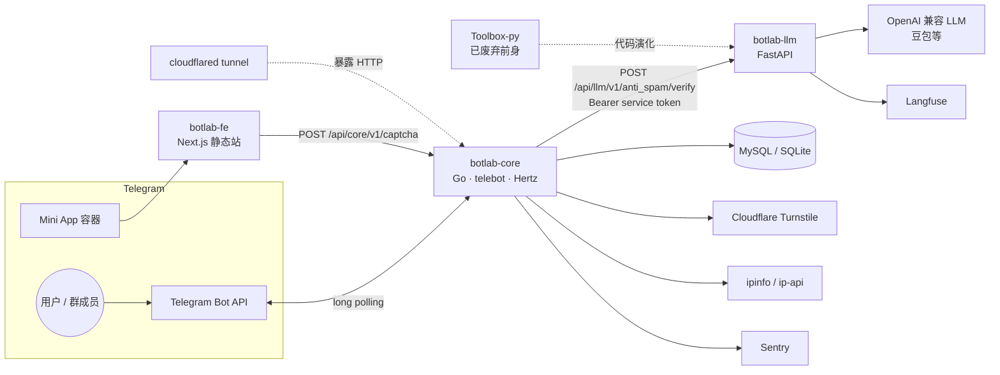
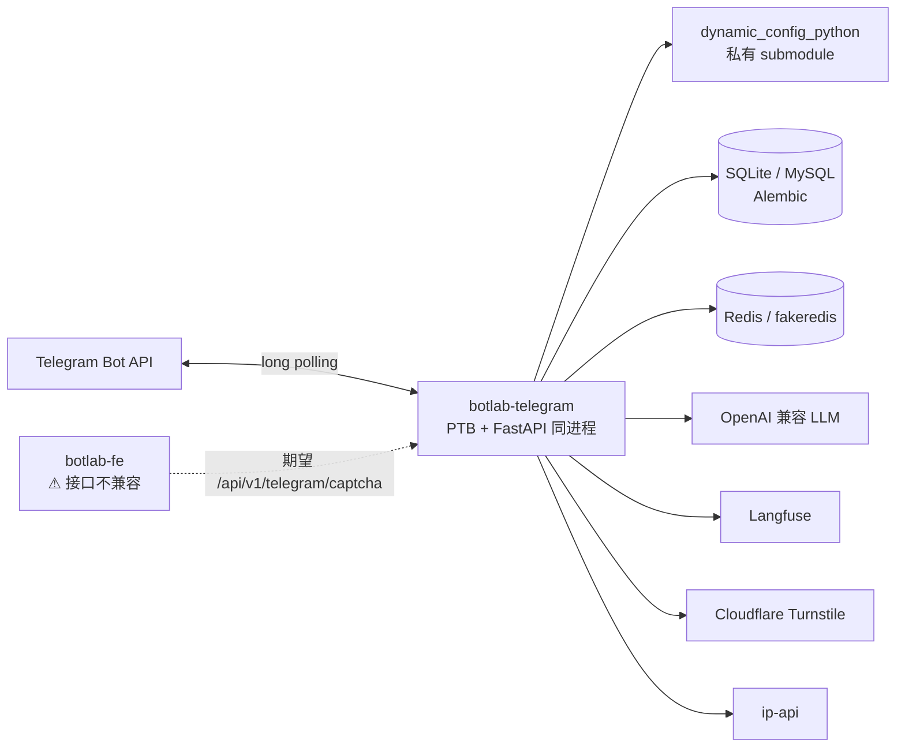
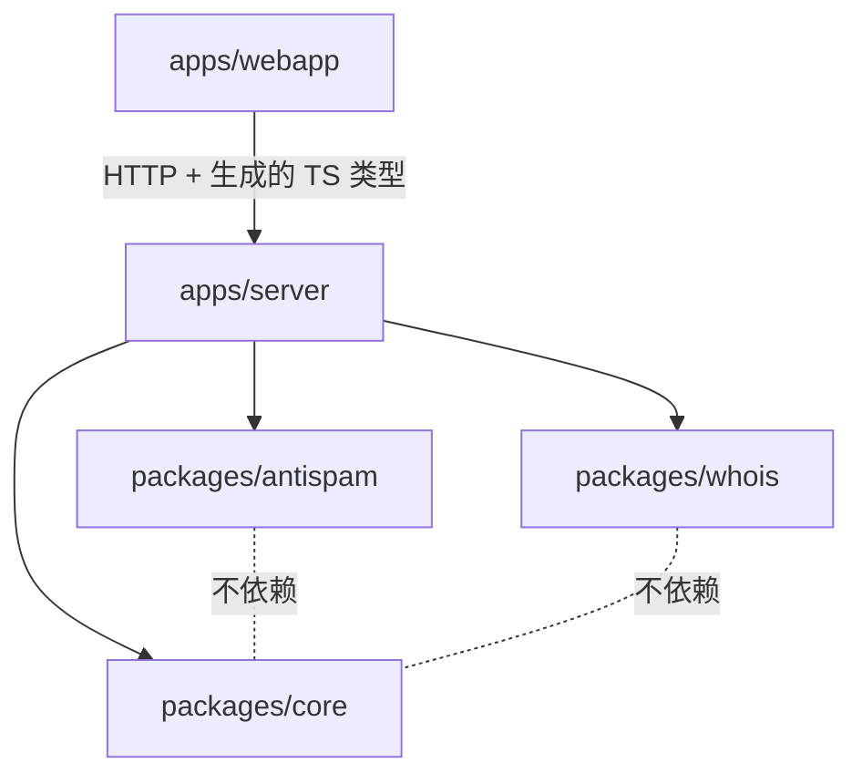

# AkkiaBot 架构设计

本文档盘点 botlab 系列旧仓库的现状，并给出 AkkiaBot monorepo 的推荐技术栈、目录结构与模块边界。迁移顺序与任务拆分见 [migration-plan.md](./migration-plan.md)。

> 盘点基于 2026-11-14 各仓库默认分支最新提交。文中不包含任何密钥；发现的敏感信息位置只在 issue 评论中提示。

## 1. 旧仓库现状盘点

### 1.1 总览

| 仓库 | 语言 / 框架 | 规模（不含 lock） | 最后提交 | 状态 |
| --- | --- | --- | --- | --- |
| botlab-core | Go 1.23 · telebot v3 · Hertz · GORM | ~2.9k 行 Go | 2025-02-01 | 第一代完整机器人，功能最全，已停止演进 |
| botlab-llm | Python 3.12 · FastAPI · openai SDK · Langfuse | ~350 行 | 2025-02-20 | core 的反垃圾 LLM 旁路服务 |
| botlab-fe | Next.js 14（静态导出）· React 18 · Tailwind 3 · @telegram-apps/sdk | ~250 行 | 2024-12-30 | Telegram Mini App，只有一个人机验证页 |
| Toolbox-py | Python · FastAPI · openai SDK | ~290 行 | 2024-08-05 | botlab-llm 的前身，代码几乎相同，已废弃 |
| botlab-telegram | Python 3.12 · python-telegram-bot 22 · FastAPI · SQLModel · Alembic · Redis · uv | ~2.9k 行 | 2025-11-08 | 第二代：用 Python 重写 core+llm 的单体，开发中，功能未补齐 |

**演进脉络**：Toolbox-py（2024-08）→ botlab 单仓（2024-07 ~ 2024-12，目录 `botlab_core/`、`botlab_llm/`、`botlab_fe/`）→ 2024-12-30 拆成 core / llm / fe 三个仓库 → 2025-09 在 botlab-telegram（从 botlab-llm 分叉）里开始用 Python 把 core 和 llm 合并重写。也就是说，作者已经在往"Python 单体"方向收敛，AkkiaBot 是把这条路走完。

### 1.2 botlab-core（Go）

- **职责**：Telegram 群管机器人本体 + 一个 HTTP API（端口 31111）。
- **功能**
  - 入群验证（captcha）：新成员入群 → 禁言 → 群内发送深链按钮 → 私聊打开 Mini App → 前端完成 Cloudflare Turnstile → `POST /api/core/v1/captcha` → 校验 Turnstile 与 Telegram `initData` → 解除禁言。只有 captcha 导致的禁言才能用这种方式解除。
  - 反垃圾：文本/图片消息经中间件异步调用 botlab-llm 判定；命中后删除消息、永久禁言、5 秒后清空该用户的历史消息；发言超过 3 条的老成员豁免；给消息打 `spam_flag`。
  - 命令：`/ip`（whois）、`/config`（群内 → 私聊深链 → inline 按钮切换 AntiSPAM / Captcha / Warn）、`/ban`、`/spam`（管理员直接封禁；普通成员举报则交给 LLM 判定，判定不是垃圾就 @ 全部管理员）、`/warn`（达到上限后封禁）、`/id`。
  - 删除"xx 加入群组"之类的系统消息；记录每条消息（**包含正文**）、发言计数、最后发言时间。
  - whois：provider 链 ipinfo → ip-api（另有 MaxMind mmdb、IP2Location 的实现，已注释停用），内存缓存。
- **存储**：GORM，MySQL 或 SQLite，启动时 `AutoMigrate`；表 `telegram_chats`、`telegram_chat_members`、`telegram_users`、`telegram_messages`。群配置的开关是数据库 + 进程内 map 缓存。
- **配置**：`data/config.yaml`。启动时会把合并默认值后的配置**写回** `config.yaml` 和 `config.example.yaml`。
- **部署**：Dockerfile 多阶段构建 → GHCR（`botlab-core:latest`），docker-compose 同时拉起 core、llm 和 cloudflared tunnel。
- **测试**：1 个依赖真实 LLM 服务的"测试"，以及 initData 校验的单测。
- **技术债**
  - 大量 `init()` 隐式初始化（配置、DB 连接、迁移都在包导入时完成），难以测试。
  - goroutine 里直接用 `tele.Context`，错误被吞掉；很多 `err` 没有检查（例如 `webCaptcha.go` 中连续覆盖 `err`）。
  - 文本消息里输入 `mock_join` 会对自己触发 captcha 流程，这是遗留的调试后门。
  - 进程内缓存没有失效机制，无法多实例部署。
  - 可观测性配置硬编码在源码里（见 issue 评论）。

### 1.3 botlab-llm 与 Toolbox-py（Python）

- **职责**：只有一个接口 `POST /api/llm/v1/anti_spam/verify`（Toolbox-py 中为 `/api/anti_spam/verify`），Bearer token 鉴权（配置里的 `TokenMap` 把 token 映射到调用方名称），返回 `{is_spam: bool}`。
- **实现**：用 OpenAI 兼容 SDK 调用模型（默认豆包 Doubao），few-shot 提示词要求只输出 `1/0`，再用正则取最后一个数字。botlab-llm 额外接了 Langfuse 追踪。
- **配置**：`data/config.yaml`，启动时同样会写回文件。
- **技术债**：依赖全部钉死在 `requirements.txt` 里且已过时；Dockerfile 里没有锁版本的环境；`knowledge_base` 是空壳；Toolbox-py 出错时返回 `None` 而不是 `False`。
- **结论**：两者都已被 botlab-telegram 中进程内的 `AntiSPAM` 取代，**不单独迁移**，只保留提示词与判定逻辑。

### 1.4 botlab-fe（Next.js）

- **职责**：Telegram Mini App 的人机验证页 `/captcha?chatID=…`，内嵌 Turnstile 组件，拿到 token 后连同 `initDataRaw` 提交给 core。
- **部署**：`output: 'export'` 纯静态导出，没有用到 SSR 或 API Route。
- **问题**
  - `mockTelegramENV()` **无条件调用**，生产环境中会用假数据覆盖真实的 Telegram 环境，导致提交的 initData 必然校验失败（除非部署前手动删掉）。
  - 与 botlab-telegram 的新接口**不兼容**：旧前端调用 `/api/core/v1/captcha`、参数 `chatID`、页面 `/captcha`；新后端是 `/api/v1/telegram/captcha`、参数 `chatId`、页面 `/captcha/telegram`；新后端还会生成 `/config/telegram` 配置面板链接，但前端里并没有这个页面。
  - 验证结果只打印到 console，用户看不到成功或失败。
  - 无测试，`@telegram-apps/sdk` 仍是 1.x，Next 14 也已落后。

### 1.5 botlab-telegram（Python，第二代）

- **职责**：同一进程里用 `asyncio.gather` 同时跑 PTB 长轮询和 FastAPI（端口 30002）。
- **已实现**：`/start`（Redis 中保存一次性 payload，再按 `captcha` / `config` 分发）、`/help`、`/id`、`/ip`（仅 ip-api）、`/ban`（封禁并批量删除记录过的消息，并发上限 10）、`/config`（只做到跳转私聊，Mini App 面板不存在）；captcha 后端（Turnstile + initData HMAC 校验 + 只解除 captcha 禁言）；删除系统消息；记录消息 ID（不存正文）；`POST /api/v1/antiSpam/verify`（只有接口，**没有接入群消息处理流程**）。
- **未补齐的旧功能**：群消息反垃圾、`/spam`、`/warn`、`/config` 开关、whois 多 provider 回退、消息保留期清理任务（函数写了但没有调度）。
- **存储**：SQLModel + Alembic（启动时用 subprocess 执行 `alembic upgrade head`）；表 `bot_config`、`chat_config`（JSON 列）、`telegram_chat_member`、`telegram_message`；Redis 用于 start payload 与白名单缓存，没有配置时退化为 fakeredis。
- **配置**：环境变量，通过私有 git submodule `AkkiaS7/dynamic_config_python`（39 行，`os.environ` 包装）读取。
- **工程化**：uv + `pyproject.toml`、pre-commit（black / isort / flake8 / pyupgrade）；**Dockerfile 与 release workflow 仍是 botlab-llm 的旧版**（安装 `requirements.txt`，镜像名是 `botlab-llm`），当前无法构建。没有测试。
- **已发现的缺陷（重写时需要规避）**
  1. `chat_id` / `user_id` / `message_id` 用的是 `sa.Integer`；超级群 ID（`-100…`，13 位）在 PostgreSQL / MySQL 上会溢出，只有 SQLite 碰巧没问题。`chat_config.chat_id` 还被定义成了字符串。
  2. 同步 SQLAlchemy Session 与 `requests` 直接在 async handler 中调用，会阻塞事件循环。
  3. initData 校验没有检查 `auth_date` 是否过期；请求里的 `chatId` 由客户端提供，没有和 start payload 绑定。
  4. `RedisClient.get` 也会刷新 TTL；Redis 以 `decode_responses=True` 连接，但白名单代码对返回值调用 `.decode()`，会抛异常。
  5. `BOTLAB_TOKEN` 期望是 dict，但 `dynamic_config` 在默认值为 `{}` 时会直接返回原始字符串，鉴权代码随之出错。
  6. 依赖里缺少 `requests` 与 `redis`（目前是被传递依赖带进来的）。

### 1.6 共享内容与耦合

- **没有共享代码包**：同样的反垃圾提示词在 Toolbox-py、botlab-llm、botlab-telegram 中各复制了一份；initData 校验和 Turnstile 校验在 Go 和 Python 中各实现了一次。
- **没有共享数据库**：core 与 telegram 各有一套 schema，并不兼容（restriction 类型一边是字符串枚举，一边是整数枚举）。
- **跨服务调用只有 HTTP**：fe → core（captcha 回调），core → llm（反垃圾判定，共享 service token）。

## 2. 依赖与调用关系

### 2.1 旧系统（第一代，core + llm + fe）



### 2.2 第二代（botlab-telegram，开发中）



## 3. 功能取舍

| 功能 | 来源 | 结论 | 说明 |
| --- | --- | --- | --- |
| 入群验证（Turnstile + Mini App） | core / telegram / fe | **保留，重写** | 以 telegram 版为蓝本；补上 auth_date 过期检查、payload 与 chat 绑定、验证消息自动清理；**超时 5 分钟，超时后维持禁言**（已确认） |
| LLM 反垃圾 | core + llm / telegram | **保留，重写** | 进程内调用；使用结构化输出代替正则取数字；保留"发言超过 N 条豁免"规则；记录判定结果 |
| `/spam` 举报 | core | **保留，移植** | 管理员举报直接封禁；成员举报交给 LLM 判定，不是垃圾则通知管理员 |
| `/warn` 警告 | core | **保留，移植** | 上限可配置 |
| `/ban` + 清理历史消息 | core / telegram | **保留** | 以 telegram 版为蓝本 |
| `/config` 群配置 | core（inline 按钮）/ telegram（Mini App，未完成） | **保留**；第一阶段用 inline 按钮（已确认） | Mini App 配置面板作为后续优化任务 |
| `/id`、`/help`、`/start` 分发 | 两边都有 | **保留** | |
| `/ip` whois | core（多 provider 回退）/ telegram（仅 ip-api） | **保留**；采用 provider 链设计 | 只用在线 API（ipinfo → ip-api），不使用离线库（已确认） |
| 删除系统消息 | 两边都有 | **保留** | 改为可按群配置 |
| 消息记录（用于封禁时批量删除） | 两边都有 | **保留 ID**；默认不存正文，只在命中反垃圾时保存正文用于审计（已确认） | 增加保留期清理定时任务 |
| 对外 HTTP 反垃圾 API（token map 鉴权） | llm / Toolbox / telegram | **丢弃** | 已确认没有第三方调用方，反垃圾改为进程内调用 |
| Sentry / Langfuse | core / llm | **保留**（已确认） | 地址和密钥只通过配置注入，源码中不含任何值 |
| Grafana 可观测性（日志、指标、埋点） | 无（新增） | **新增**（已确认） | 见 §4 可观测性与 §5.5 |
| `mock_join`、OnWebApp 回显、加群申请回复、knowledge_base 空壳、`bot_config` 表 | core / llm / telegram | **丢弃** | 调试代码、空实现，或没有被使用 |
| Toolbox-py、botlab-llm 独立服务 | — | **丢弃** | 合并进主服务 |
| dynamic_config submodule | telegram | **丢弃** | 改用 pydantic-settings |

## 4. 推荐技术栈

**一句话**：Python 3.13 单体后端（python-telegram-bot + FastAPI + SQLAlchemy 2 async + PostgreSQL），用 uv workspace 管理；前端是 Vite + React 的 Telegram Mini App（纯静态），用 pnpm 管理并部署到 Cloudflare Pages；用 ruff / pyright / pytest / Biome / Vitest 和 GitHub Actions 保证质量；后端以 Docker 镜像加 docker compose 部署；可观测性由 Sentry（错误）、Langfuse（LLM）和 Grafana（日志、指标）三部分组成。

> 2026-11-14 成员已确认：后端用 Python、生产数据库用 PostgreSQL、前端部署到 Cloudflare Pages（`bot.akkia.moe`）、后端 API 使用 `bot-api.akkia.moe`、接入 Sentry + Langfuse + Grafana Cloud。

| 领域 | 选择 | 理由 | 主要备选与取舍 |
| --- | --- | --- | --- |
| 后端语言 | **Python 3.13** | 作者最近一次重写（botlab-telegram）已经选了 Python；LLM、Langfuse 生态以 Python 为主；把 bot 和 LLM 合并到一个进程后，就不需要跨语言 HTTP 调用和 service token | **Go**：core 已有完整实现，性能和单文件部署更好，但 LLM 部分仍要另起一个 Python 服务，等于又回到双语言、双服务；群管机器人的流量对性能没有要求 |
| Telegram 框架 | **python-telegram-bot 22** | 已有代码基于它；官方 API 覆盖及时；自带 JobQueue（可用于定时清理、captcha 超时）；支持 webhook 和长轮询 | **aiogram 3**：Router / 中间件 / 依赖注入更现代，但需要全部重写，而且团队对它没有积累。如果后续中间件需求变复杂，可以再评估 |
| HTTP API | **FastAPI** | 与 PTB 同在一个 asyncio 事件循环；可以自动生成 OpenAPI，前端据此生成类型 | Litestar：差别不大，生态更小 |
| ORM / 迁移 | **SQLAlchemy 2.0（async）+ Alembic** | 修复同步 Session 阻塞事件循环的问题；所有 Telegram ID 统一用 `BigInteger` | SQLModel：对 async 和复杂类型的支持仍然别扭，旧代码里已经因此踩坑 |
| 数据库 | **PostgreSQL 17**（生产，已确认）/ SQLite（本地开发、单测） | JSONB 适合存群配置（模型层使用可移植 JSON 类型，见 §5.3）；支持并发写；docker compose 一键拉起 | MySQL：旧 core 用过，但没有必须保留的理由；纯 SQLite：单实例也够用，但不利于以后扩展 |
| 缓存 / 临时状态 | **Redis 7**（可选），接口抽象 + 内存实现作为后备 | start payload、captcha 状态需要 TTL；本地开发和测试不依赖 Redis | 只用数据库表加过期字段：可以少一个组件，但 TTL 清理要自己实现 |
| 配置 | **pydantic-settings**（环境变量 + `.env`） | 带类型校验，启动时一次性失败；替代私有 submodule 和"写回配置文件"的做法 | YAML 文件：容器化部署时不如环境变量方便 |
| LLM | **openai SDK（OpenAI 兼容端点）** + 可选 **Langfuse** | 豆包、OpenAI、DeepSeek 等都兼容这套接口；使用 JSON / 结构化输出 | LiteLLM：多一层依赖，但目前只调用一个模型，用不上 |
| HTTP 客户端 | **httpx（async）** | 替代 `requests` 的阻塞调用 | aiohttp |
| Python monorepo | **uv workspace** | botlab-telegram 已经在用 uv；一个 lock 文件；成员包可以相互依赖；速度快 | Pants / Bazel：对这个规模过重；Poetry：不支持 workspace |
| 前端 | **Vite + React 19 + TypeScript + Tailwind 4 + @telegram-apps/sdk-react 3** | 旧项目本来就是纯静态导出，用不上 Next 的服务端能力；Vite 构建更简单，产物可以直接由后端或 CDN 托管 | **Next.js（static export）**：可以沿用旧项目，但为纯静态页面背负了框架复杂度；**Svelte**：更轻，但会多一套技术栈 |
| 前端 monorepo | **pnpm workspace** | 旧项目已经在用 pnpm；以后增加配置面板等页面时可以平滑扩展 | npm / bun workspace |
| 前后端契约 | **OpenAPI → openapi-typescript** 生成 TS 类型，CI 检查生成结果是否过期 | 避免再出现 fe 与后端字段名、路径不一致的问题 | 手写类型 |
| Python lint / format / 类型 | **ruff**（lint + format）、**pyright**（standard 模式） | ruff 一个工具即可取代 black、isort、flake8、pyupgrade | mypy：更慢，对 PTB 和 SQLAlchemy 的类型推断不如 pyright |
| Python 测试 | **pytest + pytest-asyncio**、respx（模拟 HTTP）、testcontainers 或 compose 中的 PostgreSQL（集成测试） | Telegram 交互通过伪造 `Update` 加 Bot mock 测试 | — |
| 前端 lint / 测试 | **Biome**、**Vitest** | 一个工具完成 lint 和 format，配置少 | ESLint + Prettier |
| 任务入口 | **just**（`justfile`） | `just lint` / `just test` / `just dev` 统一调度 Python 与前端两侧命令 | Makefile：可以用，但跨平台和变量处理差一些 |
| Git hooks | **pre-commit**（ruff、biome、gitleaks、基础检查） | 延续现有习惯，并增加密钥扫描 | lefthook |
| CI | **GitHub Actions**：按路径触发 lint、type、test；在 main 上构建镜像并推送 GHCR；Renovate 自动升级依赖 | 延续现有 GHCR 流程，修复旧 workflow 已失效的问题 | — |
| 部署 | **后端**：Docker 镜像 + **docker compose**（app、postgres、redis、cloudflared、alloy），通过 cloudflared tunnel 暴露为 `bot-api.akkia.moe`；**前端**：构建产物部署到 **Cloudflare Pages**，自定义域名 `bot.akkia.moe`（已确认） | 后端沿用现有部署方式；前端走 CDN 边缘缓存，加载最快。Mini App 是纯静态 SPA，所有数据都通过调用后端 API 获取，满足 Pages 只托管静态文件的前提 | 前端随后端镜像托管：同源、不需要 CORS，但每次加载都要回源到后端服务器，速度更慢 |
| 可观测性 | **Sentry**（异常与性能）、**Langfuse**（LLM 调用、提示词、耗时、token 用量）、**Grafana**：日志 → Loki，指标 → Prometheus 格式的 `/metrics`，由 **Grafana Alloy** 统一采集并推送（已确认） | 三者各管一块，互不重叠；Alloy 一个 agent 同时采集容器日志和指标；后端使用 **Grafana Cloud**（已确认），免运维，免费额度足够当前规模 | 全量 OpenTelemetry（traces → Tempo）：后续需要分布式追踪时再加，目前是单进程，收益不大 |

## 5. Monorepo 结构

```text
AkkiaBot/
├── apps/
│   ├── server/                  # 可部署的后端服务（Python 包 akkiabot_server）
│   │   ├── src/akkiabot_server/
│   │   │   ├── main.py          # 入口：同一事件循环中启动 PTB 与 uvicorn，处理生命周期
│   │   │   ├── bot/             # Telegram 适配层：handler 注册、命令、中间件、按钮回调
│   │   │   │   ├── commands/    # start / help / id / ip / ban / warn / spam / config
│   │   │   │   ├── handlers/    # 群消息、成员变更、系统消息
│   │   │   │   └── jobs.py      # JobQueue 定时任务（消息保留期清理、captcha 超时）
│   │   │   ├── api/             # FastAPI 路由（/api/v1/...），Mini App 鉴权依赖
│   │   │   └── services/        # 业务用例：captcha、moderation、antispam_guard、chat_settings
│   │   └── tests/
│   └── webapp/                  # Telegram Mini App（Vite + React）
│       ├── src/
│       │   ├── pages/captcha/
│       │   └── api/             # openapi-typescript 生成的类型 + fetch 封装
│       └── tests/
├── packages/
│   ├── core/                    # akkiabot_core：配置、日志、数据库、缓存、领域模型
│   │   ├── src/akkiabot_core/
│   │   │   ├── config.py        # pydantic-settings
│   │   │   ├── logging.py
│   │   │   ├── db/              # engine、session、ORM 模型、repository
│   │   │   ├── cache/           # Cache 协议 + Redis / 内存实现
│   │   │   └── telegram/        # 与框架无关的 Telegram 工具：initData 校验、MarkdownV2 转义等
│   │   ├── migrations/          # Alembic
│   │   └── tests/
│   ├── antispam/                # akkiabot_antispam：LLM 分类器、提示词、结果模型
│   └── whois/                   # akkiabot_whois：IP 查询 provider 链 + 缓存
├── deploy/
│   ├── Dockerfile               # 后端镜像：多阶段构建，安装 uv 依赖 → 运行镜像（不含前端）
│   ├── compose.yaml             # 生产：app + postgres + redis + cloudflared + alloy
│   ├── compose.dev.yaml         # 本地：postgres + redis（可选 grafana/otel-lgtm 一体化观测栈）
│   └── observability/           # Alloy 采集配置、Grafana dashboard JSON、告警规则
├── docs/
├── .github/workflows/           # ci.yml、release.yml
├── pyproject.toml               # uv workspace 根配置 + ruff / pyright / pytest 配置
├── uv.lock
├── package.json · pnpm-workspace.yaml · pnpm-lock.yaml · biome.json
├── justfile
├── .pre-commit-config.yaml
├── .env.example
└── README.md
```

### 5.1 模块边界与依赖方向



规则（由 CI 中的 import-linter 强制执行）：

1. **`packages/*` 不依赖 Telegram 框架和 FastAPI。** `antispam`、`whois` 是纯库，只依赖 httpx / openai / pydantic，可以独立测试；`core` 只依赖 SQLAlchemy、pydantic-settings、redis。
2. **`antispam` 和 `whois` 不依赖 `core`。** 它们需要的配置由调用方以参数传入（例如 `AntiSpamClassifier(settings=...)`），不读取全局配置。
3. **只有 `apps/server` 接触 PTB 与 FastAPI。** `bot/` 和 `api/` 是很薄的适配层，只负责把 Telegram Update 或 HTTP 请求转换为 `services/` 中用例的调用；业务规则写在 `services/`，从而可以脱离 Telegram 做单元测试。
4. **数据库访问只通过 `core.db` 的 repository 进行**，不在 handler 中直接写 SQL。
5. **前后端只通过 OpenAPI 契约交互。** 后端改动 schema 后运行 `just gen-api` 重新生成前端类型，CI 会检查生成结果是否过期。

### 5.2 模块之间的关键接口（草案）

```python
# packages/antispam
class SpamVerdict(BaseModel):
    is_spam: bool
    category: Literal["ad", "gambling", "fraud", "other", "none"]
    confidence: float

class AntiSpamClassifier:
    async def classify(self, text: str, *, context: SpamContext | None = None) -> SpamVerdict: ...

# packages/whois
class IpInfo(BaseModel): ip: str; location: str; asn: str; org: str; isp: str
class WhoisService:
    def __init__(self, providers: Sequence[IpProvider], cache: TTLCache | None = None): ...
    async def lookup(self, ip: IPv4Address | IPv6Address) -> IpInfo | None: ...

# packages/core
class Cache(Protocol):
    async def get(self, key: str) -> str | None: ...
    async def set(self, key: str, value: str, ttl: int) -> None: ...
    async def pop(self, key: str) -> str | None: ...   # 一次性 payload
def verify_init_data(raw: str, bot_token: str, *, max_age: timedelta) -> WebAppInitData | None: ...
```

### 5.3 数据模型（初版）

| 表 | 主要字段 | 说明 |
| --- | --- | --- |
| `chat` | `id BIGINT PK`（Telegram chat id）、`type`、`title`、`settings JSON`（通用 `sa.JSON` 类型，在 PostgreSQL 上通过 `with_variant(JSONB)` 使用 JSONB，在 SQLite 上为普通 JSON；Alembic 迁移使用同一可移植类型）、`created_at`、`updated_at` | 群配置合并为一个 JSONB 字段（`antispam`、`captcha`、`warn`、`max_warn_count`、`delete_service_messages` 等），由 pydantic 模型校验 |
| `chat_member` | `(chat_id, user_id) UNIQUE`、`restriction`（enum：none / captcha_mute / spam_mute / admin_ban …）、`restricted_by`、`restricted_until`、`warn_count`、`message_count`、`joined_at`、`last_message_at` | 合并 core 与 telegram 两版的字段 |
| `message_log` | `chat_id`、`message_id`、`user_id`、`created_at`、`spam_verdict`（nullable）、`text`（nullable，默认不写入） | 用于封禁时批量删除和反垃圾审计；定时清理 |
| `captcha_challenge` | `id UUID`、`chat_id`、`user_id`、`status`、`created_at`、`expires_at`、`group_message_id` | 把 start payload、Mini App 回调和超时处理绑定到同一条记录 |

所有 Telegram ID 一律使用 `BIGINT`。

### 5.4 运行时形态

- **一个进程**：`main.py` 构建 PTB `Application` 和 FastAPI app，在同一个事件循环中运行 PTB（默认长轮询，可配置为 webhook）和 uvicorn；FastAPI lifespan 负责初始化和关闭数据库、缓存、HTTP 客户端。
- **数据库迁移**：通过独立命令 `akkiabot migrate`（容器启动前执行）完成，不在应用进程内用 subprocess 调用 alembic。
- **域名与前端**：
  - `bot.akkia.moe` → Cloudflare Pages（Mini App 静态文件）。`master` 分支自动发布到生产环境，PR 生成预览地址。
  - `bot-api.akkia.moe` → cloudflared tunnel → 后端容器，提供 `/api/v1/...`。
  - 前端在构建时通过 `VITE_API_BASE_URL` 注入 API 地址；后端的 CORS 只放行 `https://bot.akkia.moe`（以及配置里列出的预览域名）。
  - Mini App 的鉴权依赖请求中携带的 Telegram initData，而不是 Cookie，所以跨域不涉及凭据共享，配置很简单。
  - 备选：也可以用 Cloudflare Worker 把 `bot.akkia.moe/api/*` 转发给 tunnel，做到同源，但多一层需要维护，目前不需要。
- **健康检查**：`/healthz`（存活）与 `/readyz`（数据库和缓存连通）。

### 5.5 可观测性

| 信号 | 实现 | 去向 |
| --- | --- | --- |
| 异常、慢请求 | `sentry-sdk`（FastAPI 集成 + logging 集成），PTB handler 的异常统一上报 | Sentry |
| LLM 调用 | `langfuse` 包装的 OpenAI 客户端：记录提示词版本、输入输出、耗时、token 用量和判定结果 | Langfuse |
| 日志 | 结构化 JSON 日志输出到 stdout，字段包含 `chat_id`、`user_id`、`update_id`、`handler`、`trace_id` 等；Alloy 采集 Docker 日志并推送 | Grafana Cloud（Loki） |
| 指标 / 埋点 | `prometheus-client` 暴露 `/metrics`（只在内网可访问，不经 tunnel 暴露）；Alloy 抓取后推送 | Grafana Cloud（Prometheus） |

首批业务指标（命名前缀 `akkiabot_`）：

- `updates_total{type}`、`handler_duration_seconds{handler}`、`handler_errors_total{handler}`
- `command_total{command,result}`
- `captcha_started_total`、`captcha_total{result=passed|timeout|failed}`、`captcha_duration_seconds`
- `antispam_verdict_total{verdict,action}`、`antispam_llm_duration_seconds`、`antispam_llm_errors_total`
- `moderation_actions_total{action=ban|warn|mute|delete}`
- `telegram_api_errors_total{method}`、`whois_lookup_total{provider,result}`
- `telegram_poll_total{result}`、`telegram_poll_last_success_timestamp_seconds`（polling 心跳，供“停止接收 update”告警）
- 运行时指标：HTTP 请求（FastAPI 中间件）、数据库连接池、事件循环延迟

埋点统一通过 `akkiabot_core.observability` 提供的 helper（例如 `track_handler` 装饰器）记录，业务代码不直接操作 prometheus 对象。所有可观测性组件都在配置里设开关；关闭时代码路径不变，只是不上报。
