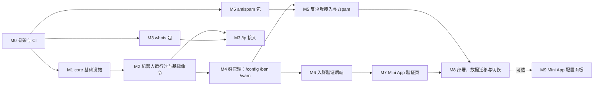

# AkkiaBot 迁移计划

架构与技术栈见 [architecture.md](./architecture.md)。本计划把重写拆成可以独立合并、独立验证的任务：每项对应一个 issue 和一个 PR，按依赖顺序推进。

## 原则

- **按用户可见的行为切分**，不按技术分层切分；每个 PR 合并后，主分支都处于可运行、可测试的状态。
- **以 botlab-telegram 为代码蓝本，以 botlab-core 为功能清单**：botlab-telegram 的结构更接近目标；core 中有、而 telegram 还没补齐的功能（反垃圾接入、`/spam`、`/warn`、`/config` 开关、whois 回退）照 core 的行为移植。
- **旧仓库保持只读**，等切换完成后再归档。
- 每个任务都要附带测试，并通过 CI（lint + type + test）。
- 规模估算：**S** 不超过约 300 行，**M** 约 300–1000 行，**L** 超过 1000 行（含测试）。

## 依赖关系

M3、M5 中的纯库部分（`packages/whois`、`packages/antispam`）只依赖 M0，可以与 M1、M2 并行开发；接入机器人的部分需要等 M2 / M4 完成。

## 任务清单

### M0 · 搭建 monorepo 骨架与 CI　`M`

- **范围**
  - uv workspace 根 `pyproject.toml`，以及 `apps/server`、`packages/core`、`packages/antispam`、`packages/whois` 四个空包（各含一个冒烟测试）。
  - pnpm workspace，以及 `apps/webapp` 的 Vite + React + TS + Tailwind 空白页。
  - ruff、pyright、pytest、Biome、Vitest 的配置；import-linter 规则（见架构文档 §5.1）。
  - `justfile`：`setup`、`lint`、`fmt`、`typecheck`、`test`、`dev`、`gen-api`。
  - `.pre-commit-config.yaml`（ruff、biome、gitleaks、基础检查）、`.editorconfig`、`.env.example`。
  - `deploy/Dockerfile`（多阶段构建：webapp → Python 依赖 → 运行镜像）、`deploy/compose.dev.yaml`（postgres、redis）。
  - GitHub Actions：`ci.yml`（PR 上按路径过滤运行 lint、type、test、镜像构建）、`release.yml`（main 分支推送 `ghcr.io/akkialab/akkiabot:<sha>` 和 `:latest`）；Renovate 配置。
  - 补充 README 中的开发说明。
- **依赖**：无（本 PR 合并后即可开始）。
- **验收标准**
  - 全新克隆后执行 `just setup && just lint && just typecheck && just test` 全部通过。
  - 在 PR 上 CI 为绿色；`docker build -f deploy/Dockerfile .` 成功，容器能启动并打印版本号后退出。
  - import-linter 能拦截违反依赖方向的导入（附带一个反例测试或文档说明）。

### M1 · core 基础设施：配置、日志、数据库、缓存　`M`

- **范围**
  - `akkiabot_core.config`：基于 pydantic-settings 的分组配置（telegram、db、redis、llm、turnstile、webapp、observability），必填项缺失时在启动阶段报错，日志中对密钥脱敏。
  - `logging`：统一格式，可选 JSON 输出。
  - `db`：SQLAlchemy 2 async engine 与 session 工厂；架构文档 §5.3 中的 `chat`、`chat_member`、`message_log`、`captcha_challenge` 四个模型（Telegram ID 一律 `BigInteger`）；对应的 repository。
  - Alembic 初始迁移，以及 `akkiabot migrate` 命令。
  - `cache`：`Cache` 协议，Redis 实现与内存实现（带 TTL，支持 `pop` 一次性读取）。
  - `telegram` 工具：带 `auth_date` 过期检查的 initData 校验、MarkdownV2 转义。
- **依赖**：M0。
- **验收标准**
  - 单测覆盖配置校验、两种缓存实现（同一套契约测试）、initData 校验（正确签名、错误签名、过期三种情况）。
  - 在 compose 拉起的 PostgreSQL 上运行迁移成功，并通过 repository 集成测试（包括 `-100` 开头的 13 位 chat id 的读写）；SQLite 上同样通过。

### M2 · 机器人运行时与基础命令　`M`

- **范围**
  - `main.py`：PTB 与 uvicorn 在同一事件循环中运行，lifespan 负责启动和关闭；默认长轮询，可通过配置切换为 webhook；提供 `/healthz` 与 `/readyz`。
  - 命令注册机制（一个声明式列表，同时生成 `set_my_commands` 和 `/help` 文本）；`/start` 的 payload 分发器（基于 `Cache.pop` 的一次性 payload）；`/help`、`/id`。
  - 群消息处理：记录 `message_log`（只存 ID）；按群配置删除系统消息；首次见到某个群时写入 `chat` 记录。
  - JobQueue 定时任务：`message_log` 保留期清理（保留天数可配置）。
  - Telegram 交互的测试工具：伪造 `Update` 的工厂函数 + Bot mock。
- **依赖**：M1。
- **验收标准**
  - 用测试 bot token 在测试群中：`/help`、`/id`（包括回复他人消息的情况）表现与旧版一致；入群等系统消息被删除；`message_log` 中有对应记录。
  - 单测覆盖命令注册、start 分发（payload 只能使用一次、过期后不可用）、消息记录过滤（忽略 bot、私聊）。

### M3 · whois 包与 `/ip`　`S`

- **范围**
  - `packages/whois`：`IpProvider` 协议；ipinfo（需要 token，可选）与 ip-api 两个实现，按顺序回退；TTL 缓存；使用 async httpx。
  - `apps/server`：`/ip <ip>` 命令，也支持回复一条包含 IP 的消息；按用户限流。
- **依赖**：包本身只依赖 M0；命令依赖 M2。
- **验收标准**
  - 使用 respx 模拟两个 provider，测试正常返回、第一个失败后回退、全部失败、缓存命中、非法 IP 输入。
  - 在测试群中 `/ip 1.1.1.1` 返回位置、AS、Org、ISP 四个字段，且 MarkdownV2 转义正确。

### M4 · 群管理：`/config`、`/ban`、`/warn`　`M`

- **范围**
  - `services/chat_settings`：读取和修改群配置（JSONB + pydantic 校验 + 缓存失效）。
  - `/config`：在群内校验管理员权限 → 发送跳转私聊的深链 → 私聊中展示 inline 开关按钮（反垃圾、入群验证、警告、删除系统消息），回调时再次校验权限（行为与 core 版一致）。
  - `services/moderation`：权限判断（群主，或有限制成员权限的管理员）、封禁并批量删除历史消息（限制并发，按 Telegram 限速退避）、警告计数与达到上限后封禁；所有操作都更新 `chat_member.restriction`。
  - `/ban`、`/warn` 命令（必须以回复方式使用；不能作用于管理员）。
- **依赖**：M2。
- **验收标准**
  - 单测覆盖权限矩阵（群主、有权限的管理员、无权限的管理员、普通成员 × 目标为管理员或普通成员）、警告计数达到上限触发封禁并清零、开关回调被越权调用时拒绝。
  - 在测试群中完整走通 `/config` 开关、`/warn` 到上限后自动封禁、`/ban` 删除历史消息。

### M5 · 反垃圾：antispam 包、群消息接入与 `/spam`　`M`

- **范围**
  - `packages/antispam`：`AntiSpamClassifier`，调用 OpenAI 兼容接口，使用 JSON 结构化输出（模型不支持时退回解析 `0/1`）；提示词从旧版迁移，并允许通过配置覆盖；可选 Langfuse 追踪；超时与异常时一律判定为"非垃圾"（fail open）。
  - `services/antispam_guard`：群消息处理流程（文本与图片说明文字）→ 判断该群是否开启反垃圾 → 发言超过 N 条的成员豁免（N 可配置，旧版为 3）→ 调用分类器 → 命中时删除消息、禁言、延迟清理历史消息、发送一条会自动删除的通知；判定结果写入 `message_log.spam_verdict`。不阻塞其他 handler。
  - `/spam`：管理员使用时直接封禁；普通成员举报时把被举报人的名字、简介和消息内容交给 LLM 判定，是垃圾则封禁，否则 @ 全部管理员进行人工审核。
- **依赖**：包本身只依赖 M0；接入依赖 M4。
- **验收标准**
  - 包内单测（模拟 LLM 响应）：结构化输出、退回 `0/1` 解析、异常和超时时 fail open。
  - 提供一个小型离线评测集（例如约 30 条正负样本，放在 `packages/antispam/tests/fixtures`）和一个可手动运行的评测命令，输出准确率，作为以后调整提示词时的基线。
  - 在测试群中，开启开关后发送明显的广告会被删除并禁言；老成员会被豁免；关闭开关后不再处理。

### M6 · 入群验证后端　`M`

- **范围**
  - 新成员入群（`chat_member` 更新事件中从 left 变为 member）且该群开启了验证 → 禁言 → 创建 `captcha_challenge` → 在群内发送脱敏称呼的提示和深链按钮。
  - 私聊 `/start` 时校验发起人就是被验证的用户 → 回复打开 Mini App 的按钮，URL 只携带 challenge id。
  - `POST /api/v1/captcha/verify`：依次校验 Turnstile（async httpx）、initData（含 `auth_date` 过期检查）、challenge 是否存在且未过期、initData 中的用户是否与 challenge 一致 → 解除禁言（只解除 captcha 造成的禁言）→ 通过 `answerWebAppQuery` 回执。
  - 超时处理（JobQueue）：超过时限未通过验证则踢出或保持禁言（策略可配置），并删除群内提示消息。
  - 成员被管理员手动解除限制时，同步更新 `chat_member` 状态。
- **依赖**：M4（`chat_member` 状态与权限工具）。
- **验收标准**
  - 单测覆盖：重放 challenge、以他人身份验证、initData 过期、Turnstile 失败、非 captcha 原因的禁言不能通过此接口解除、超时处理。
  - OpenAPI 中包含该接口，并生成前端类型。

### M7 · Mini App 验证页　`S`

- **范围**
  - `apps/webapp` 中的 `/webapp/captcha?challenge=…` 页面：初始化 @telegram-apps/sdk-react，渲染 Turnstile 组件，提交后显示成功或失败状态并提供重试；成功后关闭 Mini App。
  - 只在 `import.meta.env.DEV` 下启用 Telegram 环境模拟（修复旧版生产环境也使用模拟数据的问题）。
  - 使用 openapi-typescript 生成的类型作为请求客户端；后端用 `StaticFiles` 托管构建产物。
- **依赖**：M6。
- **验收标准**
  - Vitest 测试覆盖提交流程（模拟 fetch）和错误展示；生产构建产物中不包含 mock 代码（CI 中用 grep 检查）。
  - 在真实 Telegram 客户端中走通完整流程：入群 → 私聊 → 打开 Mini App → 完成 Turnstile → 解除禁言。

### M8 · 部署、数据迁移与切换　`M`

- **范围**
  - `deploy/compose.yaml`（app、postgres、redis、cloudflared）；`akkiabot migrate` 作为启动前的步骤；数据卷与备份说明。
  - 视开放问题 Q1 的结论：编写从旧库（core 的 MySQL/SQLite 或 telegram 的数据库）导入 `chat` 配置和 `chat_member` 限制状态的一次性脚本，并支持 dry-run。
  - 运维手册 `docs/operations.md`：配置项说明、部署与回滚、Bot token 切换顺序（同一个 token 同一时间只能有一个进程拉取更新）。
  - 切换完成并观察一段时间后，在旧仓库的 README 中标注已迁移，并将仓库归档（需要成员确认）。
- **依赖**：M5、M7。
- **验收标准**
  - 在一台干净的机器上按照运维手册，用 GHCR 镜像完成部署，健康检查通过。
  - 数据迁移脚本在旧库副本上 dry-run，输出的统计与源数据一致。
  - 正式 bot 切换到新服务后，所有命令和流程完成一轮冒烟验证。

### M9（可选）· Mini App 群配置面板　`M`

- **范围**：用 Mini App 页面替代 `/config` 的 inline 按钮，可以编辑全部群配置（包括警告上限、豁免阈值、验证超时等数值项）；后端提供 `GET/PUT /api/v1/chats/{id}/settings`，鉴权方式为 initData + 管理员权限校验。
- **依赖**：M7。
- **验收标准**：非管理员无法读取或修改配置；修改后立即对机器人行为生效。

## 需要成员拍板的开放问题

1. **线上现状与数据迁移**：目前线上实际运行的是哪一套（Go core + llm + fe，还是 botlab-telegram）？使用的是什么数据库？是否需要把已有的群配置和成员限制状态迁移到新系统，还是可以从零开始？这决定 M8 是否包含迁移脚本。
2. **后端语言**：是否同意统一用 Python（理由见架构文档 §4），放弃 Go 版？
3. **生产数据库**：是否同意使用 PostgreSQL？还是更倾向于继续使用 MySQL，或者单机只用 SQLite？
4. **消息正文存储**：旧 core 保存了全部消息正文，telegram 版只保存 ID。新版默认只存 ID，仅在命中反垃圾时保存正文用于审计。是否接受？是否需要为调优提示词而积累更多样本？
5. **群配置交互方式**：第一阶段用 inline 按钮（M4）是否可以？M9 的 Mini App 配置面板是否需要做、优先级如何？
6. **对外反垃圾 API**：旧 llm 服务的 HTTP 接口除了 core 之外是否还有其他调用方？没有的话新版不再提供。
7. **入群验证超时策略**：超时未验证时，是踢出（允许重新加入）、永久禁言，还是不处理？时限设为多少（旧版只是 2 分钟后删除提示消息，并不处理用户）？
8. **LLM 供应商与模型**：默认继续使用豆包（Volcengine 的 OpenAI 兼容端点），还是换成其他模型？Langfuse 和 Sentry 是否继续使用？
9. **whois 数据源**：是否有 ipinfo token？是否需要 MaxMind / IP2Location 离线库（需要定期更新数据文件）？
10. **前端托管**：前端随后端镜像一起托管（推荐，同源免 CORS），还是放到 Cloudflare Pages？对外域名使用哪个？
11. **旧仓库处理**：切换完成后是否把 5 个旧仓库全部归档？Toolbox-py 和 botlab-llm 是否可以现在就归档？
