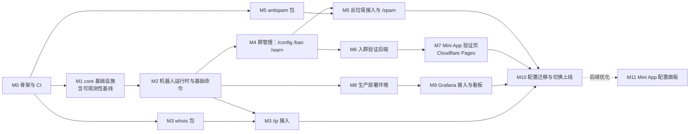

# AkkiaBot 迁移计划

架构与技术栈见 [architecture.md](./architecture.md)。本计划把重写拆成可以独立合并、独立验证的任务：每项对应一个 issue 和一个 PR，按依赖顺序推进。

## 原则

- **按用户可见的行为切分**，不按技术分层切分；每个 PR 合并后，主分支都处于可运行、可测试的状态。
- **以 botlab-telegram 为代码蓝本，以 botlab-core 为功能清单**：botlab-telegram 的结构更接近目标；线上运行的是 botlab-core，所以 core 中有、而 telegram 还没补齐的功能（反垃圾接入、`/spam`、`/warn`、`/config` 开关、whois 回退）都照 core 的行为移植。
- **可观测性从第一天开始**：每个任务都要为新增功能补上结构化日志字段和指标（见架构文档 §5.5），不留到最后统一补。
- **旧仓库保持只读**，等新系统正式切换上线后再归档。
- 每个任务都要附带测试，并通过 CI（lint + type + test）。
- 规模估算：**S** 不超过约 300 行，**M** 约 300–1000 行，**L** 超过 1000 行（含测试）。

## 已确认的决策（2026-11-14）

| # | 问题 | 决策 |
| --- | --- | --- |
| 1 | 线上现状与数据迁移 | 线上运行的是 Go 版（core + llm + fe），数据库为 **SQLite**。正式上线时做**一次性配置迁移**，允许手动操作，不要求新旧数据结构一致 → 见 M10 |
| 2 | 后端语言 | Python |
| 3 | 生产数据库 | PostgreSQL |
| 4 | 消息正文 | 默认只存消息 ID，命中反垃圾时保存正文用于审计 |
| 5 | 群配置交互 | 第一阶段用 inline 按钮（M4）；Mini App 配置面板作为后续优化（M11） |
| 6 | 对外反垃圾 API | 没有第三方调用方，不再提供 |
| 7 | 入群验证超时 | 时限 5 分钟，超时后维持禁言 |
| 8 | LLM 与可观测性 | 继续使用 OpenAI 兼容 client；保留 Langfuse 与 Sentry，**新增 Grafana Cloud**（日志、指标、埋点）→ 见 M9 |
| 9 | whois | 有 ipinfo token；只用在线 API（ipinfo → ip-api），不使用离线库 |
| 10 | 前端托管与域名 | 前端（纯静态 SPA）部署到 Cloudflare Pages：`bot.akkia.moe`；后端 API 使用 `bot-api.akkia.moe` |
| 11 | 旧仓库归档 | 正式切换上线后再归档，不在编码完成时归档 |

## 依赖关系

M3、M5 中的纯库部分（`packages/whois`、`packages/antispam`）只依赖 M0，可以与 M1、M2 并行开发；M8 只依赖 M2，可以和 M3–M7 并行推进。

## 任务清单

### M0 · 搭建 monorepo 骨架与 CI　`M`

- **范围**
  - uv workspace 根 `pyproject.toml`，以及 `apps/server`、`packages/core`、`packages/antispam`、`packages/whois` 四个空包（各含一个冒烟测试）。
  - pnpm workspace，以及 `apps/webapp` 的 Vite + React + TS + Tailwind 空白页。
  - ruff、pyright、pytest、Biome、Vitest 的配置；import-linter 规则（见架构文档 §5.1）。
  - `justfile`：`setup`、`lint`、`fmt`、`typecheck`、`test`、`dev`、`gen-api`。
  - `.pre-commit-config.yaml`（ruff、biome、gitleaks、基础检查）、`.editorconfig`、`.env.example`。
  - `deploy/Dockerfile`（后端镜像，多阶段构建）、`deploy/compose.dev.yaml`（postgres、redis）。
  - GitHub Actions：`ci.yml`（PR 上按路径过滤运行 lint、type、test、镜像构建）、`release.yml`（master 分支推送 `ghcr.io/akkialab/akkiabot:<sha>` 和 `:latest`）；Renovate 配置。
  - PR 规范：`.github/pull_request_template.md`（第一行为 `Closes BOT-`，下面列出验收标准清单）；`pr-title.yml` workflow 检查 PR 标题是否符合 `BOT-<编号>: ...`，以及正文是否含有 `Closes BOT-<编号>`，不符合时检查失败。
  - 补充 README 中的开发说明。
- **依赖**：无（本 PR 合并后即可开始）。
- **验收标准**
  - 全新克隆后执行 `just setup && just lint && just typecheck && just test` 全部通过。
  - 在 PR 上 CI 为绿色；`docker build -f deploy/Dockerfile .` 成功，容器能启动并打印版本号后退出。
  - import-linter 能拦截违反依赖方向的导入（附带一个反例测试或文档说明）。
  - 标题不含 `BOT-<编号>` 的测试 PR 会被 `pr-title` 检查标红。

### M1 · core 基础设施：配置、日志、数据库、缓存、可观测性基线　`M`

- **范围**
  - `akkiabot_core.config`：基于 pydantic-settings 的分组配置（telegram、db、redis、llm、turnstile、webapp、cors、observability），必填项缺失时在启动阶段报错；密钥以 `SecretStr`、隐藏密码的 URL 等安全形式展示。日志层不做自动脱敏（2026-11-14 成员确认，避免误伤业务与异常信息），由调用方在记录日志前改写已知密钥。
  - `akkiabot_core.observability`：
    - 结构化 JSON 日志（基于 contextvars 自动带上 `chat_id`、`user_id`、`update_id`、`trace_id`）；
    - Sentry 初始化（DSN、环境、采样率均来自配置）；
    - 基于 prometheus-client 的指标注册表，以及 `track_handler` 等埋点 helper。
  - `db`：SQLAlchemy 2 async engine 与 session 工厂；架构文档 §5.3 中的 `chat`、`chat_member`、`message_log`、`captcha_challenge` 四个模型（Telegram ID 一律 `BigInteger`）；对应的 repository。
  - Alembic 初始迁移，以及 `akkiabot migrate` 命令。
  - `cache`：`Cache` 协议，Redis 实现与内存实现（带 TTL，支持 `pop` 一次性读取）。
  - `telegram` 工具：带 `auth_date` 过期检查的 initData 校验、MarkdownV2 转义。
- **依赖**：M0。
- **验收标准**
  - 单测覆盖配置校验、两种缓存实现（同一套契约测试）、initData 校验（正确签名、错误签名、过期三种情况）、日志上下文字段注入、指标 helper。
  - 在 compose 拉起的 PostgreSQL 上运行迁移成功，并通过 repository 集成测试（包括 `-100` 开头的 13 位 chat id 的读写）；SQLite 上同样通过。
  - 不配置 Sentry DSN 时可以正常启动，且不会发出任何外部请求。

### M2 · 机器人运行时与基础命令　`M`

- **范围**
  - `main.py`：PTB 与 uvicorn 在同一事件循环中运行，lifespan 负责启动和关闭；默认长轮询，可通过配置切换为 webhook；`allowed_updates` 显式包含 `message`、`callback_query`、`chat_member`、`my_chat_member`；提供 `/healthz`、`/readyz`，以及独立端口上只在内网可访问的 `/metrics`。
  - 命令注册机制（一个声明式列表，同时生成 `set_my_commands` 和 `/help` 文本）；`/start` 的 payload 分发器（基于 `Cache.pop` 的一次性 payload）；`/help`、`/id`。
  - 每个 handler 都自动记录耗时、错误数，并把异常上报 Sentry；记录 `updates_total`、`command_total` 等基础指标。
  - 群消息处理：记录 `message_log`（只存 ID）；按群配置删除系统消息；首次见到某个群时写入 `chat` 记录。
  - JobQueue 定时任务：`message_log` 保留期清理（保留天数可配置）。
  - Telegram 交互的测试工具：伪造 `Update` 的工厂函数 + Bot mock。
- **依赖**：M1。
- **验收标准**
  - 用测试 bot token 在测试群中：`/help`、`/id`（包括回复他人消息的情况）表现与旧版一致；入群等系统消息被删除；`message_log` 中有对应记录。
  - 单测覆盖命令注册、start 分发（payload 只能使用一次、过期后不可用）、消息记录过滤（忽略 bot、私聊）。
  - `/metrics` 能看到 handler 和命令的指标；某个 handler 抛出的异常会出现在 Sentry 的测试项目中。

### M3 · whois 包与 `/ip`　`S`

- **范围**
  - `packages/whois`：`IpProvider` 协议；ipinfo（使用 token）与 ip-api 两个在线实现，按顺序回退；TTL 缓存；使用 async httpx。不实现离线库。
  - `apps/server`：`/ip <ip>` 命令，也支持回复一条包含 IP 的消息；按用户限流；记录 `whois_lookup_total{provider,result}` 指标。
- **依赖**：包本身只依赖 M0；命令依赖 M2。
- **验收标准**
  - 使用 respx 模拟两个 provider，测试正常返回、第一个失败后回退、全部失败、缓存命中、非法 IP 输入。
  - 在测试群中 `/ip 1.1.1.1` 返回位置、AS、Org、ISP 四个字段，且 MarkdownV2 转义正确。

### M4 · 群管理：`/config`、`/ban`、`/warn`　`M`

- **范围**
  - `services/chat_settings`：读取和修改群配置（可移植 JSON 列 + pydantic 校验 + 缓存失效）。
  - `/config`：在群内校验管理员权限 → 发送跳转私聊的深链 → 私聊中展示 inline 开关按钮（反垃圾、入群验证、警告、删除系统消息），回调时再次校验权限（行为与 core 版一致）。
  - `services/moderation`：权限判断（群主，或有限制成员权限的管理员）、封禁并批量删除历史消息（限制并发，按 Telegram 限速退避）、警告计数与达到上限后封禁；所有操作都更新 `chat_member.restriction`，并记录 `moderation_actions_total`。
  - `/ban`、`/warn` 命令（必须以回复方式使用；不能作用于管理员）。
- **依赖**：M2。
- **验收标准**
  - 单测覆盖权限矩阵（群主、有权限的管理员、无权限的管理员、普通成员 × 目标为管理员或普通成员）、警告计数达到上限触发封禁并清零、开关回调被越权调用时拒绝。
  - 在测试群中完整走通 `/config` 开关、`/warn` 到上限后自动封禁、`/ban` 删除历史消息。

### M5 · 反垃圾：antispam 包、群消息接入与 `/spam`　`M`

- **范围**
  - `packages/antispam`：`AntiSpamClassifier`，使用 OpenAI 兼容 client，采用 JSON 结构化输出（模型不支持时退回解析 `0/1`）；提示词从旧版迁移，并允许通过配置覆盖；通过 Langfuse 记录每次调用（提示词版本、输入输出、耗时、token 用量）；超时与异常时一律判定为"非垃圾"（fail open）。
  - `services/antispam_guard`：群消息处理流程（文本与图片说明文字）→ 判断该群是否开启反垃圾 → 发言超过 N 条的成员豁免（N 可配置，旧版为 3）→ 调用分类器 → 命中时删除消息、禁言、延迟清理历史消息、发送一条会自动删除的通知；判定结果写入 `message_log.spam_verdict`（命中时同时保存正文）；记录 `antispam_verdict_total` 等指标。不阻塞其他 handler。
  - `/spam`：管理员使用时直接封禁；普通成员举报时把被举报人的名字、简介和消息内容交给 LLM 判定，是垃圾则封禁，否则 @ 全部管理员进行人工审核。
  - 不提供对外的反垃圾 HTTP 接口。
- **依赖**：包本身只依赖 M0；接入依赖 M4。
- **验收标准**
  - 包内单测（模拟 LLM 响应）：结构化输出、退回 `0/1` 解析、异常和超时时 fail open。
  - 提供一个小型离线评测集（例如约 30 条正负样本，放在 `packages/antispam/tests/fixtures`）和一个可手动运行的评测命令，输出准确率，作为以后调整提示词时的基线。
  - 在测试群中，开启开关后发送明显的广告会被删除并禁言；老成员会被豁免；关闭开关后不再处理；每次判定都能在 Langfuse 中看到对应记录。

### M6 · 入群验证后端　`M`

- **范围**
  - 入群判定：在 polling / webhook 的 `allowed_updates` 中显式订阅 `chat_member`（Telegram 默认不推送这类更新，且要求 bot 为群管理员）；按"成员身份从非成员变为成员"判断入群，即 `old.is_member == False` 且 `new.is_member == True`，或者状态从 left / kicked 变为 member / restricted。这样，带着限制状态重新入群的用户也会被覆盖。
  - 新成员入群且该群开启了验证 → 禁言 → 创建 `captcha_challenge`（有效期 **5 分钟**）→ 在群内发送脱敏称呼的提示和深链按钮。
  - 私聊 `/start` 时校验发起人就是被验证的用户 → 回复打开 Mini App（`https://bot.akkia.moe/captcha?challenge=…`）的按钮，URL 只携带 challenge id。
  - `POST /api/v1/captcha/verify`：依次校验 Turnstile（async httpx）、initData（含 `auth_date` 过期检查）、challenge 是否存在且未过期、initData 中的用户是否与 challenge 一致 → 解除禁言（只解除 captcha 造成的禁言）→ 通过 `answerWebAppQuery` 回执。
  - CORS 只放行配置中的前端来源（生产为 `https://bot.akkia.moe`）。
  - 超时处理（JobQueue）：5 分钟内未通过验证时，challenge 标记为 `timeout`，**用户维持禁言**，删除群内提示消息；用户退群后重新加入会生成新的 challenge；管理员仍然可以手动解除禁言。
  - 成员被管理员手动解除限制时，同步更新 `chat_member` 状态。
  - 记录 `captcha_total{result}` 和 `captcha_duration_seconds` 指标。
- **依赖**：M4（`chat_member` 状态与权限工具）。
- **验收标准**
  - 单测覆盖：重放 challenge、以他人身份验证、initData 过期、Turnstile 失败、非 captcha 原因的禁言不能通过此接口解除、超时后接口拒绝验证且用户保持禁言、重新入群后可以再次验证。
  - OpenAPI 中包含该接口，并生成前端类型。

### M7 · Mini App 验证页（Cloudflare Pages）　`S`

- **范围**
  - `apps/webapp` 中的 `/captcha?challenge=…` 页面：初始化 @telegram-apps/sdk-react，渲染 Turnstile 组件，提交后显示成功、失败或已超时状态并提供重试；成功后关闭 Mini App。
  - 只在 `import.meta.env.DEV` 下启用 Telegram 环境模拟（修复旧版生产环境也使用模拟数据的问题）。
  - 使用 openapi-typescript 生成的类型作为请求客户端；API 地址在构建时由 `VITE_API_BASE_URL` 注入。
  - Cloudflare Pages 部署：`master` 分支发布到生产环境（自定义域名 `bot.akkia.moe`），PR 生成预览地址；SPA 路由回退：项目不放 `404.html`，Pages 会对未知路径自动返回根 `index.html`；如有需要，也可以显式写 `_redirects`（`/* /index.html 200`），并在验收中直接打开 `/captcha?challenge=…` 验证；缓存头写在 `_headers` 中。采用 Pages 的 Git 集成，或在 GitHub Actions 中用 `wrangler pages deploy` 发布，二选一，实现时决定。
  - 可选：接入 Sentry 浏览器 SDK，捕获前端异常。
- **依赖**：M6。
- **验收标准**
  - Vitest 测试覆盖提交流程（模拟 fetch）和错误展示；生产构建产物中不包含 mock 代码（CI 中用 grep 检查）。
  - PR 的预览地址可以打开；合并后 `https://bot.akkia.moe` 自动更新。
  - 在真实 Telegram 客户端中走通完整流程：入群 → 私聊 → 打开 Mini App → 完成 Turnstile → 解除禁言。

### M8 · 生产部署环境　`S`

- **范围**
  - `deploy/compose.yaml`：app、postgres、redis、cloudflared（`bot-api.akkia.moe` → app）；`akkiabot migrate` 作为启动前的步骤；数据卷与 PostgreSQL 备份说明（例如定时 `pg_dump`）。
  - `/metrics` 端口不经过 tunnel 暴露。
  - 运维手册 `docs/operations.md`：配置项说明、部署与回滚、DNS 规划（`bot.akkia.moe` → Pages，`bot-api.akkia.moe` → tunnel）。
  - 使用测试 bot 和预发布子域名（例如 `bot-api-staging.akkia.moe`）搭一套预发布环境，作为 M9、M10 的演练场。
- **依赖**：M2（可以和 M3–M7 并行推进，随功能合入持续验证）。
- **验收标准**：在一台干净的机器上按照运维手册，用 GHCR 镜像完成部署，健康检查通过；预发布环境中的测试 bot 能正常响应。

### M9 · Grafana 接入与看板　`M`

- **范围**
  - `deploy/observability/`：Grafana Alloy 配置，负责采集 Docker 容器的 JSON 日志并推送到 Loki，抓取 `/metrics` 并推送到 Grafana Cloud 的 Prometheus 端点；Grafana Cloud 的 stack 地址和 token 通过环境变量注入，不进仓库；加入 compose。
  - Grafana dashboard（JSON 纳入版本管理）：
    - 总览：update 量、handler 耗时 P50/P95、错误率；
    - 入群验证漏斗：发起 → 通过 / 超时 / 失败；
    - 反垃圾：判定量、命中率、LLM 耗时与错误；
    - 群管理动作统计；
    - 日志面板：可以按 `chat_id`、`user_id`、`trace_id` 筛选。
  - 基础告警规则：bot 停止接收 update、handler 错误率升高、LLM 错误或超时持续出现、`/readyz` 失败。
  - `compose.dev.yaml` 中可选加入 `grafana/otel-lgtm` 一体化镜像，方便本地查看。
- **依赖**：M8。
- **验收标准**：在预发布环境中，dashboard 的各个面板都有数据；手动制造一次错误能触发告警；日志可以按 `chat_id` 检索到一次完整的入群验证流程。

### M10 · 配置迁移与正式切换上线　`S`

- **范围**
  - **一次性配置迁移**（不要求新旧结构一致，允许手动操作）：
    - 编写 `akkiabot import-legacy` 脚本，直接读取 Go 版的 SQLite 文件（`botlab_core/data/sqlite.db` 的只读副本），把 `telegram_chats` 的 `EnableCaptcha`、`EnableAntiSpam`、`EnableWarn`、`MaxWarnCount` 映射为新的 `chat.settings`；把 `telegram_chat_members` 的 `WarnCount` 写入新的 `chat_member`；支持 `--dry-run`，并输出差异报告。
    - 如果脚本在实际数据上不划算，退而求其次：导出成 CSV 后手动导入，或者让管理员在各群里重新执行 `/config`，并在运维手册中写明。
    - 切换时如果还有处于 captcha 禁言中的成员，脚本把他们列出来，由管理员手动处理（新系统中没有对应的 challenge）。
  - 切换步骤（写入运维手册）：
    1. 停止 Go 版 core（同一个 bot token 同一时间只能有一个进程拉取更新）；
    2. 导入配置；
    3. 启动新服务；
    4. 将 Mini App 地址切换到 `bot.akkia.moe`；
    5. 冒烟验证。
  - 回滚步骤：停止新服务，重新启动 Go 版（旧数据库在此期间保持只读，不做修改）。
  - **切换上线并观察稳定之后**，在 5 个旧仓库的 README 中标注已迁移，并将它们归档（归档前在 issue 中再确认一次）。
- **依赖**：M3、M5、M7、M9（切换前所有旧命令，包括 `/ip`，都必须已经迁移）。
- **验收标准**：脚本在旧库副本上 dry-run 的统计与源数据一致；正式 bot 切换后，所有命令、入群验证、反垃圾完成一轮冒烟验证，Grafana 和 Sentry 中能看到生产数据。

### M11（后续优化）· Mini App 群配置面板　`M`

- **范围**：用 Mini App 页面（同样部署在 Cloudflare Pages）替代 `/config` 的 inline 按钮，可以编辑全部群配置（包括警告上限、豁免阈值等数值项）；后端提供 `GET/PUT /api/v1/chats/{id}/settings`，鉴权方式为 initData + 管理员权限校验。
- **依赖**：M10（在新系统稳定运行之后再做）。
- **验收标准**：非管理员无法读取或修改配置；修改后立即对机器人行为生效。

## 待确认事项

目前没有。实现过程中遇到新的问题，会在对应任务的 issue 中提出。
