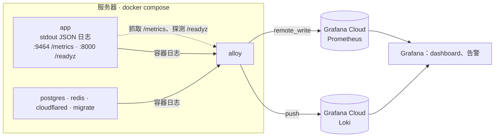

# 可观测性：Grafana Alloy、dashboard 与告警

本文说明日志和指标如何从服务器进入 Grafana Cloud，以及版本化的 dashboard、告警规则如何维护和发布。异常走 Sentry、LLM 调用走 Langfuse，见 `docs/architecture.md` §5.5；部署步骤见 `docs/operations.md`。任务范围见 `docs/migration-plan.md` M9。

## 1. 数据流



`deploy/observability/` 下的文件：

| 文件 | 用途 |
| --- | --- |
| `config.alloy` | Alloy 配置。生产、预发布与本地开发共用，环境差异全部来自环境变量。 |
| `dashboards/akkiabot.json` | dashboard（uid `akkiabot-overview`），JSON 是唯一来源。 |
| `alerting/akkiabot.yaml` | 告警规则组 `akkiabot`，Grafana 文件预置格式。 |
| `alerting/env-missing.yaml` | “环境停止上报”规则模板和预期环境列表（`environments`），由同步脚本按环境展开，追加到同一个规则组。 |
| `dev/dashboards.yaml` | 本地 `grafana/otel-lgtm` 的 dashboard provider。 |
| `grafana-sync.env.tpl` | `scripts/grafana_sync.py` 的 1Password 引用（`staging-grafana`）。 |

### 1.1 日志

- Alloy 通过只读挂载的 `/var/run/docker.sock` 发现容器，只采集 `com.docker.compose.project` 等于 `COMPOSE_PROJECT_NAME` 的容器。同一台机器上的生产栈和预发布栈各自有一个 Alloy，互不重复采集。
- 标签只保留低基数字段：`env`、`service`（compose 服务名）、`container`、`level`。
- app 和 migrate 输出的 JSON 日志会被解析，`chat_id`、`user_id`、`update_id`、`trace_id`、`handler`、`logger` 写入 Loki 的 structured metadata，不作为标签，避免基数爆炸。查询方式和标签一样：

  ```logql
  {env="staging", service="app"} | chat_id="-1001234567890"
  {env="staging", service="app"} | trace_id="3f2a…"
  {env="staging", service="app", level="error"}
  ```

- 日志内容原样推送，不做脱敏，遵守仓库日志约定：调用方在打日志前自行改写已知密钥（`AGENTS.md`）。

### 1.2 指标

- `prometheus.scrape` 每 30 秒抓取 `app:9464/metrics`（job `akkiabot`），同时用 Alloy 内置的 blackbox exporter 探测 `http://app:8000/readyz`（job `akkiabot-readyz`，指标 `probe_success`）。
- `remote_write` 给所有序列加上外部标签 `env`。
- 业务指标的定义见 `packages/core/src/akkiabot_core/observability/metrics.py`，清单见 `docs/architecture.md` §5.5。为本里程碑新增了两组：
  - `akkiabot_captcha_started_total`：入群验证漏斗的起点（新成员被禁言，并收到验证）。
  - `akkiabot_telegram_poll_total{result}`、`akkiabot_telegram_poll_last_success_timestamp_seconds`：polling 心跳。群里没人说话时 `updates_total` 本来就不会增长，但长轮询每次超时都会返回，所以用心跳判断“bot 是否停止接收 update”比用 update 量更可靠。webhook 模式不安装心跳，时间戳保持 0，告警规则会排除这种情况。

### 1.3 环境变量

`config.alloy` 读取的变量都由 compose 设置：生产和预发布使用 `deploy/compose.yaml`，取值来自 `.env`（`docs/operations.md` §3.1）；本地开发使用 `deploy/compose.dev.yaml`。

| 变量 | 生产 / 预发布 | 本地 |
| --- | --- | --- |
| `AKKIABOT_ENV` | `.env` 的 `AKKIABOT_ENV`（`production` / `staging`） | `dev` |
| `AKKIABOT_COMPOSE_PROJECT` | `COMPOSE_PROJECT_NAME` | `akkiabot-dev` |
| `AKKIABOT_METRICS_TARGET`、`AKKIABOT_READYZ_URL` | `app:9464`、`http://app:8000/readyz` | `127.0.0.1:9464`、`http://127.0.0.1:8000/readyz`（`just serve`） |
| `GRAFANA_CLOUD_*` | `.env`，来自 1Password | 本地 lgtm 的地址，不校验凭据 |

## 2. Grafana Cloud 与 1Password

dev 和 staging 共用一个 Grafana Cloud stack，生产使用另一组凭据，同 Cloudflare 的划分方式一致。dashboard 和告警按 `env` 标签区分环境，所以也可以让生产写入同一个 stack，只要换用生产的 token。

1Password vault `AkkiaBot` 中的条目：

| 条目 | 字段 | 用途 |
| --- | --- | --- |
| `staging-grafana` | `grafana_url` | stack 地址，例如 `https://<stack>.grafana.net` |
| | `cloud_token` | Access policy token，scope 为 `metrics:write`、`logs:write`（可以另加 `metrics:read`、`logs:read`，方便排障时查询）。Alloy 用它推送数据。 |
| | `grafana_sa_token` | Grafana 实例内的 service account token，角色为 Admin。`grafana_sync.py` 用它上传 dashboard 和告警。 |
| | `prometheus_url`、`prometheus_user`、`loki_url`、`loki_user` | Alloy 的推送地址和实例 ID。不是密钥，可以用 `grafana_sync.py discover` 查出来再填入。 |
| `prod-grafana` | 同上 | 生产（M10 切换前准备）。 |

预发布机器上，`deploy/staging/grafana.env.tpl` 会把这些值渲染进 `.env`（`docs/operations.md` §8）。

## 3. 发布 dashboard 与告警

仓库中的文件是唯一来源。修改 JSON 或 YAML 并合并后，执行一次同步。在 Grafana UI 里做的修改会在下次同步时被覆盖。通过 API 上传的告警规则在 UI 中是只读的。

```bash
# 在仓库根目录；需要能读取 AkkiaBot vault 的 1Password CLI
op run --env-file deploy/observability/grafana-sync.env.tpl -- just grafana-sync discover
op run --env-file deploy/observability/grafana-sync.env.tpl -- just grafana-sync sync
```

- `discover` 打印 stack 的 Prometheus 和 Loki 数据源（uid、Alloy 推送地址、实例 ID），不包含任何密钥。
- `sync` 会把 `env-missing.yaml` 按预期环境展开，与 `akkiabot.yaml` 一起作为规则组上传；`sync` 会创建文件夹 `AkkiaBot`（uid `akkiabot`），覆盖上传 dashboard，并把 dashboard 的数据源变量预选为本 stack 的 `grafanacloud-*-prom`、`grafanacloud-*-logs`；然后整体替换告警规则组 `akkiabot`，同时把规则里的数据源 uid `prometheus` 换成本 stack 的 Prometheus uid。
- 数据源无法自动识别时，用 `--prometheus-uid`、`--loki-uid` 指定。

在 dashboard 里编辑后，想保存回仓库：在 Grafana 中选择 Export → Export as JSON，**不要**勾选 “Export for sharing externally”，覆盖 `dashboards/akkiabot.json`，再执行 `pnpm exec biome format --write deploy/observability/dashboards`。`tests/test_observability_config.py` 会检查面板引用的指标都确实存在、查询都带有 `env="$env"`。

## 4. dashboard

dashboard 名为 **AkkiaBot**，顶部变量依次是数据源、`env`、日志的服务与级别，以及 `chat_id`、`user_id`、`trace_id` 和搜索（均为正则，默认 `.*` 表示全部）。

| 区块 | 面板 |
| --- | --- |
| 总览 | 按类型统计的 update 速率；handler 耗时 P50/P95（整体及按 handler）；handler 错误率；`/readyz` 状态；距上次成功轮询的时间；Telegram API 失败次数 |
| 入群验证 | 漏斗：发起 → 通过 / 超时 / 失败（失败指被拒绝的验证尝试，一次验证可能失败多次）；趋势；通过耗时 P50/P95 |
| 反垃圾 | 按判定结果和处置统计的判定量；命中率 = spam / (spam + ham)；LLM 耗时 P50/P95；按类型统计的 LLM 错误 |
| 群管理 | ban / warn / mute / delete 的次数和趋势；按命令和结果统计的命令量 |
| 日志 | 按级别统计的日志量，以及日志列表；都受顶部筛选变量控制 |

按 `chat_id` 查一次完整的入群验证：在日志区把 `chat_id` 设为群 ID，时间范围覆盖入群时刻。可以依次看到 `member joined` → `captcha challenge created`（禁言并发出提示）→ 结果：`captcha passed`（Mini App 提交，经 HTTP API），或者 `captcha verification rejected`（附 `reason`；在加载验证之前就被拒绝的请求，例如 Turnstile 失败，也会补查所属的群并打上 `chat_id`），或者 `captcha timed out; member stays muted`。验证 API 和超时任务不是由群消息触发的，所以会额外绑定该验证所属的群 `chat_id` 和成员 `user_id`。成员在私聊中点击深链的 `/start` 属于私聊，`chat_id` 是私聊 ID；要看到这一步，改为按 `user_id` 筛选。

计数器类面板用 `or vector(0)` 兜底，所以没有发生过的事件显示为 0，而不是 No data。比值面板（命中率）和耗时分位数在分母为 0、或者还没有样本时显示 No data，这是正常的。

## 5. 告警

规则组 `akkiabot`，每分钟评估一次。每条规则都按 `env` 分别告警。

| 规则 | 条件 | 持续 | 无数据时 |
| --- | --- | --- | --- |
| bot 停止接收 update | `time() - telegram_poll_last_success_timestamp_seconds > 300` | 2 分钟 | OK（webhook 模式、app 停止时由 `/readyz` 告警覆盖） |
| `/readyz` 失败 | `min(probe_success{job="akkiabot-readyz"}) < 1` | 2 分钟 | **告警**（所有环境都没有数据时） |
| 环境停止上报（每个预期环境一条） | `absent(probe_success{job="akkiabot-readyz", env="<env>"})` | 2 分钟（加上 5 分钟回溯，约 7 分钟触发） | OK（正常上报时 absent 没有结果） |
| handler 错误率升高 | 最近 5 分钟 `handler_errors_total / handler 调用次数 > 5%` | 1 分钟 | OK |
| LLM 错误或超时持续出现 | 15 分钟内 `antispam_llm_errors_total` 增加 ≥ 3 | 5 分钟 | OK |

为什么需要“环境停止上报”：多个环境共用一个 stack 时，只要还有任一环境在上报，`/readyz 失败` 的查询就有数据，它的 noDataState 不会生效；某个环境的 Alloy 或主机失联后，它的序列只会被当作 MissingSeries 移除，不会告警（[Grafana 官方说明](https://grafana.com/docs/grafana/latest/alerting/guides/missing-data/)）。所以要对每个预期环境单独用 `absent()` 检测。预期环境列在 `alerting/env-missing.yaml` 的 `environments` 中：`staging` 和 `production`（生产栈于 M10 切换时开始上报，BOT-16）。临时指定可以用 `just grafana-sync sync --env staging --env production`。本地 lgtm 不加载这条模板。

通知走 Grafana Cloud 默认的 notification policy 和 contact point（stack 所有者的邮箱）。需要发到其他渠道（例如 Telegram）时，在 Grafana 中新增 contact point，并修改 notification policy；这部分目前不纳入版本管理。

验证告警（只在预发布环境做）：停掉 redis 制造一次 `/readyz` 失败，大约 3 分钟后 `/readyz 失败` 进入 Firing，然后恢复：

```bash
cd /opt/akkiabot/staging
docker compose stop redis      # /readyz 返回 503，probe_success 变为 0
# Grafana → Alerting → Alert rules → AkkiaBot：/readyz 失败 先 Pending，2 分钟后 Firing
docker compose start redis     # 恢复后规则回到 Normal
```

## 6. 本地开发

```bash
just dev-observability          # 启动 grafana/otel-lgtm 和 Alloy（profile observability）
just serve                      # 另开一个终端；指标在 127.0.0.1:9464
# 浏览器打开 http://127.0.0.1:3000 → Dashboards → AkkiaBot → AkkiaBot，环境选 dev
just dev-down                   # 连同观测栈一起停止
```

- `lgtm` 是 Grafana、Prometheus、Loki 的一体化镜像。启动时直接挂载并预置仓库里的 dashboard 和告警规则（数据源 uid 就是 `prometheus`、`loki`），修改文件后重启 `lgtm` 即可生效。
- 本地的 Alloy 使用 host 网络，所以可以访问只监听 `127.0.0.1` 的 `just serve`。它只采集 `akkiabot-dev` 这个 compose 项目里的容器日志；`just serve` 的日志在终端里，不会进入本地 Loki。
- 本地 Grafana 匿名登录即为管理员，端口只绑定在 `127.0.0.1`。

## 7. 排障

| 现象 | 排查 |
| --- | --- |
| Grafana 中完全没有数据 | `docker compose logs alloy`。`401`/`403`：token 或实例 ID 错误，或者 token 缺少 `metrics:write`/`logs:write`。`no such host`：推送地址填错。 |
| 有指标、没有日志 | Alloy 日志里出现 `permission denied` 访问 `docker.sock`：宿主机 socket 权限异常；也要确认 `COMPOSE_PROJECT_NAME` 与容器的 compose 项目名一致（`docker inspect <容器> --format '{{index .Config.Labels "com.docker.compose.project"}}'`）。 |
| `env` 变量下拉框为空 | 还没有任何 `up{job="akkiabot"}` 序列：检查 app 的 `OBSERVABILITY_METRICS_ENABLED`，以及 Alloy 能否访问 `app:9464`（两者都在 `telemetry` 网络中）。 |
| `/readyz` 告警但 app 正常 | `docker compose exec app python -c "import urllib.request;print(urllib.request.urlopen('http://127.0.0.1:8000/readyz').read())"`，看 `checks` 中是哪一项失败。 |
| 本地看 Alloy 的组件状态 | Alloy UI 只监听容器内的 `127.0.0.1:12345`：`docker compose exec alloy wget -qO- 127.0.0.1:12345/-/ready`。 |
