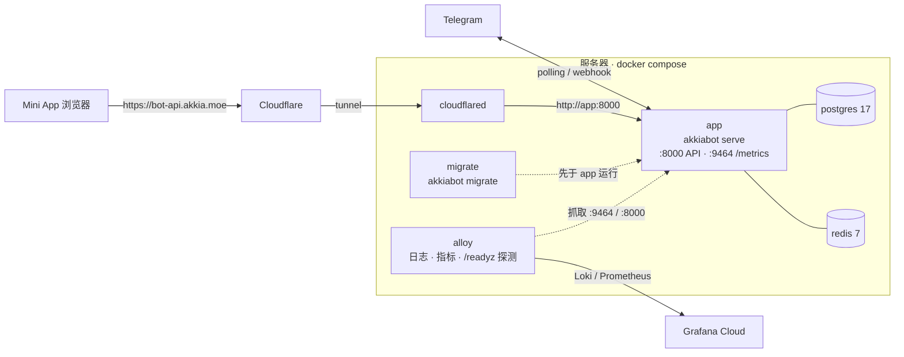

# AkkiaBot 运维手册

本文说明后端在服务器上的部署、配置、升级与回滚、备份与恢复、DNS 和预发布环境，以及从 Go 版正式切换（§9）。日志、指标、dashboard 与告警见 `docs/observability.md`。前端 Mini App 部署在 Cloudflare Pages（M7），不在本文范围内。架构依据见 `docs/architecture.md` §4、§6，任务范围见 `docs/migration-plan.md` M8。

## 1. 总览



`deploy/compose.yaml` 定义了六个服务：

| 服务 | 作用 | 网络 | 对外暴露 |
| --- | --- | --- | --- |
| `postgres` | PostgreSQL 17，数据在卷 `postgres-data` | backend | 无 |
| `redis` | 缓存（一次性 payload、限流等），数据在卷 `redis-data` | backend | 无 |
| `migrate` | 执行 `akkiabot migrate` 后退出；成功后才会启动 `app` | backend | 无 |
| `app` | `akkiabot serve`：bot 和 HTTP API（`/healthz`、`/readyz`、`/telegram/webhook`、`/api/v1/...`） | backend、edge | 仅宿主机回环 `127.0.0.1:${AKKIABOT_HTTP_PORT}` → 8000 |
| `cloudflared` | Cloudflare tunnel，把公网域名转发到 `http://app:8000` | edge | 无入站端口 |
| `alloy` | Grafana Alloy：采集本栈容器日志、抓取 `app:9464/metrics`、探测 `/readyz`，推送到 Grafana Cloud（`docs/observability.md`） | telemetry | 无 |

网络边界：

- `backend` 是 internal 网络，没有出网路由；postgres、redis、migrate 只在这个网络里。
- `edge` 只有 `app` 和 `cloudflared`，tunnel 只需要访问 app。
- `telemetry` 只有 `app` 和 `alloy`；它不是 internal 网络，Alloy 经由它推送到 Grafana Cloud。Alloy 只读挂载宿主机的 `/var/run/docker.sock`，用于发现本栈（按 `COMPOSE_PROJECT_NAME` 过滤）的容器并读取日志。
- `/metrics` 由单独的监听器提供（容器内 `:9464`），**不发布到宿主机，也不能配置为 tunnel 的目标**。只有同一 compose 网络中的采集器（Alloy）可以抓取。tunnel 的转发规则只指向 `http://app:8000`，所以公网访问 `https://bot-api.akkia.moe/metrics` 会得到 404。

## 2. 服务器上的文件

每套环境一个目录，生产环境和预发布环境互不共用：

```text
/opt/akkiabot/production/       # 预发布环境为 /opt/akkiabot/staging/
├── compose.yaml                # 来自仓库 deploy/compose.yaml（固定在某个 commit）
├── .env                        # compose 变量，来自 deploy/.env.example；chmod 600
├── app.env                     # 应用配置，来自 deploy/app.env.example；chmod 600
├── backup.sh                   # 来自仓库 deploy/backup.sh
├── restore.sh                  # 来自仓库 deploy/restore.sh
├── observability/config.alloy  # 来自仓库 deploy/observability/config.alloy（compose 按相对路径挂载）
└── backups/                    # pg_dump 备份及 backup.log（部署时用 install -d -m 700 创建）
```

**当前生产环境**（BOT-16，2026-11-15 切换）：服务器 `greencloud-tyo-01`，经 Cloudflare Access 以 `akkia` 用户登录（`ProxyCommand cloudflared access ssh --hostname ssh-greencloud-tyo-01.akkia.moe`，密钥为 1Password `AkkiaBot/shared-ssh`）。该用户在 docker 组中，但没有免密 sudo，所以生产目录在 `~/akkiabot/production`（即 `/home/akkia/akkiabot/production`），本文中的 `/opt/akkiabot/production` 都按这个路径理解；compose 项目名为 `akkiabot`。预发布环境仍在 `/opt/akkiabot/staging`。

`.env` 和 `app.env` 含有密钥，只存在服务器上，不提交到仓库，也不要贴到 issue 或日志里。密钥都在 1Password 的 `AkkiaBot` vault 中：生产用 `prod-*` 条目（如 `prod-cloudflare`、`prod-bot`，由负责人填写），预发布与本地开发共用 `staging-*` 条目。预发布环境的 `app.env` 由 `deploy/staging/app.env.tpl` 通过 1Password 渲染（见 §8）。

## 3. 配置项

### 3.1 compose 变量（`.env`）

| 变量 | 必填 | 说明 |
| --- | --- | --- |
| `COMPOSE_PROJECT_NAME` | 是 | 栈名称，决定容器、卷、网络的前缀。生产用 `akkiabot`，预发布用 `akkiabot-staging`。**部署后不要改**，否则 compose 会新建一套空的数据卷。 |
| `AKKIABOT_IMAGE` | 否 | 镜像仓库，默认 `ghcr.io/akkialab/akkiabot`。 |
| `AKKIABOT_TAG` | 否 | 镜像标签，默认 `latest`。master 的每次推送都会发布 `:<完整 commit sha>` 和 `:latest`（`.github/workflows/release.yml`）。**生产环境固定为某个 sha**，回滚只需改回旧 sha。 |
| `AKKIABOT_HTTP_PORT` | 否 | app 在宿主机回环地址上的端口，默认 8000。同一台机器跑两套环境时错开（预发布用 8001）。 |
| `POSTGRES_PASSWORD` | 是 | 数据库密码。它会被拼进 `DB_URL`，只能用字母和数字：`openssl rand -hex 32`。第一次启动后数据库已用该密码初始化，之后修改需要同时在库内改密码。 |
| `CLOUDFLARED_TOKEN` | 是 | 本环境 Cloudflare tunnel 的 token（§7）。 |
| `AKKIABOT_ENV` | 否 | 日志和指标上的 `env` 标签，默认 `production`；预发布为 `staging`。dashboard 和告警按它区分环境。 |
| `GRAFANA_CLOUD_PROMETHEUS_URL`、`GRAFANA_CLOUD_PROMETHEUS_USER` | 是 | Grafana Cloud Prometheus 的 remote_write 地址（`…/api/prom/push`）和实例 ID。 |
| `GRAFANA_CLOUD_LOKI_URL`、`GRAFANA_CLOUD_LOKI_USER` | 是 | Grafana Cloud Loki 的推送地址（`…/loki/api/v1/push`）和实例 ID。 |
| `GRAFANA_CLOUD_TOKEN` | 是 | Access policy token，权限 `metrics:write`、`logs:write`。1Password：生产 `prod-grafana`，预发布 `staging-grafana`。 |

缺少 `POSTGRES_PASSWORD`、`CLOUDFLARED_TOKEN` 或任何 `GRAFANA_CLOUD_*` 时，`docker compose` 会直接报错退出，不会用默认值启动。

### 3.2 由 compose 设定的应用配置

以下配置写死在 `compose.yaml` 中，会覆盖 `app.env` 里的同名项，`app.env` 不需要写：

| 变量 | 取值 | 说明 |
| --- | --- | --- |
| `DB_URL` | `postgresql+asyncpg://akkiabot:<POSTGRES_PASSWORD>@postgres:5432/akkiabot` | 数据库连接（日志中密码显示为 `***`）。 |
| `REDIS_URL` | `redis://redis:6379/0` | 留空时使用进程内缓存，本栈始终使用 Redis。 |
| `SERVER_HOST`、`SERVER_PORT` | `0.0.0.0`、`8000` | HTTP API 监听地址。 |
| `OBSERVABILITY_LOG_FORMAT` | `json` | 结构化日志写到 stdout，由 Docker 的 json-file 驱动保存（单文件 10 MB，保留 5 个），由 Alloy 采集到 Loki。 |
| `OBSERVABILITY_METRICS_HOST`、`OBSERVABILITY_METRICS_PORT` | `0.0.0.0`、`9464` | `/metrics` 监听器。只在 compose 网络内可达，见 §1。 |

### 3.3 应用配置（`app.env`）

变量名为 `<分组>_<字段>`，空值视为未设置；完整定义见 `packages/core/src/akkiabot_core/config.py`。启动时必填项缺失或格式错误，`app` 会记录错误并退出，错误信息不会带出密钥。

| 变量 | 默认值 | 说明 |
| --- | --- | --- |
| `TELEGRAM_BOT_TOKEN` | 必填 | @BotFather 发放的 bot token。生产用正式 bot；预发布用测试环境的测试 bot。 |
| `TELEGRAM_MODE` | `polling` | `polling` 主动拉取更新；`webhook` 由 Telegram 推送到 `<TELEGRAM_WEBHOOK_URL>/telegram/webhook`（经 tunnel）。同一个 token 同一时间只能有一个进程拉取更新。 |
| `TELEGRAM_WEBHOOK_URL` | 空 | webhook 模式的公网 API 地址，例如 `https://bot-api.akkia.moe`。 |
| `TELEGRAM_WEBHOOK_SECRET` | 空 | webhook 模式必填：1–256 位 `A-Z a-z 0-9 _ -`，Telegram 会在请求头里带回，用于校验。 |
| `TELEGRAM_TEST_ENVIRONMENT` | `false` | `true` 时使用 Telegram 测试环境（`/bot<token>/test/`），只能配合测试环境的 bot。生产必须为 `false`。 |
| `TELEGRAM_MESSAGE_LOG_RETENTION_DAYS` | `30` | `message_log` 的保留天数，超过的由定时任务删除。 |
| `TELEGRAM_MESSAGE_LOG_CLEANUP_INTERVAL` | `3600` | 两次清理之间的秒数（≥ 60）。 |
| `TELEGRAM_START_PAYLOAD_TTL` | `600` | 一次性 `/start` 深链 payload 的有效秒数。 |
| `DB_ECHO` | `false` | 打印 SQL，仅用于排障，生产保持关闭。 |
| `LLM_BASE_URL`、`LLM_API_KEY`、`LLM_MODEL` | 空 | OpenAI 兼容接口，反垃圾使用（M5）。 |
| `ANTISPAM_TIMEOUT` | `45` | 单条消息判定的总耗时上限（秒）；超时则放行该消息。 |
| `ANTISPAM_STRUCTURED_OUTPUT` | `auto` | `auto`：使用 JSON 结构化输出，接口不支持时退回 0/1 回答；`json_schema`：只用结构化输出，不退回；`off`：只用 0/1 回答。 |
| `ANTISPAM_PROMPT_FILE` | 空 | 替换内置基础提示词的 UTF-8 文件（输出格式说明会自动追加）。这是容器内路径，使用时需要在 compose 中把文件挂载进 app 容器。 |
| `ANTISPAM_PROMPT_VERSION` | 空 | `ANTISPAM_PROMPT_FILE` 的版本标签，默认为 `custom-<哈希>`。 |
| `ANTISPAM_EXEMPT_MESSAGE_COUNT` | `3` | 已记录消息数超过该值的成员不再检测。 |
| `ANTISPAM_PURGE_DELAY` | `5` | 判定为垃圾后，等待多少秒再删除该成员已记录的历史消息。 |
| `ANTISPAM_NOTICE_TTL` | `60` | “已删除垃圾消息”提示在多少秒后自动删除。 |
| `ANTISPAM_REPORT_RATE_LIMIT`、`ANTISPAM_REPORT_RATE_WINDOW` | `3`、`300` | 普通成员在 `ANTISPAM_REPORT_RATE_WINDOW` 秒内最多发起 `ANTISPAM_REPORT_RATE_LIMIT` 次 `/spam` 举报。 |
| `LANGFUSE_PUBLIC_KEY`、`LANGFUSE_SECRET_KEY` | 空 | Langfuse LLM 调用追踪；两个都设置时才启用。 |
| `LANGFUSE_HOST` | 空 | Langfuse 地址；为空时使用 Langfuse Cloud（EU）。 |
| `WHOIS_IPINFO_TOKEN` | 空 | ipinfo token；为空时 `/ip` 只使用 ip-api。 |
| `WHOIS_TIMEOUT` | `5` | 单次查询超时（秒）。 |
| `WHOIS_CACHE_TTL`、`WHOIS_CACHE_SIZE` | `3600`、`1024` | 进程内查询缓存的秒数和条数。 |
| `WHOIS_RATE_LIMIT`、`WHOIS_RATE_WINDOW` | `5`、`60` | 每个用户在 `WHOIS_RATE_WINDOW` 秒内最多查询 `WHOIS_RATE_LIMIT` 次。 |
| `TURNSTILE_SECRET_KEY` | 空 | Cloudflare Turnstile 服务端密钥（M6 入群验证）。为空时 `/api/v1/captcha/verify` 返回 503。 |
| `TURNSTILE_VERIFY_URL` | `https://challenges.cloudflare.com/turnstile/v0/siteverify` | Turnstile 服务端校验接口，一般不需要修改。 |
| `TURNSTILE_TIMEOUT` | `10` | 调用校验接口的单次超时（秒）。 |
| `WEBAPP_URL` | 空 | Mini App 地址，生产为 `https://bot.akkia.moe`。 |
| `WEBAPP_INIT_DATA_MAX_AGE` | `3600` | Mini App initData 自 `auth_date` 起的有效秒数。 |
| `WEBAPP_CAPTCHA_TIMEOUT` | `300` | 新成员完成入群验证的时限（秒，≥ 30）；超时后验证失效，成员保持禁言。 |
| `CORS_ALLOW_ORIGINS` | 空 | 允许跨域访问 API 的来源，逗号分隔；生产为 `https://bot.akkia.moe`。 |
| `OBSERVABILITY_LOG_LEVEL` | `INFO` | 日志级别。即使设为 `DEBUG`，会在 URL 中带出 token 的第三方日志器也保持固定级别。 |
| `OBSERVABILITY_SENTRY_DSN` | 空 | 为空时不启用 Sentry。 |
| `OBSERVABILITY_SENTRY_ENVIRONMENT` | `development` | Sentry 环境名：生产用 `production`，预发布用 `staging`。 |
| `OBSERVABILITY_SENTRY_TRACES_SAMPLE_RATE` | `0.0` | Sentry 性能采样率，0–1。 |
| `OBSERVABILITY_METRICS_ENABLED` | `true` | 是否启动 `/metrics` 监听器。 |

## 4. 首次部署（干净机器）

> **M10 切换之前，生产栈不得使用正式 bot token 启动。** Go 版 core 仍在用同一个 token 拉取更新，两个进程会争抢 update，并且新服务会直接作用在真实群组上。M8 的部署演练和验收在预发布环境（§8）完成；生产目录可以提前准备好，并用 `docker compose up -d --wait postgres redis && docker compose run --rm migrate` 验证数据库和迁移，但不要启动 `app`（也不要执行不带服务名的 `up`）。切换步骤见 §9。

### 4.1 前置条件

- Linux 服务器（x86_64），出站可以访问 `ghcr.io`、`api.telegram.org`（TCP 443）和 Cloudflare 隧道边缘（TCP 7844），完整列表见 §7。
- Docker Engine 和 Compose 插件 v2.24 或更高版本：`docker compose version`。
- 执行部署的用户能运行 docker（属于 `docker` 组，或者使用 root）。
- 本环境的 Cloudflare tunnel token（§7）。
- 镜像是公开的，拉取不需要登录 GHCR。

### 4.2 步骤

以下命令在服务器上执行。`REF` 取要部署的 master commit 的完整 sha，镜像标签使用同一个 sha，保证 compose 文件和镜像版本一致：

```bash
REF=<master 上的完整 commit sha>
sudo mkdir -p /opt/akkiabot/production && sudo chown "$USER" /opt/akkiabot/production
cd /opt/akkiabot/production

base="https://raw.githubusercontent.com/AkkiaLab/AkkiaBot/$REF/deploy"
curl -fsSLo compose.yaml "$base/compose.yaml"
curl -fsSLo backup.sh "$base/backup.sh"
curl -fsSLo restore.sh "$base/restore.sh"
curl -fsSLo observability/config.alloy --create-dirs "$base/observability/config.alloy"
chmod +x backup.sh restore.sh
install -d -m 700 backups                           # 定时备份的日志也写在这里，必须先建好
curl -fsSLo .env "$base/.env.example"
curl -fsSLo app.env "$base/app.env.example"
chmod 600 .env app.env

# 生成数据库密码，并固定镜像版本
sed -i "s/^POSTGRES_PASSWORD=.*/POSTGRES_PASSWORD=$(openssl rand -hex 32)/" .env
sed -i "s/^AKKIABOT_TAG=.*/AKKIABOT_TAG=$REF/" .env
```

然后用编辑器填写：

- `.env` 中的 `CLOUDFLARED_TOKEN` 和 `GRAFANA_CLOUD_*`（1Password `prod-grafana`，见 `docs/observability.md`）；
- `app.env` 中的 `TELEGRAM_BOT_TOKEN` 以及需要的其他配置（§3.3）。

不要用把密钥写在命令行参数里的方式填写（会进入 shell 历史和进程列表）。

启动并等待所有服务健康：

```bash
docker compose pull
docker compose up -d --wait
```

`--wait` 会依次等待 postgres/redis 健康 → migrate 成功退出 → app 的 `/readyz` 通过 → cloudflared 连上 Cloudflare。任何一步失败，命令都会以非零退出码返回，此时按 §5.3 排查。

### 4.3 验证

```bash
docker compose ps                                   # app、postgres、redis、cloudflared 为 healthy；alloy 为 running；migrate 为 exited (0)
curl -fsS http://127.0.0.1:8000/readyz              # {"status":"ok","checks":{"db":true,"cache":true}}
curl -fsS https://bot-api.akkia.moe/healthz         # 经 tunnel：{"status":"ok"}
curl -s -o /dev/null -w '%{http_code}\n' https://bot-api.akkia.moe/metrics   # 404，指标不经 tunnel 暴露
docker compose logs --tail 50 app                   # JSON 日志，含 "starting akkiabot" 和带 bot_username 的 "bot started"
```

最后在 Telegram 中私聊 bot 发送 `/start`、`/help`，确认 bot 有回复。

## 5. 日常运维

### 5.1 升级

版本流程下，staging 与生产的升级都由 `deploy/upgrade.sh` 执行（`just release-staging` / `just release-deploy production`，`docs/release.md` §4）：它在同一目录按下面的顺序完成配置检查、迁移门禁、拉镜像、备份、替换文件、启动和健康检查，失败时按是否涉及迁移决定自动回滚或停下交给人。以下是等价的手动步骤，供排障和工具不可用时使用。

```bash
cd /opt/akkiabot/production
grep '^AKKIABOT_TAG=' .env                           # 记下当前（旧）sha，回滚时要用
./backup.sh                                         # 先备份（迁移不可自动回退），记下输出的文件名
NEW=<新 commit 的完整 sha>
base="https://raw.githubusercontent.com/AkkiaLab/AkkiaBot/$NEW/deploy"
curl -fsSLo compose.yaml "$base/compose.yaml"       # compose 文件有变化时
curl -fsSLo observability/config.alloy --create-dirs "$base/observability/config.alloy"
sed -i "s/^AKKIABOT_TAG=.*/AKKIABOT_TAG=$NEW/" .env
docker compose pull && docker compose up -d --wait
```

`up` 会先用新镜像重新运行 `migrate`，成功后再替换 `app`。升级期间 bot 会有几秒到几十秒不处理 update；Telegram 会保留未拉取的 update，恢复后继续处理。新版本 `.env.example` 或 `app.env.example` 增加了配置项时，按 PR 说明补充到服务器上的文件。

### 5.2 回滚

先确认新版本是否包含数据库迁移：比较新旧 commit 之间 `packages/core/src/akkiabot_core/db/migrations/versions/` 是否有变化，或者对比 `docker compose exec -T postgres psql -U akkiabot -d akkiabot -tAc 'select version_num from alembic_version'` 与旧版本代码中最新的 revision。

**没有数据库迁移的版本**：把 `AKKIABOT_TAG` 改回旧 sha，必要时恢复对应版本的 `compose.yaml`，再执行 `docker compose up -d --wait`。

**包含数据库迁移的版本**：`akkiabot migrate` 只能升级，旧版本代码不保证能使用新表结构，只能恢复升级前（§5.1 第二步）的备份。恢复之后，升级以来写入的数据会丢失，回滚前先在 issue 中确认。整个过程**不能启动新镜像的 `migrate` 或 `app`**，所以先把 compose 文件和镜像切回旧版本，再恢复数据库，最后启动：

```bash
cd /opt/akkiabot/production
OLD=<升级前的完整 sha>
DUMP=backups/akkiabot-<升级前备份的时间>.dump

# 1. 停止写入
docker compose stop app cloudflared

# 2. 把 compose 文件和镜像固定为旧版本（此后任何 up 都只会用旧镜像；restore.sh 与版本无关，保留当前文件）
base="https://raw.githubusercontent.com/AkkiaLab/AkkiaBot/$OLD/deploy"
curl -fsSLo compose.yaml "$base/compose.yaml"
sed -i "s/^AKKIABOT_TAG=.*/AKKIABOT_TAG=$OLD/" .env
docker compose pull

# 3. 恢复升级前的备份：删库重建后再导入，不会残留新迁移加的表或列；不会启动 app
./restore.sh "$DUMP"                                # 最后一行输出恢复后的 alembic revision

# 4. 确认 revision 与旧版本一致后再启动；旧镜像的 migrate 此时什么也不做
docker compose up -d --wait
```

如果第 3 步失败，app 仍处于停止状态，数据库可能是空的或不完整：修复问题后重新执行第 3 步，不要启动 app。按 §4.3 验证回滚结果。

### 5.3 排障

| 现象 | 排查 |
| --- | --- |
| `up` 报 `required variable ... is missing a value` | `.env` 中缺少该项，按 §3.1 填写。 |
| `migrate` 退出码非 0 | `docker compose logs migrate`；常见原因是数据库密码与已初始化的卷不一致。 |
| app 不健康 | `docker compose logs app`。`invalid configuration` 表示 `app.env` 缺项或格式错误；`/readyz` 返回 503 时，`checks` 字段会标出不可用的依赖。 |
| cloudflared 不健康 | `docker compose logs cloudflared`；检查 token 是否属于本环境的 tunnel，以及 tunnel 的 public hostname 是否指向 `http://app:8000`。日志中的 `Registered tunnel connection` 应带 `protocol=http2`；反复出现 `Connection terminated` 时，检查到 Cloudflare 边缘的出站 TCP 7844 是否被防火墙拦截或不稳定（见 §7）。 |
| Grafana 中没有数据 | `docker compose logs alloy`：`401`/`403` 表示 `GRAFANA_CLOUD_TOKEN` 或实例 ID 不对；`permission denied ... docker.sock` 表示宿主机 docker socket 不可读。详见 `docs/observability.md`。 |
| bot 不回复，日志有 `Conflict: terminated by other getUpdates request` | 同一个 token 有另一个进程在拉取（Go 版 core 或另一套环境），停掉其中一个。 |

常用命令：`docker compose logs -f app`、`docker compose restart app`、`docker compose down`（停止，保留数据卷）。**不要执行 `docker compose down -v`**，它会删除数据库卷。

## 6. 备份与恢复

### 6.1 定时备份

`backup.sh` 通过 `docker compose exec postgres pg_dump` 生成自定义格式的备份 `backups/akkiabot-<UTC 时间>.dump`（文件权限 600）。dump 会先写入临时文件，成功后才改名，失败时不会留下半截文件。默认保留最近 14 份，可以用 `BACKUP_KEEP` 调整，用 `BACKUP_DIR` 改变目录。

用 cron 每天备份一次。cron 会在脚本运行前打开日志文件，所以 `backups/` 必须事先存在（§4.2 的部署步骤已经创建）：

```bash
cd /opt/akkiabot/production
install -d -m 700 backups                           # 已存在时不会改动内容
./backup.sh >> backups/backup.log 2>&1 && tail -n 1 backups/backup.log   # 先手动跑一次，确认能生成备份
crontab -e
# 每天 03:17（服务器时区）备份生产库
17 3 * * * cd /opt/akkiabot/production && ./backup.sh >> backups/backup.log 2>&1
```

备份保存在同一台服务器上，只能应对误操作和升级失败。需要防范整机故障时，再用 rclone 等工具把 `backups/` 同步到异地存储，这部分由负责人决定，暂不在本仓库实现。Redis 只用作缓存，不需要备份。

### 6.2 恢复

用于误操作后找回数据，镜像版本不变。跨数据库迁移的版本回滚见 §5.2，不要直接套用本节。

```bash
cd /opt/akkiabot/production
./restore.sh backups/akkiabot-<时间>.dump           # 停 app/cloudflared，删库重建并导入，输出 alembic revision
docker compose up -d --wait                          # 当前镜像的 migrate 会把表结构升级到它的版本
```

`restore.sh` 只启动 postgres，不会启动 app 或 migrate；导入失败时会以非零退出码停止（`pg_restore --exit-on-error`）。

建议每季度在预发布环境演练一次恢复：把生产备份复制到预发布服务器，按上面的步骤恢复，确认 `/readyz` 通过。

## 7. DNS 与 tunnel

| 域名 | 指向 | 用途 |
| --- | --- | --- |
| `bot.akkia.moe` | Cloudflare Pages（M7） | Mini App 静态页面 |
| `bot-api.akkia.moe` | 生产 tunnel → `http://app:8000` | 生产后端 API、webhook |
| `bot-api-staging.akkia.moe` | 预发布 tunnel → `http://app:8000` | 预发布后端 API |

Mini App 和 API 不同源，后端通过 `CORS_ALLOW_ORIGINS` 放行 `https://bot.akkia.moe`。

每套环境使用**单独的** tunnel，由 Cloudflare 远程管理（转发规则保存在 Cloudflare 控制台）。创建方法（需要 `akkia.moe` 所在 Cloudflare 账号的权限）：

1. Cloudflare 控制台 → Zero Trust → Networks → Tunnels → Create a tunnel，类型选 Cloudflared，名称为 `akkiabot-production`（预发布为 `akkiabot-staging`）。
2. 在安装步骤页面选 Docker，从显示的命令中复制 `--token` 后面的值，填入该环境 `.env` 的 `CLOUDFLARED_TOKEN`。不需要执行页面上的 `docker run` 命令，compose 会运行 cloudflared。
3. Public Hostname 只添加一条：子域名 `bot-api`（预发布为 `bot-api-staging`），域名 `akkia.moe`，类型 `HTTP`，URL 为 `app:8000`。Cloudflare 会自动创建对应的 CNAME 记录。
4. **不要**添加指向 `app:9464` 或其他服务的规则。

compose 中的 cloudflared 固定使用 HTTP/2 连接 Cloudflare（`TUNNEL_TRANSPORT_PROTOCOL=http2`），不使用默认的 QUIC：预发布主机上 QUIC 连接多次超时断开，健康检查随之反复失败。两种协议的隧道连接都使用 **7844** 端口，区别只是 TCP 或 UDP（见 [Cloudflare 防火墙说明](https://developers.cloudflare.com/cloudflare-one/networks/connectors/cloudflare-tunnel/configure-tunnels/tunnel-with-firewall/)）。

服务器需要的出站流量：

| 用途 | 目标 | 端口 |
| --- | --- | --- |
| 隧道连接（HTTP/2） | Cloudflare 边缘 `region1.v2.argotunnel.com`、`region2.v2.argotunnel.com` | **TCP 7844** |
| cloudflared 的 API 调用（注册、更新检查等） | `api.cloudflare.com`、`update.argotunnel.com` | TCP 443 |
| Telegram Bot API、ipinfo / ip-api、Turnstile 校验、Sentry 等 | 各服务的 HTTPS 地址 | TCP 443 |
| 拉取镜像 | `ghcr.io`、Docker Hub | TCP 443 |

只放行 TCP 443 时，隧道无法建立。如果日后改回 QUIC，还需要放行 UDP 7844。

## 8. 预发布环境

预发布环境用于 M9（Grafana 接入）和 M10（切换演练）。它使用同一个 `compose.yaml`，区别如下：

| 项目 | 预发布 |
| --- | --- |
| 目录 | `/opt/akkiabot/staging`（可以和生产在同一台机器上，也可以单独一台） |
| `.env` | 来自 `deploy/staging/.env.example`：`COMPOSE_PROJECT_NAME=akkiabot-staging`，`AKKIABOT_HTTP_PORT=8001`，预发布 tunnel 的 token |
| `app.env` | 由 `deploy/staging/app.env.tpl` 用 1Password 渲染：Telegram 测试环境中**专用的 staging bot**（`TELEGRAM_TEST_ENVIRONMENT=true`），密钥来自 `AkkiaBot` vault 的 `staging-bot`、`staging-services` 条目 |
| 域名 | `bot-api-staging.akkia.moe` |
| 镜像 | 固定为本次 staging 发版的 master sha（§8.1），staging 验收通过后，生产使用同一个 sha |

1Password `AkkiaBot` vault 中预发布专用的配置分两个条目：`staging-bot`（bot）与 `staging-cloudflare`（tunnel，以及 dev/staging 共用的 Cloudflare API token）：

| 字段 | 内容 |
| --- | --- |
| `staging-bot`：`bot_token`、`bot_username` | staging bot（测试环境 BotFather 创建，当前为 `@akkiabot_staging_669a8d_bot`）。它和 e2e 自动验收用的 bot（`e2e-bot` 条目）是两个不同的 bot，所以 `just e2e --serve` 不会和预发布栈争抢 update。 |
| `staging-cloudflare`：`cloudflared_token`、`tunnel_id` | 预发布 tunnel `akkiabot-staging` 的 token 和 ID |
| `staging-bot`：`environment` | 固定为 `test` |
| `staging-grafana` | dev/staging 共用的 Grafana Cloud：Alloy 推送用的地址、实例 ID 与 `cloud_token`，以及上传 dashboard 和告警用的 `grafana_url`、`grafana_sa_token`（`docs/observability.md`） |

tunnel 和 DNS 记录可以按 §7 在控制台创建，也可以用 `staging-cloudflare/api_token`（dev/staging 共用的 token，权限：Account · Cloudflare Tunnel · Edit、Cloudflare Pages · Edit、Turnstile · Edit，Zone · DNS · Edit、Zone · Read，zone 范围仅 `akkia.moe`；生产使用 `prod-cloudflare/api_token`）通过 Cloudflare API 创建，效果相同：远程管理的 tunnel，ingress 只有 `bot-api-staging.akkia.moe → http://app:8000`，其余请求返回 `http_status:404`；外加一条代理的 CNAME `bot-api-staging` → `<tunnel_id>.cfargotunnel.com`。

步骤（在预发布机器上执行，需要能访问 `AkkiaBot` vault 的 1Password CLI，例如设置了该 vault 服务账号的 `OP_SERVICE_ACCOUNT_TOKEN`）：

```bash
REF=<master 上的完整 commit sha>
sudo mkdir -p /opt/akkiabot/staging && sudo chown "$USER" /opt/akkiabot/staging
cd /opt/akkiabot/staging

base="https://raw.githubusercontent.com/AkkiaLab/AkkiaBot/$REF/deploy"
curl -fsSLo compose.yaml "$base/compose.yaml"
curl -fsSLo backup.sh "$base/backup.sh"
curl -fsSLo restore.sh "$base/restore.sh"
curl -fsSLo observability/config.alloy --create-dirs "$base/observability/config.alloy"
chmod +x backup.sh restore.sh
install -d -m 700 backups                           # 定时备份的日志也写在这里，必须先建好
curl -fsSLo .env "$base/staging/.env.example"
curl -fsSLo app.env.tpl "$base/staging/app.env.tpl"
curl -fsSLo grafana.env.tpl "$base/staging/grafana.env.tpl"
chmod 600 .env
sed -i "s/^POSTGRES_PASSWORD=.*/POSTGRES_PASSWORD=$(openssl rand -hex 32)/" .env

# 密钥只经过 op inject 写入文件，不出现在终端、命令行参数或 shell 历史里
umask 077
op inject -f -i app.env.tpl -o app.env
sed -i '/^CLOUDFLARED_TOKEN=/d' .env
echo 'CLOUDFLARED_TOKEN={{ op://AkkiaBot/staging-cloudflare/cloudflared_token }}' | op inject >> .env
sed -i '/^GRAFANA_CLOUD_/d' .env
op inject -i grafana.env.tpl >> .env               # Alloy → Grafana Cloud（staging-grafana 条目）
docker compose pull && docker compose up -d --wait
```

验证：

```bash
docker compose ps
curl -fsS http://127.0.0.1:8001/readyz
curl -fsS https://bot-api-staging.akkia.moe/healthz
curl -s -o /dev/null -w '%{http_code}\n' https://bot-api-staging.akkia.moe/metrics   # 404
```

staging bot 是否正常响应：用 Telegram 测试环境的账号私聊 staging bot，发送 `/start`、`/help`、`/id`，确认都有回复。

不要用 `just e2e` 去验收预发布栈：它读取的是 `e2e-bot` 条目中的 e2e bot，验收的是本机进程。验收预发布栈用 `just e2e-staging`（`tools/e2e/staging-release.env.tpl`，见 `docs/e2e-acceptance.md` §6.2）。

### 8.1 staging 发版

staging 发版以 RC 为单位（`docs/release.md` §4.1）：`release-rc.yml` 为 RC 的 sha 构建镜像并发布 staging Mini App，然后在本机执行 `just release-staging <RC tag> <场景>`，它持有 staging 环境锁，用该 commit 的 `deploy/upgrade.sh` 升级本目录并执行差异验收。前后端始终是同一个 RC commit，master 的后续推送不会覆盖 staging。手动执行时的等价步骤：

```bash
SHA=<RC tag 指向的完整 commit sha，release-rc.yml 已推送该镜像>
cd /opt/akkiabot/staging
cp -p .env ".env.bak-$(date -u +%Y%m%dT%H%M%SZ)"
sed -i "s/^AKKIABOT_TAG=.*/AKKIABOT_TAG=$SHA/" .env
# 模板有变化时，先从该 commit 更新 app.env.tpl，再重新渲染
curl -fsSLo app.env.tpl "https://raw.githubusercontent.com/AkkiaLab/AkkiaBot/$SHA/deploy/staging/app.env.tpl"
(umask 077 && op inject -f -i app.env.tpl -o app.env)
docker compose pull && docker compose up -d --wait
curl -fsS https://bot-api-staging.akkia.moe/readyz
curl -fsS https://staging.akkiabot-webapp.pages.dev/version.json   # sha 应为 $SHA
```

然后在仓库检出中执行 `just e2e-staging --record-status "$SHA" --baseline "$BASE" --scenarios <场景>`，只验收上一个通过 `staging-acceptance` 的 commit（`BASE`）以来产品改动明确涉及的场景，并写入 `staging-acceptance` 状态；场景选择、全量验收的用法和 `success` 的含义见 `docs/e2e-acceptance.md` §6.2。生产只发布通过验收并经封版打正式 tag 的 `SHA`（`docs/release.md` §4.2–4.3）：负责人审批 `release-production.yml` 后，`just release-deploy production <tag>` 按 §5.1 升级后端，再触发前端的 `webapp-promote.yml`。生产发布前需要负责人确认，发布后只做健康检查和非 Telegram 的冒烟，不重复全量验收；Telegram 相关能力只靠自然流量观测（见 §9.4 第 5 步）。

在执行 `usermod -aG docker` 之前就已启动的进程（例如长期运行的 Multica daemon 及其子进程）不会获得新加入的 docker 组权限：可以重新登录或重启该进程，也可以临时用 `sg docker -c "docker compose ..."` 执行。

1Password 中 `staging-*` 条目的值更新后，重新执行上面的三条 `op inject` 和 `docker compose up -d --wait`。

## 9. 正式切换（M10）

本节说明从 Go 版 botlab-core 切换到 AkkiaBot 的步骤：前置检查、版本锁定、配置导入、切换、健康检查与观测核对、回滚，以及之后的旧仓库归档。范围见 `docs/migration-plan.md` M10。**停止旧服务、导入生产数据、用正式 bot 启动生产栈、归档旧仓库，每一步都要先在 BOT-4 中请求负责人确认后再执行**；本节只是操作手册，本身不构成授权。

### 9.1 前置检查

全部满足后才能请求确认切换：

- [ ] M3、M5、M7、M9 已完成，旧版的全部命令（包括 `/ip`）都已迁移。
- [ ] staging 已经用一个确定的 master sha 完成 staging 发版验收（§8.1，差异或全量，commit status `staging-acceptance` 为 success），生产会使用同一个 sha。
- [ ] 生产目录已按 §4.2 准备好，`app.env` 使用 `prod-*` 条目：正式 bot token、`WEBAPP_URL=https://bot.akkia.moe`、prod Turnstile、`OBSERVABILITY_SENTRY_DSN`；`.env` 填好 `prod-cloudflare` 的 tunnel token 和 `prod-grafana`。按 §4 的说明，只执行 `docker compose up -d --wait postgres redis && docker compose run --rm migrate`，**还没有启动 `app`**。
- [ ] 前端：`webapp-promote.yml` 已经可以用同一个 sha 提升到 `bot.akkia.moe`（需要负责人审批）。
- [ ] 确认旧版使用 SQLite：旧部署目录中 `botlab_core/data/config.yaml` 的 `db.driver` 为 `sqlite`。如果是 `mysql`，本脚本不适用，改用 §9.8 的备选方案。
- [ ] 已用旧库只读副本完成一次 dry-run（§9.3），统计“一致”，报告中的注意事项和最近被 captcha 禁言的名单都已看过。
- [ ] 记下旧版镜像的 digest，回滚时使用：在旧部署目录执行 `docker compose images core`，或 `docker inspect --format '{{index .RepoDigests 0}}' ghcr.io/akkialab/botlab-core:latest`。

### 9.2 版本锁定

- 后端：生产 `.env` 的 `AKKIABOT_TAG` 设为通过 staging 验收的完整 sha（不要用 `latest`），`compose.yaml` 等文件从同一个 sha 下载（§4.2）。
- 前端：`webapp-promote.yml` 输入同一个 sha；切换后检查 `https://bot.akkia.moe/version.json`，其中的 sha 应与后端一致。
- 旧版：Go 版 core 的镜像不要再 `pull`。旧的 compose 使用 `latest` 标签，回滚时如果本地镜像已经被清理，就按 9.1 记录的 digest 拉取（`ghcr.io/akkialab/botlab-core@sha256:...`）。

### 9.3 配置导入：`akkiabot import-legacy`

脚本以只读方式（SQLite `mode=ro`）打开旧库副本，读取未软删除（`deleted_at IS NULL`）的记录：

| 旧库（botlab-core） | 新库 | 说明 |
| --- | --- | --- |
| `telegram_chats.enable_captcha` | `chat.settings.captcha` | 只导入 `type` 为 `group` / `supergroup` 的记录，其他类型（私聊、频道）跳过并计数 |
| `telegram_chats.enable_anti_spam` | `chat.settings.antispam` | |
| `telegram_chats.enable_warn` | `chat.settings.warn` | |
| `telegram_chats.max_warn_count` | `chat.settings.max_warn_count` | 超出新系统允许范围 1–100 时按边界值导入，并在“注意事项”中列出。新旧系统都在达到上限的那次 `/warn` 时封禁，语义相同 |
| `telegram_chat_members.warn_count`（> 0） | `chat_member.warn_count` | 旧库的值为准 |
| `telegram_chat_members.message_count`（> 0） | `chat_member.message_count` | 新旧两边取较大值。新旧系统都对发言数超过 3 的成员免于反垃圾检查（新系统 `ANTISPAM_EXEMPT_MESSAGE_COUNT` 默认 3），导入后老成员保持豁免 |
| `telegram_messages`（最近 `--recent-hours` 小时，默认 48） | `message_log`（只有消息 id、发送者和时间，不含正文） | 切换后立即 `/ban`、`/warn` 封禁或反垃圾封禁时，仍能清理该成员切换前的近期消息（Telegram 只允许 bot 删除 48 小时内的消息，旧版也只删 23 小时内的） |
| `restriction_type = 'CaptchaBAN'` 的成员 | 不写入 | 在 Telegram 中保持禁言，与切换前相同（负责人于 BOT-16 决定）。报告按群汇总人数，只逐个列出最近 `--recent-hours` 小时内被禁言的成员，完整名单在 JSON 报告中 |
| `AdminBAN` / `AdminSPAM` 等其他限制记录 | 不写入 | 封禁本身由 Telegram 保存，不受切换影响。不导入记录，是为了避免管理员早已在客户端解封、但旧库仍记为封禁的成员重新入群时被跳过入群验证 |

成员数据（警告数、发言数、近期消息）除了上面这些群，还包括旧库中**没有群记录的群**：旧版只有在群里执行过 `/config` 才会保存群记录，其他群的所有开关都为关。这些群（负数 chat id）只导入成员数据，不创建 `chat` 配置；新系统对没有配置的群同样按全关运行，行为一致。私聊（正数 chat id）不导入。

“最近”从旧库的**最后活动时间**（最新一条消息或成员记录的更新时间）往前算，不使用当前时间，所以用停服后的副本导入时，窗口正好覆盖停服前的 48 小时。

已经存在的 `chat` 只更新上面四项，`delete_service_messages` 等旧版没有的配置保持不变；新建的 `chat` 使用旧库中的 `type` 和标题。成员和消息批量写入。所有写入在同一个事务里完成，重复执行结果相同（第二次执行时全部为“不变”）。已用真实旧库副本对 PostgreSQL 17 做过正式导入演练（数据量和耗时只记在受控记录中，不写入仓库）。

报告是 Markdown 格式，输出到 stdout（日志写到 stderr），内容包括：

- **源数据统计**：直接用 SQL 对旧库计数（群、各开关开启数、有警告的成员数、警告数合计、有发言数的成员数、发言数合计、captcha 禁言人数）。
- **一致性校验**：逐项比较源数据统计与导入计划。任何一项不一致时，脚本不写入任何数据，并以退出码 1 结束。
- **变更汇总**、**群配置差异**、**警告数差异**：新建 / 更新 / 不变，以及原值和新值；发言数只给汇总（含导入后免于反垃圾检查的人数），逐人明细在 JSON 中。
- **captcha 禁言中的成员**（按群汇总，加最近 `--recent-hours` 小时的名单）、**注意事项**。

`--report FILE` 会把同样的内容另外写成 JSON。`FILE` 必须是一个不存在的新文件（所在目录要已存在），也不能是符号链接；在读取旧库之前就会检查，不满足时退出码为 2，不会读写任何数据，避免误把报告写到旧库副本上。退出码：`0` 成功；`1` 一致性校验失败，未写入；`2` 文件、库结构或配置错误。

**制作只读副本**（在旧服务器上执行）。正式切换时，在 9.4 第 1 步停止旧服务之后再复制；切换前的演练可以在服务运行时用 SQLite 在线备份复制。旧服务器（`ovh-hil-01`，部署目录 `/root/docker_data/botlab`，需要 sudo）上没有 `sqlite3` 命令，用后面的 Python 写法；有 `sqlite3` 时也可以用下面的命令：

```bash
cd <旧部署目录>                                     # 含 docker-compose.yml 和 botlab_core/data/
STAMP=$(date -u +%Y%m%dT%H%M%SZ)
install -d -m 755 legacy-copy
sqlite3 botlab_core/data/sqlite.db ".backup legacy-copy/sqlite-$STAMP.db"     # 只读取原库
sqlite3 legacy-copy/sqlite-$STAMP.db "PRAGMA journal_mode=DELETE; PRAGMA integrity_check;"  # 只改副本；应输出 delete、ok
chmod 444 legacy-copy/sqlite-$STAMP.db
sha256sum botlab_core/data/sqlite.db legacy-copy/sqlite-$STAMP.db   # 记录下来；旧服务停止期间，原库的哈希不应变化
```

没有 `sqlite3` 命令时，用系统自带的 Python 完成同样的事。原库以只读方式打开，副本写到登录用户的家目录：

```bash
sudo python3 -I - <<'PY'
import hashlib, os, sqlite3, time
src_path = "/root/docker_data/botlab/botlab_core/data/sqlite.db"
out_dir = os.path.expanduser("~akkia/akkiabot-legacy-copy")
dst_path = f"{out_dir}/sqlite-{time.strftime('%Y%m%dT%H%M%SZ', time.gmtime())}.db"
os.makedirs(out_dir, mode=0o700, exist_ok=True)
src = sqlite3.connect(f"file:{src_path}?mode=ro", uri=True)
dst = sqlite3.connect(dst_path)
src.backup(dst)
src.close()
print(dst.execute("PRAGMA journal_mode=DELETE").fetchone()[0], dst.execute("PRAGMA integrity_check").fetchone()[0])  # delete ok
dst.close()
os.chmod(dst_path, 0o444)
for path in (out_dir, dst_path):
    os.chown(path, 1001, 1001)                       # akkia
print(dst_path, hashlib.sha256(open(dst_path, "rb").read()).hexdigest())
PY
```

副本中有群标题和用户 id，按生产数据处理：不要上传到 issue 或公开位置。把副本复制到生产服务器的 `/opt/akkiabot/production/legacy/`（目录权限 755，文件 444；容器以 uid 10001 运行，需要能读到）。

**dry-run**（不写入；生产库在切换前是空的，所以差异就是将要导入的全部内容）：

```bash
cd /opt/akkiabot/production
DB=sqlite-<STAMP>.db
docker compose run --rm -v "$PWD/legacy:/legacy:ro" migrate \
  import-legacy "/legacy/$DB" --dry-run > "legacy/report-dry-run-$(date -u +%Y%m%dT%H%M%SZ).md"
echo "exit=$?"
```

`migrate` 服务只连接 `backend` 网络，正好满足导入的需要（只访问 postgres），不会启动 app。演练时也可以不连接数据库：在仓库检出中执行 `uv run akkiabot import-legacy <副本> --dry-run`（不设置 `DB_URL`），此时差异按空库计算，报告中会注明。

**正式导入**：去掉 `--dry-run`，在 9.4 的第 2 步执行。

### 9.4 切换步骤

同一个 bot token 同一时间只能有一个进程拉取更新，所以必须先停旧服务再启动新服务。整个过程中 bot 会停止响应几分钟；Telegram 会保留未拉取的 update（最多 24 小时），新服务启动后继续处理。

1. **停止 Go 版 core**（旧服务器，旧部署目录）：`docker compose stop core`。确认已停止：`docker compose ps core`。llm、cloudflared 暂时保留，回滚时不用重新启动。从这一刻起，旧库保持只读，不再修改。
2. **导入配置**：按 9.3 制作停服后的副本，复制到生产服务器，先 dry-run 一次，确认“一致”，再正式导入：

   ```bash
   cd /opt/akkiabot/production
   ./backup.sh                                        # 导入前备份一次（此时是迁移后的空库）
   docker compose run --rm -v "$PWD/legacy:/legacy:ro" migrate \
     import-legacy "/legacy/$DB" > "legacy/report-import-$(date -u +%Y%m%dT%H%M%SZ).md"
   echo "exit=$?"                                     # 必须为 0
   ```

   历史上未完成验证的成员保持禁言，不需要处理。报告中“最近 48 小时内被禁言的成员”的旧验证按钮已失效；负责人于 2026-11-15 决定**不主动交接**这份名单，禁言保持原状，报告只作受控留存（权限 600，不公开）。
3. **启动新服务**：`docker compose up -d --wait`，然后按 §4.3 验证（`/readyz`、tunnel、日志中的 `bot started`）。Grafana 告警规则的预期环境加入 `production`（`docs/observability.md` §5）。
4. **切换 Mini App 地址**：执行 `webapp-promote.yml`（同一个 sha，需要负责人审批），确认 `https://bot.akkia.moe/version.json`。如果旧 bot 在 BotFather 中设置过菜单按钮或 Mini App 地址（`/mybots` → Bot Settings → Menu Button / Configure Mini App），改为 `https://bot.akkia.moe`。新的入群验证按钮使用 `app.env` 的 `WEBAPP_URL`，不再使用旧前端的地址。
5. **健康检查与观测核对**：生产侧受 Telegram 平台限制，**不执行 Telegram 相关的主动冒烟**（不在生产群发命令、不用测试账号入群或制造垃圾消息），也不请求生产验证账号（负责人于 BOT-4 决定，2026-11-15）。
   - 非 Telegram 检查：`/readyz`、tunnel、日志中的 `bot started` 和持续的 getUpdates；`https://bot.akkia.moe/version.json` 的 sha；必要时在生产容器内做不经过 Telegram 的后端调用（例如 whois 查询、LLM 判定）。
   - Telegram 能力（私聊命令、群管理命令、入群验证、反垃圾、入群申请提示等）：用自然流量的日志、指标、链路和告警观测，按 `chat_id` 等条件检索；逐项记录**已观测**和**未观测**，未观测不算通过，也不因缺少测试账号阻塞收尾，后续有自然流量时再补记。
   - Grafana：dashboard 中 `production` 环境有 update 量、handler 耗时等数据；Sentry：`production` 环境能看到本次版本（release `akkiabot@<版本>`）的事件。没有自然产生的错误时，是否人为制造一次错误由负责人决定。
   结果记录到 BOT-16，包括版本 sha、已观测与未观测的能力。

### 9.5 回滚

切换后出现无法快速修复的问题时：

1. 停止新服务：`cd /opt/akkiabot/production && docker compose stop app cloudflared`。
2. 在旧部署目录重新启动 Go 版：`docker compose start core`（本地镜像不在时，用 9.1 记录的 digest 拉取）。旧库在切换期间没有被修改，配置和警告数仍是切换前的状态；新系统运行期间产生的警告、禁言记录不会回写到旧库。
3. Mini App 地址：如果在 BotFather 中改过，改回旧地址；`bot.akkia.moe` 可以保留，旧版不会使用它。
4. 用 `/start`、`/help` 确认旧 bot 恢复响应，并在 BOT-16 记录回滚原因。

再次切换时从 9.4 第 1 步重新开始，用新的停服副本重新导入（新库已有数据时，导入只更新四项群配置和警告数，报告中会列出原值）。

### 9.6 旧仓库归档

切换上线并稳定运行一段时间（时长由负责人决定）之后：在 BOT-16 中**再请求一次确认**，然后在 5 个旧仓库（botlab-core、botlab-telegram、botlab-llm、botlab-fe、Toolbox-py）的 README 顶部注明“已迁移到 AkkiaLab/AkkiaBot”，再把它们归档（GitHub Settings → Archive）。旧服务器上的 Go 版服务和旧库保留到负责人决定清理为止。

### 9.7 版本记录

切换完成后，在 BOT-16 记录：生产后端/前端 sha、旧库副本的 sha256、dry-run 与正式导入报告的统计摘要（不贴群标题和用户 id）、健康检查与观测核对结果（已观测/未观测）、旧版镜像 digest。

### 9.8 备选方案

如果脚本在实际数据上不适用（例如旧版使用 MySQL，或旧库结构与预期不一致，脚本以退出码 2 报告缺少的列）：

- **导出 CSV 后手动导入**：用 `sqlite3 -csv`（或 MySQL 的 `SELECT ... INTO OUTFILE`）导出 `telegram_chats` 的 `id, type, title, enable_captcha, enable_anti_spam, enable_warn, max_warn_count` 和 `telegram_chat_members` 中 `warn_count > 0 OR message_count > 0` 的 `chat_id, user_id, warn_count, message_count`（都加 `WHERE deleted_at IS NULL`），整理成同样表结构的 SQLite 文件后再用本脚本导入；或者直接按 9.3 的映射表在新库中逐条写入。
- **管理员重新配置**：群数量很少时，切换后请各群管理员重新执行 `/config` 打开需要的开关。警告数无法这样恢复，从 0 开始计数，需要在群里提前说明。

### 9.9 切换记录（2026-11-15）

- 版本：后端镜像与前端都是 `5f5227aeccef23384e18752569b71fcdd82f1b16`（`staging-acceptance=success`，差异验收基线 `aeebf8c`）；前端经 `webapp-promote.yml` 发布到 `bot.akkia.moe`。
- 新环境在停旧服务前全部就绪：postgres、redis、migrate、alloy 已运行，生产配置加载检查通过，并用旧库副本对生产库做过一次 dry-run。
- 切换顺序：停止旧版 core（`ovh-hil-01`，`/root/docker_data/botlab`，镜像按 digest 固定，回滚时直接 `docker compose start core`）→ 停服副本（旧机上没有 `sqlite3`，用 §9.3 的 Python 写法，并核对原库哈希前后一致）→ dry-run，一致性校验全部通过后 → 正式导入 → 启动新服务，确认新 bot 开始拉取更新。实际时间点、停机时长和导入统计属于生产记录，保存在 1Password `AkkiaBot/prod-cutover-evidence-20261115` 和生产机上的导入报告中，不写入仓库。
- 旧机上 llm、cloudflared 等其他服务未动；旧库与停服副本保留在旧机，未修改。
- Grafana 告警的预期环境已加入 `production`（`alerting/env-missing.yaml`）。

**证据索引**（§9.7；只记录哈希、digest 和位置，旧库内容、群标题、用户 id 不出现在仓库或 issue 中；带时间戳的实际文件名见 1Password `AkkiaBot/prod-cutover-evidence-20261115`）：

| 项目 | 值 | 位置 |
| --- | --- | --- |
| 旧库原文件（停服后，未修改） | sha256 `789e3ce416ee7a5dfa3f31cd9086c256a49af9526ed19c90b5471264b7ed1cd9` | `ovh-hil-01:/root/docker_data/botlab/botlab_core/data/sqlite.db` |
| 停服副本（正式导入所用） | sha256 `952669b197af9ea4acf98bfd5dd9533b5d8fcb12c13ce4e43e31478a24f04237` | `ovh-hil-01:~akkia/akkiabot-legacy-copy/sqlite-cutover-<时间戳>.db`（目录 700）；`greencloud-tyo-01:~/akkiabot/production/legacy-in/` 同名文件（目录 711，文件 444） |
| 切换前演练副本 | sha256 `1c25d68046647d0211ca7eae7b275b1c98b73a2faadf801273767dcc4d63c997` | 同上两处，`sqlite-<时间戳>.db` |
| 旧版 core 镜像 | `ghcr.io/akkialab/botlab-core@sha256:c4d2587e1b4c87129880f032f91bf0c9245a1dcd7f73d45ffd275f6f6cf21dae`（本地镜像仍在，容器为 Exited） | `ovh-hil-01:/root/docker_data/botlab/docker-compose.yaml` |
| 导入报告（含 captcha 禁言名单） | dry-run 与正式导入各一份 Markdown，权限 600 | `greencloud-tyo-01:~/akkiabot/production/legacy-in/report-cutover-{dry-run,import}.md` |
| 导入前生产库备份 | `backups/akkiabot-<时间戳>.dump`（切换当天导入前的那一份） | `greencloud-tyo-01:~/akkiabot/production/backups/` |

`ovh-hil-01` 上另有一份更早时间戳的 `sqlite-cutover-*.db`，哈希与正式副本相同：第一次执行停止命令时命令没有生效，所以那份副本是在停服前制作的，期间旧库没有写入。删除它需要另行确认，暂时保留。
