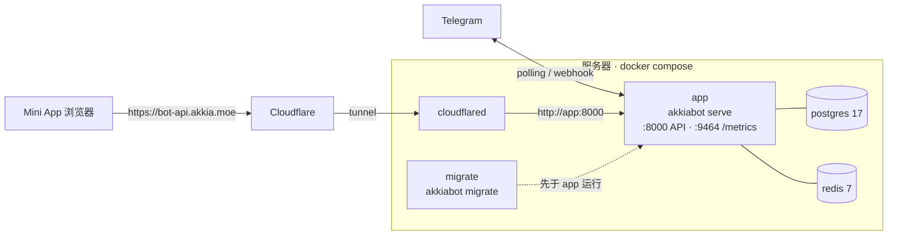

# AkkiaBot 运维手册

本文说明后端在服务器上的部署、配置、升级与回滚、备份与恢复，以及 DNS 和预发布环境。前端 Mini App 部署在 Cloudflare Pages（M7），不在本文范围内。架构依据见 `docs/architecture.md` §4、§6，任务范围见 `docs/migration-plan.md` M8。

## 1. 总览



`deploy/compose.yaml` 定义了五个服务：

| 服务 | 作用 | 网络 | 对外暴露 |
| --- | --- | --- | --- |
| `postgres` | PostgreSQL 17，数据在卷 `postgres-data` | backend | 无 |
| `redis` | 缓存（一次性 payload、限流等），数据在卷 `redis-data` | backend | 无 |
| `migrate` | 执行 `akkiabot migrate` 后退出；成功后才会启动 `app` | backend | 无 |
| `app` | `akkiabot serve`：bot 和 HTTP API（`/healthz`、`/readyz`、`/telegram/webhook`、`/api/v1/...`） | backend、edge | 仅宿主机回环 `127.0.0.1:${AKKIABOT_HTTP_PORT}` → 8000 |
| `cloudflared` | Cloudflare tunnel，把公网域名转发到 `http://app:8000` | edge | 无入站端口 |

网络边界：

- `backend` 是 internal 网络，没有出网路由；postgres、redis、migrate 只在这个网络里。
- `edge` 只有 `app` 和 `cloudflared`，tunnel 只需要访问 app。
- `/metrics` 由单独的监听器提供（容器内 `:9464`），**不发布到宿主机，也不能配置为 tunnel 的目标**。只有同一 compose 网络中的采集器（M9 的 Alloy）可以抓取。tunnel 的转发规则只指向 `http://app:8000`，所以公网访问 `https://bot-api.akkia.moe/metrics` 会得到 404。

## 2. 服务器上的文件

每套环境一个目录，生产环境和预发布环境互不共用：

```text
/opt/akkiabot/production/       # 预发布环境为 /opt/akkiabot/staging/
├── compose.yaml                # 来自仓库 deploy/compose.yaml（固定在某个 commit）
├── .env                        # compose 变量，来自 deploy/.env.example；chmod 600
├── app.env                     # 应用配置，来自 deploy/app.env.example；chmod 600
├── backup.sh                   # 来自仓库 deploy/backup.sh
├── restore.sh                  # 来自仓库 deploy/restore.sh
└── backups/                    # pg_dump 备份及 backup.log（部署时用 install -d -m 700 创建）
```

`.env` 和 `app.env` 含有密钥，只存在服务器上，不提交到仓库，也不要贴到 issue 或日志里。密钥都在 1Password 的 `AkkiaBot` vault 中：生产用 `prod-*` 条目（如 `prod-cloudflare`、`prod-bot`，由负责人填写），预发布与本地开发共用 `staging-*` 条目。预发布环境的 `app.env` 由 `deploy/staging/app.env.tpl` 通过 1Password 渲染（见 §8）。

## 3. 配置项

### 3.1 compose 变量（`.env`）

| 变量 | 必填 | 说明 |
| --- | --- | --- |
| `COMPOSE_PROJECT_NAME` | 是 | 栈名称，决定容器、卷、网络的前缀。生产用 `akkiabot`，预发布用 `akkiabot-staging`。**部署后不要改**，否则 compose 会新建一套空的数据卷。 |
| `AKKIABOT_IMAGE` | 否 | 镜像仓库，默认 `ghcr.io/akkialab/akkiabot`。 |
| `AKKIABOT_TAG` | 否 | 镜像标签，默认 `latest`。master 的每次推送都会发布 `:<完整 commit sha>` 和 `:latest`（`.github/workflows/release.yml`）。**生产环境固定为某个 sha**，回滚只需改回旧 sha。 |
| `AKKIABOT_HTTP_PORT` | 否 | app 在宿主机回环地址上的端口，默认 8000。同一台机器跑两套环境时错开（预发布用 8001）。 |
| `POSTGRES_PASSWORD` | 是 | 数据库密码。它会被拼进 `DB_URL`，只能用字母和数字：`openssl rand -hex 32`。第一次启动后数据库已用该密码初始化，之后修改需要同时在库内改密码。 |
| `CLOUDFLARED_TOKEN` | 是 | 本环境 Cloudflare tunnel 的 token（§7）。 |

缺少 `POSTGRES_PASSWORD` 或 `CLOUDFLARED_TOKEN` 时，`docker compose` 会直接报错退出，不会用默认值启动。

### 3.2 由 compose 设定的应用配置

以下配置写死在 `compose.yaml` 中，会覆盖 `app.env` 里的同名项，`app.env` 不需要写：

| 变量 | 取值 | 说明 |
| --- | --- | --- |
| `DB_URL` | `postgresql+asyncpg://akkiabot:<POSTGRES_PASSWORD>@postgres:5432/akkiabot` | 数据库连接（日志中密码显示为 `***`）。 |
| `REDIS_URL` | `redis://redis:6379/0` | 留空时使用进程内缓存，本栈始终使用 Redis。 |
| `SERVER_HOST`、`SERVER_PORT` | `0.0.0.0`、`8000` | HTTP API 监听地址。 |
| `OBSERVABILITY_LOG_FORMAT` | `json` | 结构化日志写到 stdout，由 Docker 的 json-file 驱动保存（单文件 10 MB，保留 5 个）；M9 由 Alloy 采集。 |
| `OBSERVABILITY_METRICS_HOST`、`OBSERVABILITY_METRICS_PORT` | `0.0.0.0`、`9464` | `/metrics` 监听器。只在 compose 网络内可达，见 §1。 |

### 3.3 应用配置（`app.env`）

变量名为 `<分组>_<字段>`，空值视为未设置；完整定义见 `packages/core/src/akkiabot_core/config.py`。启动时必填项缺失或格式错误，`app` 会记录错误并退出，错误信息不会带出密钥。

| 变量 | 默认值 | 说明 |
| --- | --- | --- |
| `TELEGRAM_BOT_TOKEN` | 必填 | @BotFather 发放的 bot token。生产用正式 bot；预发布用测试环境的测试 bot。 |
| `TELEGRAM_MODE` | `polling` | `polling` 主动拉取更新；`webhook` 由 Telegram 推送到 `<TELEGRAM_WEBHOOK_URL>/telegram/webhook`（经 tunnel）。同一个 token 同一时间只能有一个进程拉取更新。 |
| `TELEGRAM_WEBHOOK_URL` | 空 | webhook 模式的公网 API 地址，例如 `https://bot-api.akkia.moe`。 |
| `TELEGRAM_WEBHOOK_SECRET` | 空 | webhook 模式必填：1–256 位 `A-Z a-z 0-9 _ -`，Telegram 会在请求头里带回，用于校验。 |
| `TELEGRAM_TEST_ENVIRONMENT` | `false` | `true` 时使用 Telegram 测试环境（`/bot<token>/test/`），只能配合测试环境的 bot。生产必须为 `false`。 |
| `TELEGRAM_MESSAGE_LOG_RETENTION_DAYS` | `30` | `message_log` 的保留天数，超过的由定时任务删除。 |
| `TELEGRAM_MESSAGE_LOG_CLEANUP_INTERVAL` | `3600` | 两次清理之间的秒数（≥ 60）。 |
| `TELEGRAM_START_PAYLOAD_TTL` | `600` | 一次性 `/start` 深链 payload 的有效秒数。 |
| `DB_ECHO` | `false` | 打印 SQL，仅用于排障，生产保持关闭。 |
| `LLM_BASE_URL`、`LLM_API_KEY`、`LLM_MODEL` | 空 | OpenAI 兼容接口，反垃圾使用（M5）。 |
| `ANTISPAM_TIMEOUT` | `45` | 单条消息判定的总耗时上限（秒）；超时则放行该消息。 |
| `ANTISPAM_STRUCTURED_OUTPUT` | `auto` | `auto`：使用 JSON 结构化输出，接口不支持时退回 0/1 回答；`json_schema`：只用结构化输出，不退回；`off`：只用 0/1 回答。 |
| `ANTISPAM_PROMPT_FILE` | 空 | 替换内置基础提示词的 UTF-8 文件（输出格式说明会自动追加）。这是容器内路径，使用时需要在 compose 中把文件挂载进 app 容器。 |
| `ANTISPAM_PROMPT_VERSION` | 空 | `ANTISPAM_PROMPT_FILE` 的版本标签，默认为 `custom-<哈希>`。 |
| `ANTISPAM_EXEMPT_MESSAGE_COUNT` | `3` | 已记录消息数超过该值的成员不再检测。 |
| `ANTISPAM_PURGE_DELAY` | `5` | 判定为垃圾后，等待多少秒再删除该成员已记录的历史消息。 |
| `ANTISPAM_NOTICE_TTL` | `60` | “已删除垃圾消息”提示在多少秒后自动删除。 |
| `ANTISPAM_REPORT_RATE_LIMIT`、`ANTISPAM_REPORT_RATE_WINDOW` | `3`、`300` | 普通成员在 `ANTISPAM_REPORT_RATE_WINDOW` 秒内最多发起 `ANTISPAM_REPORT_RATE_LIMIT` 次 `/spam` 举报。 |
| `LANGFUSE_PUBLIC_KEY`、`LANGFUSE_SECRET_KEY` | 空 | Langfuse LLM 调用追踪；两个都设置时才启用。 |
| `LANGFUSE_HOST` | 空 | Langfuse 地址；为空时使用 Langfuse Cloud（EU）。 |
| `WHOIS_IPINFO_TOKEN` | 空 | ipinfo token；为空时 `/ip` 只使用 ip-api。 |
| `WHOIS_TIMEOUT` | `5` | 单次查询超时（秒）。 |
| `WHOIS_CACHE_TTL`、`WHOIS_CACHE_SIZE` | `3600`、`1024` | 进程内查询缓存的秒数和条数。 |
| `WHOIS_RATE_LIMIT`、`WHOIS_RATE_WINDOW` | `5`、`60` | 每个用户在 `WHOIS_RATE_WINDOW` 秒内最多查询 `WHOIS_RATE_LIMIT` 次。 |
| `TURNSTILE_SECRET_KEY` | 空 | Cloudflare Turnstile 服务端密钥（M6 入群验证）。为空时 `/api/v1/captcha/verify` 返回 503。 |
| `TURNSTILE_VERIFY_URL` | `https://challenges.cloudflare.com/turnstile/v0/siteverify` | Turnstile 服务端校验接口，一般不需要修改。 |
| `TURNSTILE_TIMEOUT` | `10` | 调用校验接口的单次超时（秒）。 |
| `WEBAPP_URL` | 空 | Mini App 地址，生产为 `https://bot.akkia.moe`。 |
| `WEBAPP_INIT_DATA_MAX_AGE` | `3600` | Mini App initData 自 `auth_date` 起的有效秒数。 |
| `WEBAPP_CAPTCHA_TIMEOUT` | `300` | 新成员完成入群验证的时限（秒，≥ 30）；超时后验证失效，成员保持禁言。 |
| `CORS_ALLOW_ORIGINS` | 空 | 允许跨域访问 API 的来源，逗号分隔；生产为 `https://bot.akkia.moe`。 |
| `OBSERVABILITY_LOG_LEVEL` | `INFO` | 日志级别。即使设为 `DEBUG`，会在 URL 中带出 token 的第三方日志器也保持固定级别。 |
| `OBSERVABILITY_SENTRY_DSN` | 空 | 为空时不启用 Sentry。 |
| `OBSERVABILITY_SENTRY_ENVIRONMENT` | `development` | Sentry 环境名：生产用 `production`，预发布用 `staging`。 |
| `OBSERVABILITY_SENTRY_TRACES_SAMPLE_RATE` | `0.0` | Sentry 性能采样率，0–1。 |
| `OBSERVABILITY_METRICS_ENABLED` | `true` | 是否启动 `/metrics` 监听器。 |

## 4. 首次部署（干净机器）

> **M10 切换之前，生产栈不得使用正式 bot token 启动。** Go 版 core 仍在用同一个 token 拉取更新，两个进程会争抢 update，并且新服务会直接作用在真实群组上。M8 的部署演练和验收在预发布环境（§8）完成；生产目录可以提前准备好，并用 `docker compose up -d --wait postgres redis && docker compose run --rm migrate` 验证数据库和迁移，但不要启动 `app`（也不要执行不带服务名的 `up`）。

### 4.1 前置条件

- Linux 服务器（x86_64），出站可以访问 `ghcr.io`、`api.telegram.org`（TCP 443）和 Cloudflare 隧道边缘（TCP 7844），完整列表见 §7。
- Docker Engine 和 Compose 插件 v2.24 或更高版本：`docker compose version`。
- 执行部署的用户能运行 docker（属于 `docker` 组，或者使用 root）。
- 本环境的 Cloudflare tunnel token（§7）。
- 镜像是公开的，拉取不需要登录 GHCR。

### 4.2 步骤

以下命令在服务器上执行。`REF` 取要部署的 master commit 的完整 sha，镜像标签使用同一个 sha，保证 compose 文件和镜像版本一致：

```bash
REF=<master 上的完整 commit sha>
sudo mkdir -p /opt/akkiabot/production && sudo chown "$USER" /opt/akkiabot/production
cd /opt/akkiabot/production

base="https://raw.githubusercontent.com/AkkiaLab/AkkiaBot/$REF/deploy"
curl -fsSLo compose.yaml "$base/compose.yaml"
curl -fsSLo backup.sh "$base/backup.sh"
curl -fsSLo restore.sh "$base/restore.sh"
chmod +x backup.sh restore.sh
install -d -m 700 backups                           # 定时备份的日志也写在这里，必须先建好
curl -fsSLo .env "$base/.env.example"
curl -fsSLo app.env "$base/app.env.example"
chmod 600 .env app.env

# 生成数据库密码，并固定镜像版本
sed -i "s/^POSTGRES_PASSWORD=.*/POSTGRES_PASSWORD=$(openssl rand -hex 32)/" .env
sed -i "s/^AKKIABOT_TAG=.*/AKKIABOT_TAG=$REF/" .env
```

然后用编辑器填写：

- `.env` 中的 `CLOUDFLARED_TOKEN`；
- `app.env` 中的 `TELEGRAM_BOT_TOKEN` 以及需要的其他配置（§3.3）。

不要用把密钥写在命令行参数里的方式填写（会进入 shell 历史和进程列表）。

启动并等待所有服务健康：

```bash
docker compose pull
docker compose up -d --wait
```

`--wait` 会依次等待 postgres/redis 健康 → migrate 成功退出 → app 的 `/readyz` 通过 → cloudflared 连上 Cloudflare。任何一步失败，命令都会以非零退出码返回，此时按 §5.3 排查。

### 4.3 验证

```bash
docker compose ps                                   # app、postgres、redis、cloudflared 为 healthy；migrate 为 exited (0)
curl -fsS http://127.0.0.1:8000/readyz              # {"status":"ok","checks":{"db":true,"cache":true}}
curl -fsS https://bot-api.akkia.moe/healthz         # 经 tunnel：{"status":"ok"}
curl -s -o /dev/null -w '%{http_code}\n' https://bot-api.akkia.moe/metrics   # 404，指标不经 tunnel 暴露
docker compose logs --tail 50 app                   # JSON 日志，含 "starting akkiabot" 和带 bot_username 的 "bot started"
```

最后在 Telegram 中私聊 bot 发送 `/start`、`/help`，确认 bot 有回复。

## 5. 日常运维

### 5.1 升级

```bash
cd /opt/akkiabot/production
grep '^AKKIABOT_TAG=' .env                           # 记下当前（旧）sha，回滚时要用
./backup.sh                                         # 先备份（迁移不可自动回退），记下输出的文件名
NEW=<新 commit 的完整 sha>
base="https://raw.githubusercontent.com/AkkiaLab/AkkiaBot/$NEW/deploy"
curl -fsSLo compose.yaml "$base/compose.yaml"       # compose 文件有变化时
sed -i "s/^AKKIABOT_TAG=.*/AKKIABOT_TAG=$NEW/" .env
docker compose pull && docker compose up -d --wait
```

`up` 会先用新镜像重新运行 `migrate`，成功后再替换 `app`。升级期间 bot 会有几秒到几十秒不处理 update；Telegram 会保留未拉取的 update，恢复后继续处理。新版本 `.env.example` 或 `app.env.example` 增加了配置项时，按 PR 说明补充到服务器上的文件。

### 5.2 回滚

先确认新版本是否包含数据库迁移：比较新旧 commit 之间 `packages/core/src/akkiabot_core/db/migrations/versions/` 是否有变化，或者对比 `docker compose exec -T postgres psql -U akkiabot -d akkiabot -tAc 'select version_num from alembic_version'` 与旧版本代码中最新的 revision。

**没有数据库迁移的版本**：把 `AKKIABOT_TAG` 改回旧 sha，必要时恢复对应版本的 `compose.yaml`，再执行 `docker compose up -d --wait`。

**包含数据库迁移的版本**：`akkiabot migrate` 只能升级，旧版本代码不保证能使用新表结构，只能恢复升级前（§5.1 第二步）的备份。恢复之后，升级以来写入的数据会丢失，回滚前先在 issue 中确认。整个过程**不能启动新镜像的 `migrate` 或 `app`**，所以先把 compose 文件和镜像切回旧版本，再恢复数据库，最后启动：

```bash
cd /opt/akkiabot/production
OLD=<升级前的完整 sha>
DUMP=backups/akkiabot-<升级前备份的时间>.dump

# 1. 停止写入
docker compose stop app cloudflared

# 2. 把 compose 文件和镜像固定为旧版本（此后任何 up 都只会用旧镜像；restore.sh 与版本无关，保留当前文件）
base="https://raw.githubusercontent.com/AkkiaLab/AkkiaBot/$OLD/deploy"
curl -fsSLo compose.yaml "$base/compose.yaml"
sed -i "s/^AKKIABOT_TAG=.*/AKKIABOT_TAG=$OLD/" .env
docker compose pull

# 3. 恢复升级前的备份：删库重建后再导入，不会残留新迁移加的表或列；不会启动 app
./restore.sh "$DUMP"                                # 最后一行输出恢复后的 alembic revision

# 4. 确认 revision 与旧版本一致后再启动；旧镜像的 migrate 此时什么也不做
docker compose up -d --wait
```

如果第 3 步失败，app 仍处于停止状态，数据库可能是空的或不完整：修复问题后重新执行第 3 步，不要启动 app。按 §4.3 验证回滚结果。

### 5.3 排障

| 现象 | 排查 |
| --- | --- |
| `up` 报 `required variable ... is missing a value` | `.env` 中缺少该项，按 §3.1 填写。 |
| `migrate` 退出码非 0 | `docker compose logs migrate`；常见原因是数据库密码与已初始化的卷不一致。 |
| app 不健康 | `docker compose logs app`。`invalid configuration` 表示 `app.env` 缺项或格式错误；`/readyz` 返回 503 时，`checks` 字段会标出不可用的依赖。 |
| cloudflared 不健康 | `docker compose logs cloudflared`；检查 token 是否属于本环境的 tunnel，以及 tunnel 的 public hostname 是否指向 `http://app:8000`。日志中的 `Registered tunnel connection` 应带 `protocol=http2`；反复出现 `Connection terminated` 时，检查到 Cloudflare 边缘的出站 TCP 7844 是否被防火墙拦截或不稳定（见 §7）。 |
| bot 不回复，日志有 `Conflict: terminated by other getUpdates request` | 同一个 token 有另一个进程在拉取（Go 版 core 或另一套环境），停掉其中一个。 |

常用命令：`docker compose logs -f app`、`docker compose restart app`、`docker compose down`（停止，保留数据卷）。**不要执行 `docker compose down -v`**，它会删除数据库卷。

## 6. 备份与恢复

### 6.1 定时备份

`backup.sh` 通过 `docker compose exec postgres pg_dump` 生成自定义格式的备份 `backups/akkiabot-<UTC 时间>.dump`（文件权限 600）。dump 会先写入临时文件，成功后才改名，失败时不会留下半截文件。默认保留最近 14 份，可以用 `BACKUP_KEEP` 调整，用 `BACKUP_DIR` 改变目录。

用 cron 每天备份一次。cron 会在脚本运行前打开日志文件，所以 `backups/` 必须事先存在（§4.2 的部署步骤已经创建）：

```bash
cd /opt/akkiabot/production
install -d -m 700 backups                           # 已存在时不会改动内容
./backup.sh >> backups/backup.log 2>&1 && tail -n 1 backups/backup.log   # 先手动跑一次，确认能生成备份
crontab -e
# 每天 03:17（服务器时区）备份生产库
17 3 * * * cd /opt/akkiabot/production && ./backup.sh >> backups/backup.log 2>&1
```

备份保存在同一台服务器上，只能应对误操作和升级失败。需要防范整机故障时，再用 rclone 等工具把 `backups/` 同步到异地存储，这部分由负责人决定，暂不在本仓库实现。Redis 只用作缓存，不需要备份。

### 6.2 恢复

用于误操作后找回数据，镜像版本不变。跨数据库迁移的版本回滚见 §5.2，不要直接套用本节。

```bash
cd /opt/akkiabot/production
./restore.sh backups/akkiabot-<时间>.dump           # 停 app/cloudflared，删库重建并导入，输出 alembic revision
docker compose up -d --wait                          # 当前镜像的 migrate 会把表结构升级到它的版本
```

`restore.sh` 只启动 postgres，不会启动 app 或 migrate；导入失败时会以非零退出码停止（`pg_restore --exit-on-error`）。

建议每季度在预发布环境演练一次恢复：把生产备份复制到预发布服务器，按上面的步骤恢复，确认 `/readyz` 通过。

## 7. DNS 与 tunnel

| 域名 | 指向 | 用途 |
| --- | --- | --- |
| `bot.akkia.moe` | Cloudflare Pages（M7） | Mini App 静态页面 |
| `bot-api.akkia.moe` | 生产 tunnel → `http://app:8000` | 生产后端 API、webhook |
| `bot-api-staging.akkia.moe` | 预发布 tunnel → `http://app:8000` | 预发布后端 API |

Mini App 和 API 不同源，后端通过 `CORS_ALLOW_ORIGINS` 放行 `https://bot.akkia.moe`。

每套环境使用**单独的** tunnel，由 Cloudflare 远程管理（转发规则保存在 Cloudflare 控制台）。创建方法（需要 `akkia.moe` 所在 Cloudflare 账号的权限）：

1. Cloudflare 控制台 → Zero Trust → Networks → Tunnels → Create a tunnel，类型选 Cloudflared，名称为 `akkiabot-production`（预发布为 `akkiabot-staging`）。
2. 在安装步骤页面选 Docker，从显示的命令中复制 `--token` 后面的值，填入该环境 `.env` 的 `CLOUDFLARED_TOKEN`。不需要执行页面上的 `docker run` 命令，compose 会运行 cloudflared。
3. Public Hostname 只添加一条：子域名 `bot-api`（预发布为 `bot-api-staging`），域名 `akkia.moe`，类型 `HTTP`，URL 为 `app:8000`。Cloudflare 会自动创建对应的 CNAME 记录。
4. **不要**添加指向 `app:9464` 或其他服务的规则。

compose 中的 cloudflared 固定使用 HTTP/2 连接 Cloudflare（`TUNNEL_TRANSPORT_PROTOCOL=http2`），不使用默认的 QUIC：预发布主机上 QUIC 连接多次超时断开，健康检查随之反复失败。两种协议的隧道连接都使用 **7844** 端口，区别只是 TCP 或 UDP（见 [Cloudflare 防火墙说明](https://developers.cloudflare.com/cloudflare-one/networks/connectors/cloudflare-tunnel/configure-tunnels/tunnel-with-firewall/)）。

服务器需要的出站流量：

| 用途 | 目标 | 端口 |
| --- | --- | --- |
| 隧道连接（HTTP/2） | Cloudflare 边缘 `region1.v2.argotunnel.com`、`region2.v2.argotunnel.com` | **TCP 7844** |
| cloudflared 的 API 调用（注册、更新检查等） | `api.cloudflare.com`、`update.argotunnel.com` | TCP 443 |
| Telegram Bot API、ipinfo / ip-api、Turnstile 校验、Sentry 等 | 各服务的 HTTPS 地址 | TCP 443 |
| 拉取镜像 | `ghcr.io`、Docker Hub | TCP 443 |

只放行 TCP 443 时，隧道无法建立。如果日后改回 QUIC，还需要放行 UDP 7844。

## 8. 预发布环境

预发布环境用于 M9（Grafana 接入）和 M10（切换演练）。它使用同一个 `compose.yaml`，区别如下：

| 项目 | 预发布 |
| --- | --- |
| 目录 | `/opt/akkiabot/staging`（可以和生产在同一台机器上，也可以单独一台） |
| `.env` | 来自 `deploy/staging/.env.example`：`COMPOSE_PROJECT_NAME=akkiabot-staging`，`AKKIABOT_HTTP_PORT=8001`，预发布 tunnel 的 token |
| `app.env` | 由 `deploy/staging/app.env.tpl` 用 1Password 渲染：Telegram 测试环境中**专用的 staging bot**（`TELEGRAM_TEST_ENVIRONMENT=true`），密钥来自 `AkkiaBot` vault 的 `staging-bot`、`staging-services` 条目 |
| 域名 | `bot-api-staging.akkia.moe` |
| 镜像 | 一般跟随 `latest`，或者设为待发布到生产的 sha，用来提前验证 |

1Password `AkkiaBot` vault 中预发布专用的配置分两个条目：`staging-bot`（bot）与 `staging-cloudflare`（tunnel，以及 dev/staging 共用的 Cloudflare API token）：

| 字段 | 内容 |
| --- | --- |
| `staging-bot`：`bot_token`、`bot_username` | staging bot（测试环境 BotFather 创建，当前为 `@akkiabot_staging_669a8d_bot`）。它和 e2e 自动验收用的 bot（`e2e-bot` 条目）是两个不同的 bot，所以 `just e2e --serve` 不会和预发布栈争抢 update。 |
| `staging-cloudflare`：`cloudflared_token`、`tunnel_id` | 预发布 tunnel `akkiabot-staging` 的 token 和 ID |
| `staging-bot`：`environment` | 固定为 `test` |

tunnel 和 DNS 记录可以按 §7 在控制台创建，也可以用 `staging-cloudflare/api_token`（dev/staging 共用的 token，权限：Account · Cloudflare Tunnel · Edit、Cloudflare Pages · Edit、Turnstile · Edit，Zone · DNS · Edit、Zone · Read，zone 范围仅 `akkia.moe`；生产使用 `prod-cloudflare/api_token`）通过 Cloudflare API 创建，效果相同：远程管理的 tunnel，ingress 只有 `bot-api-staging.akkia.moe → http://app:8000`，其余请求返回 `http_status:404`；外加一条代理的 CNAME `bot-api-staging` → `<tunnel_id>.cfargotunnel.com`。

步骤（在预发布机器上执行，需要能访问 `AkkiaBot` vault 的 1Password CLI，例如设置了该 vault 服务账号的 `OP_SERVICE_ACCOUNT_TOKEN`）：

```bash
REF=<master 上的完整 commit sha>
sudo mkdir -p /opt/akkiabot/staging && sudo chown "$USER" /opt/akkiabot/staging
cd /opt/akkiabot/staging

base="https://raw.githubusercontent.com/AkkiaLab/AkkiaBot/$REF/deploy"
curl -fsSLo compose.yaml "$base/compose.yaml"
curl -fsSLo backup.sh "$base/backup.sh"
curl -fsSLo restore.sh "$base/restore.sh"
chmod +x backup.sh restore.sh
install -d -m 700 backups                           # 定时备份的日志也写在这里，必须先建好
curl -fsSLo .env "$base/staging/.env.example"
curl -fsSLo app.env.tpl "$base/staging/app.env.tpl"
chmod 600 .env
sed -i "s/^POSTGRES_PASSWORD=.*/POSTGRES_PASSWORD=$(openssl rand -hex 32)/" .env

# 密钥只经过 op inject 写入文件，不出现在终端、命令行参数或 shell 历史里
umask 077
op inject -f -i app.env.tpl -o app.env
sed -i '/^CLOUDFLARED_TOKEN=/d' .env
echo 'CLOUDFLARED_TOKEN={{ op://AkkiaBot/staging-cloudflare/cloudflared_token }}' | op inject >> .env
docker compose pull && docker compose up -d --wait
```

验证：

```bash
docker compose ps
curl -fsS http://127.0.0.1:8001/readyz
curl -fsS https://bot-api-staging.akkia.moe/healthz
curl -s -o /dev/null -w '%{http_code}\n' https://bot-api-staging.akkia.moe/metrics   # 404
```

staging bot 是否正常响应：用 Telegram 测试环境的账号私聊 staging bot，发送 `/start`、`/help`、`/id`，确认都有回复。

不要用 `just e2e` 去验收预发布栈：e2e 工具读取的是 `e2e-bot` 条目中的 e2e bot，验收的是本机进程，不是预发布栈。

在执行 `usermod -aG docker` 之前就已启动的进程（例如长期运行的 Multica daemon 及其子进程）不会获得新加入的 docker 组权限：可以重新登录或重启该进程，也可以临时用 `sg docker -c "docker compose ..."` 执行。

1Password 中 `staging-*` 条目的值更新后，重新执行上面的两条 `op inject` 和 `docker compose up -d --wait`。
