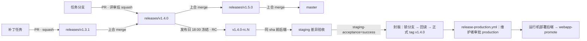

# 版本开发、逐级上合与发布流程

本文是“按版本开发与自动发布”在仓库中的实现说明与运行手册。分层验收的场景选择仍以 `AGENTS.md` 与 `docs/e2e-acceptance.md` 为准，服务器操作细节以 `docs/operations.md` 为准。

工具入口：`just release <命令>`（即 `python -m scripts.release`，代码在 `scripts/release/`，只依赖 Python 标准库、`git` 和 `gh`）。GitHub Actions 与运行机执行同一份代码。



## 1. 名称与来源

| 对象 | 形式 | 说明 |
| --- | --- | --- |
| 发布分支 | `releases/vX.Y.Z` | 每个目标版本一个短期分支 |
| 正式 tag | `vX.Y.Z` | 指向最终验收并发布的确定 commit，只由封版流程创建，永不移动或删除 |
| RC tag | `vX.Y.Z-rc.N` | staging 验收的确定 commit；后续任何修复或上合都要出新 RC，旧 RC 不移动 |

- x 只在重大迭代时变化；每个常规版本占用一个 y（`vX.Y.0`）；z 用于修复发版、加车等小版本。
- 常规版本 `vX.Y.0` 从**最新 master** 创建；小版本 `vX.Y.Z`（Z>0）从**上一个正式 tag** `vX.Y.(Z-1)` 创建（v1.2.0 → v1.2.1 → v1.2.2），上一个正式 tag 不存在时拒绝创建。
- 版本号严格校验（`v` 前缀、无前导零），已存在的版本（分支或 tag）不能复用，常规版本不能低于已存在的常规版本。版本按语义排序（v1.10.0 > v1.9.0）。
- 创建：`just release-app create vX.Y.Z`；`just release-app create next` 创建当前常规版本之后的下一个常规版本。重复执行是幂等的。缺失的目标版本由维护者创建。
- 只有智能体共用 App `akkialab-agent`（规则集绕过者，见 §7）能创建版本分支（`releases` 规则集的必需检查在创建时也生效，其他账号推送新分支会被拒绝），所以 `create` 要以 App 身份运行：`just release-app …` 经 `scripts/release/as-app.sh` 用运行机 1Password 中的 `AkkiaBot/release-app`（该 App 的发布私钥）换取**发布用途**的安装令牌，令牌只放在子进程环境中。其他只读命令（`status`、`baseline`、`check-rc` 等）照常用 `just release …`。

## 2. 日常开发

- 任务分支从**目标 release** 创建，PR 提向该 release：`git switch -c <分支名> origin/releases/vX.Y.Z`。原始实现 PR 照常评审后 squash 合并。不跟本期上线的改动从下一个 release 开发。
- `release-guard`（`.github/workflows/release-guard.yml`，规则来自 base 分支上的工具代码，不使用 PR 自身的代码，只读）检查：
  - 版本流程启用后（存在任意 `releases/*`），PR 不再直接提向 master；例外是带 `release-forward` 标签的上合冲突解决 PR。
  - base 已封版：拒绝。
  - base 是处于冻结期的当前常规版本：只接受带 `release:fix` 标签的修复（及上合冲突解决 PR）。
  - PR 分支必须从目标 release 创建：PR 新增的提交如果已经属于 master 或其他版本分支，判为基分支错误。
- 冻结与下车：每周四、周日 18:00（UTC+8）起，**当前常规版本**（最低的未封版 `vX.Y.0`）冻结新增功能，直到封版或当天结束（当天未发布则顺延到下一窗口，冻结随之解除）。冻结任务把仍提向当前版本、没有 `release:fix` / `release-forward` 标签的 PR 自动改提到下一个常规版本（不存在就创建），并留言说明变基命令。小版本分支不受时钟冻结约束，由维护者控制加车内容。
- 功能还是修复由标签决定：默认按功能处理（保守），修复由实现者加 `release:fix`，冻结期改回当前版本需维护者确认。

## 3. 逐级上合

### 3.1 模型

把所有 `releases/*` 按版本排序，最后接 master。每个分支上合到**下一个可接收节点**：下一个未封版的 release，或 master。已封版分支不再接收任何上合，但仍作为来源补传播，延迟到达的提交不会丢。

- 每一步都是 `git merge --no-ff`，保留 merge 关系（通常 squash 规则的明确例外）；原始实现 PR 仍 squash。
- 需要上合的判定只看祖先关系：来源 HEAD 不是目标 HEAD 的祖先就需要上合。因此每次运行都是一次完整对账，与触发事件无关。

### 3.2 触发、并发与补偿（`release-cascade.yml`）

- 触发：PR 合并进 `releases/**`（`pull_request_target` closed，只检出 master 上的工具代码，不检出 PR 代码）、`releases/**` 推送、每小时第 23 分的定时对账、手动运行。
- 默认 `GITHUB_TOKEN` 的推送不会再触发工作流，所以链路不依赖“上一跳推送触发下一跳”：一次运行在同一个 job 内循环规划→合并→推送，直到没有缺口或只剩冲突暂停的方向。推送使用 App 的发布用途 token。
- 并发：`concurrency: release-cascade` 串行执行。GitHub 只保留一个排队运行，被替换的运行不会丢工作，因为后一个运行会重新对账全部分支。推送是非强制推送；目标在合并期间被更新会被拒绝，此时重新获取并规划，同一跳连续 3 次被拒绝则失败报警。
- 重复、延迟事件：已包含的来源不会再合并，重复运行是空操作；漏掉的事件由定时对账补偿。

### 3.3 冲突、去重与恢复

- 某一跳合并冲突时：中止合并，**只暂停这一方向**，其他方向照常上合。
- 去重：在仓库中创建一个带 `release-forward-conflict` 标签的 issue，正文含标记 `<!-- release-forward: 来源->目标 -->`。存在打开的同标记 issue 时不会重复创建，也不会重复通知。
- 上下文：issue 记录触发来源、来源/目标 SHA、冲突文件、来源侧待上合的 PR、目标侧改动过冲突文件的 PR（含标题）以及恢复步骤；同时向可选的发布通知 webhook（secret `RELEASE_NOTIFY_WEBHOOK_URL`）发送一次 `release-forward-conflict` 载荷。webhook 通知未送达（secret 未配置或接收方停用）时，上合本身由 GitHub Actions 执行不受影响，冲突仍会在仓库 issue 中记录，需要人工关注。仓库是公开的，issue 中只有分支、SHA、文件名和 PR 编号。
- 解决：

  ```bash
  git fetch origin
  git switch -c forward/<来源版本>-to-<目标> origin/<目标分支>
  git merge --no-ff origin/<来源分支>   # 解决冲突后 git commit
  git push origin HEAD
  ```

  向目标分支提 PR，加标签 `release-forward`，由评审者评审。**不要 squash**：评审 App 准出且检查通过后，上合流水线（定时对账，或手动 `release-cascade.yml -f land_pr=<PR 号>`）以快进方式把目标分支推到该 merge commit，GitHub 随即把 PR 标为已合并。App 拥有绕过权限，不受分支规则的合并门禁约束，所以落地前由工具自己逐项核对，任一不满足都不落地：
  - PR 打开、带 `release-forward` 标签、目标未封版、包含目标当前 HEAD 和一个处于暂停的来源；
  - 评审 App（`akkialab-agent[bot]`，按 bot 用户 ID 356702926 识别，不按登录名，App 改名不影响）的最新评审是对**当前 head** 的 Approve（其他账号的批准不算，与它同名的用户或其他 App 也不算）；
  - 任何人的最新评审都不是 Request changes；所有评审线程已解决；
  - 评审 App 准出之后，除 PR 作者和评审 App 外没有新的评论或评审（例如 Copilot 的后续意见）；有的话须处理后由评审 App 重新准出；
  - 以上信息逐页读全（评审线程、评审、评论分别分页，直到没有下一页）；超出页数上限或查询失败时拒绝落地；
  - 当前 head 的 `ci-ok`、`secret-scan`、`release-guard` 通过；
  - 推送前再读一次 PR，head、base、状态都没有变化。
- 恢复：来源成为目标祖先后，下一次运行关闭冲突 issue 并继续后续传播。每次运行都会检查所有打开的冲突 issue：来源已包含在 issue 记录的目标中，或已包含在来源当前的上合目标中（例如来源封版后，由新建的补丁版本接替传播），就关闭该 issue。若冲突仍存在，会以新方向另建 issue，旧方向的 issue 不会一直挂着。

## 4. RC、封版与生产

### 4.1 RC → staging（`release-rc.yml`）

1. `release-rc.yml -f version=vX.Y.Z` 在版本分支 HEAD 上创建下一个 RC（HEAD 已有最新 RC 时沿用，不重复创建）；`-f tag=vX.Y.Z-rc.N` 重新部署已有 RC。RC 只在这里（或由发布窗口触发这里）创建，不监听 tag 推送，一个 RC 对应一次运行。
2. `check-rc`：RC 必须是该版本最新的 RC，且等于分支当前 HEAD；否则判为过期，需要新 RC。
3. 同一 sha 构建后端镜像（`release.yml`，只打 sha 标签）。RC 工作流本身不写 staging。
4. 交接给运行机（staging 栈、1Password 与测试会话都在运行机上）：`just release-staging vX.Y.Z-rc.N <场景>`。以下步骤严格按顺序执行，任一步失败都会停止，不进入后续步骤：
   1. 取得本机 staging 锁和仓库级 **staging 租约**，并再次核对 RC 有效；
   2. 触发 `webapp-deploy.yml -f sha=<sha>` 发布 staging Mini App，并等待它成功；
   3. 用该 commit 的 `deploy/upgrade.sh` 升级 `/opt/akkiabot/staging`（渲染该 commit 的 `staging/app.env.tpl`）；
   4. 公网 `/readyz` 必须通过，Mini App `version.json` 必须可读且等于该 sha；否则命令以非零退出（9 / 10），不进入验收；
   5. 执行 `just e2e-staging --record-status <sha> --baseline <基线> --scenarios <场景>`（不带场景时全量）；
   6. 结束后释放租约（包括失败）。唯一例外：前端运行超时或查询出错时，工具先取消该运行，必要时强制取消，并等 GitHub 确认它已结束；无法确认时（找不到运行，或取消后仍未结束）**保留租约**并以退出码 11 结束，因为迟到的上传仍可能覆盖下一个 RC。恢复：在 Actions 中确认该 `webapp-deploy` 运行已结束，再执行 `just release lease release <sha>`，然后重跑；租约最迟在到期时间自动失效。
5. staging 租约（`scripts/release/lease.py`）：引用 `refs/release/staging-lease` 指向一个租约 commit，它的父提交是被租用的 sha，提交说明记录持有者和到期时间（默认 6 小时）。取得租约用 `--force-with-lease` 原子地“不存在才创建”，过期租约用比较并交换接管；释放同样只删除自己的租约。staging Mini App 的**所有**上传（`webapp-deploy.yml`，手动运行也一样）在上传前用 master 上的工具执行 `lease check <sha>`，只有租约有效且正好属于该 sha 时才上传。因此另一个 RC 或一次手动部署都无法在验收期间替换前端；后端和验收由同一个持有租约的进程执行。手动部署 staging 前端须先取得租约：`just release lease acquire <sha>`，用完后执行 `just release lease release <sha>`。查看当前租约：`just release lease show`。该引用不在 `refs/heads`、`refs/tags` 下，不受分支或 tag 规则约束，也不会触发工作流。
6. 基线：该 sha 的**祖先**中、`staging-acceptance=success` 且不被其他已验收祖先包含的最近一个（`just release baseline <sha>`）。只认祖先，补丁谱系（从旧 tag 切出）不会拿到较新常规版本的验收结果，反之亦然；不使用“全局最近一次成功”。没有已验收祖先时必须全量验收。
7. 场景选择、跳过原因、`success` 的含义和 PEER_FLOOD/FloodWait 处理不变（`docs/e2e-acceptance.md` §6、§6.2）。区间内没有明确涉及的场景时仍按现行规则选 `commands.help` 作最小冒烟，并在发版记录中写明。

### 4.2 封版（`release-seal.yml` / `just release seal vX.Y.Z`）

1. 最新 RC 的 `staging-acceptance=success`，且等于分支 HEAD；否则不加锁、不打 tag。
2. 把分支加入规则集 `releases 封版`（`update`、`deletion`、`non_fast_forward`，无绕过者）：GitHub 直接拒绝之后的 PR 合并和直接推送，上合机器人也无法写入。
3. 回读：规则集包含该分支，`GET /rules/branches/<分支>` 显示规则已生效，分支 HEAD 仍等于 RC。规则未生效则失败、不打 tag；锁定期间分支被推进（竞态）则撤销锁定、不打 tag，需要新 RC。
4. 在 RC 的同一 commit 上创建正式 tag，回读确认。tag 保护规则集禁止更新和删除 `v*` tag。
5. 每一步都可重复执行：已锁定、已打 tag 的版本再次封版只补齐锁定；正式 tag 已存在但指向其他 commit 时报错，不移动 tag。
6. 成功后显式触发 `release-production.yml -f tag=vX.Y.Z`。

### 4.3 生产（`release-production.yml` + 运行机）

- `verify`：只能从 master 运行；正式 tag 所在分支已封版、分支 HEAD 等于 tag、tag 在最新 RC 上、`staging-acceptance=success`；环境 `production` 必须配置了审批人（没有就失败，防止 GitHub 自动创建一个无保护的环境后直接放行）。
- `image`：确保该 sha 的镜像存在。
- `approve`：环境 `production`，等待维护者审批。智能体不审批。
- `handoff`：向可选的发布通知 webhook 发送 `release-production-approved`，由接收方在运行机执行 `just release-deploy production vX.Y.Z`（未配置时手动执行）。该命令再次执行 `verify-formal`，并确认本次 tag 的 `生产发布 vX.Y.Z` 运行（master 上）`approve` 成功且有 `production` 环境的批准记录，否则不连接服务器。
- 服务器侧 `deploy/upgrade.sh`（取自该 tag 的 commit，经 ssh 管道执行，生产目录 `~/akkiabot/production`）：
  1. 一次只允许一个升级（`flock`）；已在目标 sha 且健康时直接成功（失败重试同一版本是安全的）；
  2. 下载该 commit 的 compose、Alloy 配置、备份/恢复脚本和配置样例；
  3. 配置检查：新样例中的每个键在 `.env` / `app.env` 中都存在（只比较键名，不输出值）；
  4. 迁移门禁：新旧版本之间 `db/migrations/versions/` 有变化（旧版本未知也视为有变化）时，必须带 `--allow-migration`，即维护者已确认本次迁移；
  5. 先用旧 compose 文件拉取新镜像；
  6. `backup.sh`，保存当前文件快照，替换文件和 `AKKIABOT_TAG`，`docker compose up -d --wait`；
  7. 回环 `/readyz` 健康检查；之后由工具检查公网 `/readyz`，失败时以退出码 9 结束（后端已切换，后续步骤停止，查因后重试同一 tag 或按 §4.4 回滚）；
  8. 切换后失败：无迁移时自动恢复快照并启动旧版本（退出码 7）；有迁移时**不回滚、不恢复数据库**，按 `docs/operations.md` §5.2 由人处理（退出码 6）；回滚也失败时退出码 8。
  9. 每次尝试追加到服务器上的 `releases.log`（权限 600，只在服务器，不进仓库或评论）。
- 后端和公网检查都成功后才触发 `webapp-promote.yml -f sha=<sha>`（接受带正式 tag 的 commit），前端保留 `webapp-production` 的维护者审批。
- 生产只做配置检查、健康检查和非 Telegram 冒烟；Telegram 能力靠自然流量观测（`AGENTS.md`）。正式 tag 不等于生产成功，实际结果以部署记录为准；失败后重试同一个 tag，不改 tag。

### 4.4 回滚入口

- 回滚目标是一个确定的正式 tag（通常是上一个，例如 `v1.4.0` 出问题回到 `v1.3.1`）。入口与发布相同：`release-production.yml -f tag=<旧 tag>` → 维护者重新审批 → `just release-deploy production <旧 tag>`。部署门禁只认该 tag **最新一次**运行的审批，不复用当初发布时的审批。
- 无迁移变化时 `upgrade.sh` 正常切回旧版本（同样先备份）。目标比当前版本旧且中间有迁移变化时，工具直接拒绝：需要恢复备份，按 `docs/operations.md` §5.2 人工执行并经维护者确认；流水线从不自动恢复数据库。

### 4.5 失败与恢复

| 失败点 | 状态 | 恢复 |
| --- | --- | --- |
| 上合冲突 | 该方向暂停，issue + 发布通知 | §3.3 解决 PR，落地后自动继续 |
| 上合推送被拒 | 无变化 | 下次运行重新规划；持续被拒检查规则/App 权限 |
| RC 过期（分支前进） | 旧 RC 不能部署/封版 | 出新 RC，按影响重新验收 |
| staging 部署失败 | 前端失败时后端未改动；后端失败看 `upgrade.sh` 退出码；公网或版本检查失败为 9 / 10，不进入验收 | 查因后重跑 `just release-staging`（租约已释放） |
| 前端运行未确认结束（退出码 11） | 租约保留，后端未改动 | 在 Actions 确认运行已结束后 `just release lease release <sha>`，再重跑 |
| staging 租约被占用 | 新的部署被拒绝 | 等待持有者结束；持有者异常退出时等租约过期，或核实后执行 `just release lease release <sha>` |
| 验收未通过 | `staging-acceptance=failure`，不能封版 | 修复进 release → 新 RC |
| 封版锁定未生效 / 打 tag 失败 | 无正式 tag | 修复后重跑封版（幂等续做） |
| 封版竞态 | 已撤销锁定，无正式 tag | 新 RC → 验收 → 封版 |
| 生产审批未通过 | 不部署 | 维护者审批或重新运行同一 tag |
| 生产部署失败 | 见退出码 4/5/6/7/8 | 4/5/7：查因后重试同一 tag；6/8：人工按 §5.2 |

## 5. 发布窗口与加车（`release-window.yml`）

- 定时：周四、周日 16:13、18:03、20:03（UTC+8，cron 用 UTC）。GitHub 的定时任务可能延迟甚至跳过，所以每次运行按**开始时的时钟**判断阶段：16:00–18:00 准备、18:00–20:00 冻结、20:00–24:00 发布，延迟的运行与准点运行做出相同决定；重复运行不会产生新变化。
- 准备：当前常规版本相对此前所有正式 tag 没有新提交，或只有上合产生的 merge、文件与上一个正式 tag 完全相同时，视为无待发布内容，跳过本窗口（冻结、发布阶段同样跳过）；否则确保下一个常规版本存在（下车目标）。
- 冻结：下车（§2），然后为当前版本出 RC 并触发 `release-rc.yml`（已有对应 HEAD 的 RC 时沿用）。沿用的 RC 满足以下任一条件时不再触发：该 RC 的 `release-rc-ready` 已发送过（`release-rc.yml` 的 handoff 在 webhook 返回 2xx 后上传内容固定的标记 artifact `release-rc-ready-<RC tag>`（不含事件载荷，公开库的 artifact 可被下载），`tag` 与 `version` 两种入口都会写）；该 sha 已有 `staging-acceptance` 状态；仍有可能交接它的 `release-rc.yml` 运行在排队或运行（标题为 `RC <RC tag>` 或 `RC <版本>`）。webhook 未配置时 handoff 成功但不写 artifact，之后沿用该 RC 仍会补发首次通知。需要重新部署已有 RC 时手动运行 `release-rc.yml -f tag=…`（会再次发送）。
- 演练：手动运行时勾选 `dry_run`（或在运行机执行 `python3 -m scripts.release window --phase <阶段> --dry-run`），只输出各阶段的判断，不建分支、不打 RC、不触发其他 workflow、不改 PR、不封版。注意手动运行使用 master 上的脚本与 workflow。
- 发布：没有 RC、RC 过期或未通过验收时**停止并报错**，不封版；通过时触发 `release-seal.yml`，随后进入生产审批。已有正式 tag 时跳过。
- 手动加车 / 小版本：`release-window.yml`，`phase` 选 `freeze` 或 `release`，`version` 填目标版本（例如先 `just release-app create v1.4.1` 创建补丁版本，PR 合入后执行 freeze 出 RC、验收后执行 release）。门禁与定时窗口完全相同。维护者汇总发布范围与加车理由；生产切换需维护者审批。

## 6. 首次引导

仓库里还没有任何版本分支或 tag 时，工具不会推导首个版本：首个版本号由维护者显式指定（`just release-app create vX.Y.Z`），从 master 创建。创建后 master 不再接收实现 PR（`release-guard` 是 master 的必需检查），存量的 master PR 由各自实现者改提到该 release（`gh pr edit <号> --base releases/vX.Y.Z` 并按 §2 变基）。

## 7. 平台接入清单

| 项 | 需要的配置 | 说明 |
| --- | --- | --- |
| GitHub App `akkialab-agent`（承担发布流水线写操作，取代原独立发布 App） | 安装权限：Contents R/W、Pull requests R/W、Issues R/W、Actions R/W、Administration R/W（编辑规则集）、Commit statuses R、Checks R、Metadata R；不开 webhook。流水线签发 token 时显式请求这组权限（以 `scripts/release/app_permissions.py` 为准，`release-setup` 的 `permission-*` 输入、`as-app.sh` 请求体与之一致，由 `tests/release/test_app_permissions.py` 校验）。该 App 的 bot 用户 ID 为 356702926，工具按 ID 识别，不按登录名；该 App 的其他用途（评审、合并）另按用途缩权，在本仓库之外维护 | 权限变更需维护者确认。改 release 权限时，同一 App 其他用途的工具要同步核对 |
| 仓库变量 `RELEASE_APP_ID`、secret `RELEASE_APP_PRIVATE_KEY`；运行机 1Password `AkkiaBot/release-app` | 共用 App 的 App ID 与**发布专用私钥**（与其他用途的私钥分开，经 stdin 写入） | 未配置时上合/窗口/RC/封版工作流明确失败，不伪装成功。轮换：App 设置页新建私钥 → 写入 1Password 与 secret（均经 stdin）→ 手动运行一次 `release-cascade.yml` 确认 → 删除旧私钥 |
| 规则集 `releases`（`refs/heads/releases/**`） | 禁止删除、强制推送；PR 需评审并只允许 squash；必需检查 `ci-ok`、`secret-scan`、`release-guard`；绕过者：`akkialab-agent`（App ID 5760780） | App 绕过用于上合 merge 与冲突解决的快进落地 |
| master 规则集 | 现有规则保留；必需检查加入 `release-guard`；绕过者加入 `akkialab-agent` | 上合以 merge commit 推入 master，与“只允许 squash 的 PR”兼容。`release-guard` 必须是必需检查，否则提向 master 的普通 PR 即使检查失败也能合并（已在演练中实测） |
| 规则集 `releases 封版` | 目标 branch，include 初始为空（工具维护），规则 `update`、`deletion`、`non_fast_forward`，**无绕过者** | 名称须完全一致 |
| tag 规则集 `版本 tag 创建`、`版本 tag 不可变`（`refs/tags/v*`） | 前者限制创建，绕过者仅 `akkialab-agent`；后者禁止更新、删除，**无绕过者** | 规则集的绕过对整套规则生效，所以不可变规则单独放在无绕过者的规则集中：App 和管理员都不能移动或删除正式 tag 与 RC tag |
| 环境 `production` | 审批人 `AkkiaS7`；部署分支只允许 master | `verify` 会检查审批人存在 |
| secret `RELEASE_NOTIFY_WEBHOOK_URL` | 可选的发布通知 webhook | 载荷 `kind` 为 `release-forward-conflict`、`release-rc-ready`、`release-production-approved`，由接收方自行处理。未配置时跳过，只在运行摘要中提示 |
| 运行机 ssh | `~/.ssh/config` 中 `Host greencloud-tyo-01`（`ProxyCommand cloudflared access ssh --hostname ssh-greencloud-tyo-01.akkia.moe`，密钥取自 1Password `AkkiaBot/shared-ssh`） | `just release-deploy production` 的默认目标；也可 `--ssh/--dir` 覆盖 |
| 标签 | `release:fix`、`release-forward`、`release-forward-conflict` | 不存在时 GitHub 在首次使用时会报错，先创建 |
| Renovate | 待定：`renovate.json` 仍以 master 为基分支 | 依赖 PR 会被 master 的必需检查 `release-guard` 拦下，需要由维护者另行确定接入方式（平台接入遗留项） |

## 8. 测试与已知限制

- `tests/release/` 用真实的本地 git 仓库（bare origin）和内存版 GitHub 覆盖：版本解析与语义排序、常规/小版本来源、冻结分类、PR 基分支检查、下车、连续上合与 merge 关系、重复/延迟/并发推送、已封版目标跳过与来源补传播、冲突暂停/去重/上下文/恢复/落地门禁、RC 过期、谱系基线与补丁分叉、封版的验收/过期/锁定未生效/竞态/幂等续做、正式 tag 门禁、生产审批阻断与同 tag 重试、发布窗口的跳过/幂等/延迟；`deploy/upgrade.sh` 用假的 docker/curl/op 覆盖成功、幂等重试、配置缺项、迁移门禁、拉取/备份失败不改动、部分失败自动回滚、迁移后失败不回滚、回滚失败。
- 真实 GitHub 规则集、App 权限、环境审批、发布通知 webhook、staging 部署与验收、ssh 生产通路无法在单元测试中覆盖，已在平台接入时单独演练；生产部署本身不在演练范围内。
- `e2e-prune-trigger.yml` 只扫描 master 历史中的 `staging-acceptance`：RC 在上合到 master 之前（例如处于冲突暂停）写入的状态，要等上合后才会被统计。
