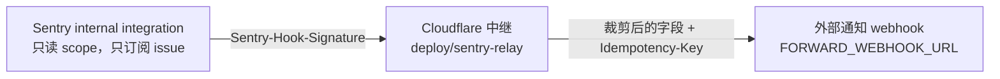

# Sentry webhook 签名中继

本文说明 Sentry 新增报错、回归和 resolved 的 webhook 如何经签名中继转发给一个可选的外部通知 webhook，以及部署、验证、停用和恢复方法。Sentry SDK 的接入见 `docs/observability.md`。本链路由 BOT-55（旧工作区编号，已不可访问）建立。转发之后如何处理（例如建任务、去重、对账）由下游接收方自行负责，不在本仓库范围内。

## 1. 数据流



- **为什么需要中继**：常见的 webhook 入口只能用 URL 令牌鉴权，不能校验 `Sentry-Hook-Signature`，也不会裁剪载荷；Sentry 投递只带 `Request-ID`，接收方需要 `Idempotency-Key` 才能去重。
- **中继**（`deploy/sentry-relay/worker.mjs`）按以下顺序处理：
  1. 用 integration 的 Client Secret 校验原始 body 的 HMAC，时间戳偏差超过 5 分钟就拒绝。
  2. 只放行 `issue` 资源中 `created`、`unresolved`、`resolved` 三种 action，且项目必须是 `ALLOWED_PROJECT_SLUGS` 中的项目（配置了 installation uuid 时也校验它）。
  3. 只转发 issue id、项目 slug、short id、级别、substatus 和 Request-ID。标题、culprit、异常 metadata、操作者和统计数据都不离开中继；接收方需要更多信息时应使用只读 token 回查 Sentry API，并按 Sentry **当前**状态处理，这样伪造、重复或乱序的 webhook 都不会造成错误结果。
  4. 转发时设置 `Idempotency-Key: sentry-<Request-ID>`。
  5. 转发地址只保存在中继的 secret 里，Sentry 看不到。

## 2. 配置与凭据位置

| 项 | 位置 | 说明 |
| --- | --- | --- |
| 中继 | Cloudflare Pages 项目 `akkiabot-sentry-relay`（advanced mode，`_worker.js` 即 `worker.mjs`），地址 `https://akkiabot-sentry-relay.pages.dev/` | 用 `staging-cloudflare` token 部署（该 token 有 Pages · Edit 权限，没有 Workers Scripts · Edit） |
| 中继 secret | Pages 生产环境：`SENTRY_CLIENT_SECRET`、`FORWARD_WEBHOOK_URL`、`ALLOWED_PROJECT_SLUGS`，可选 `SENTRY_INSTALLATION_UUID` | 值来自 1Password `AkkiaBot/sentry-webhook`，通过 stdin 写入 |
| Sentry 只读 token | 1Password `AkkiaBot/sentry-webhook` 的 `sentry_readonly_token` | internal integration 的 token，不会过期，scope 为 Organization、Project、Issue & Event 只读；供下游接收方回查使用。**自动化不使用个人 OAuth** |
| Client Secret | 同一条目的 `sentry_client_secret` | 只用于中继验签 |
| 转发 webhook URL | 条目 `AkkiaBot/sentry-webhook` 中的转发 URL 字段 | 外部通知 webhook 的地址，含鉴权令牌；默认不显示 |

## 3. 部署与更新

在能读取 `AkkiaBot` vault 的机器上执行。token 只通过环境变量传入，不出现在命令参数中：

```bash
export CLOUDFLARE_API_TOKEN="$(op read op://AkkiaBot/staging-cloudflare/api_token)"
export CLOUDFLARE_ACCOUNT_ID="$(op read op://AkkiaBot/staging-cloudflare/account_id)"
dir="$(mktemp -d)" && cp deploy/sentry-relay/worker.mjs "$dir/_worker.js" && cd "$dir"
# 首次创建项目（新版 wrangler 默认转到 Workers，需要加 --force 才使用 Pages）
npx -y wrangler@4.162.0 pages project create akkiabot-sentry-relay --production-branch main --force
op read op://AkkiaBot/sentry-webhook/sentry_client_secret | npx -y wrangler@4.162.0 pages secret put SENTRY_CLIENT_SECRET --project-name akkiabot-sentry-relay
op read op://AkkiaBot/sentry-webhook/<转发 URL 字段> | npx -y wrangler@4.162.0 pages secret put FORWARD_WEBHOOK_URL --project-name akkiabot-sentry-relay
printf 'akkiabot-staging' | npx -y wrangler@4.162.0 pages secret put ALLOWED_PROJECT_SLUGS --project-name akkiabot-sentry-relay
npx -y wrangler@4.162.0 pages deploy . --project-name akkiabot-sentry-relay --branch main --commit-dirty=true
```

修改 secret 后需要重新部署一次才会生效。未配置 secret 时，中继对所有 POST 返回 503 `not_configured`，不会转发。

Sentry 侧的配置（需要组织 owner 或 manager 在网页上操作）：Settings → Developer Settings → Custom Integrations → Create New Integration → Internal Integration。
- Webhook URL 填中继地址。
- Permissions 只给 Project、Issue & Event、Organization 的 Read。
- Webhooks 只勾选 `issue`。
- 保存后，把 Client Secret 和自动生成的 Token 填入 1Password 对应字段。

## 4. 验证

- 单元测试：`uv run pytest tests/test_sentry_relay.py`，覆盖验签、裁剪、过滤、重投和转发失败处理。
- 真实链路：
  1. 在 staging 环境用 staging DSN 发送一条标题含 `[SENTRY-WEBHOOK-TEST]` 的测试事件，检查接收方收到转发。
  2. 在 Sentry 上 resolve，再 unresolve，检查接收方收到对应 action。
  3. 用同一个 Request-ID 重放，检查转发带有相同的 `Idempotency-Key`。
  4. 用 Client Secret 签名一个非目标项目的受控请求，中继应返回 `ignored`。
  - 不向生产和已停用的旧项目写入事件。
- 中继日志在 Cloudflare 的 Pages 项目里查看（只记录 HTTP 状态和事件名）。

## 5. 停用与恢复

- 停止接收：在 Sentry integration 里取消 `issue` 订阅；或删除中继的 `SENTRY_CLIENT_SECRET` 后重新部署，此后所有请求返回 503。
- 转发 URL 泄露：在接收方轮换 URL，再更新 1Password 和中继的 `FORWARD_WEBHOOK_URL`，然后重新部署。
- Client Secret 或 token 泄露：在 Sentry integration 页面轮换，更新 1Password，然后重新部署中继。
