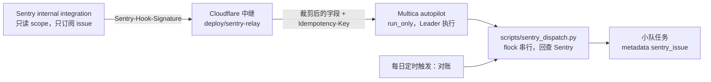

# Sentry 报错自动分派

本文说明 Sentry 新增报错、回归和 resolved 如何自动同步为 Multica 小队任务，以及部署、验证、停用和恢复方法。Sentry SDK 的接入见 `docs/observability.md`，任务分工见工作区约定。本链路由 BOT-55（旧工作区编号，已不可访问）建立；配套的 autopilot「Sentry 报错分派」尚待迁入 AkkiaLab 工作区（由 DevOps 主责，外部 webhook 切换需负责人确认），迁入前不会自动建单。

## 1. 数据流



- **为什么需要中继**：Multica 的 webhook 入口只能用 URL 令牌鉴权，不能校验 `Sentry-Hook-Signature`，也不会裁剪载荷；Sentry 投递只带 `Request-ID`，而 Multica 只按 `Idempotency-Key` 去重。
- **中继**（`deploy/sentry-relay/worker.mjs`）按以下顺序处理：
  1. 用 integration 的 Client Secret 校验原始 body 的 HMAC，时间戳偏差超过 5 分钟就拒绝。
  2. 只放行 `issue` 资源中 `created`、`unresolved`、`resolved` 三种 action，且项目必须是 `ALLOWED_PROJECT_SLUGS` 中的项目（配置了 installation uuid 时也校验它）。
  3. 只转发 issue id、项目 slug、short id、级别、substatus 和 Request-ID。标题、culprit、异常 metadata、操作者和统计数据都不离开中继。
  4. 转发时设置 `Idempotency-Key: sentry-<Request-ID>`。
  5. Multica 地址只保存在中继的 secret 里，Sentry 看不到。
- **分派脚本**（`scripts/sentry_dispatch.py`）只从 webhook 中取 issue id，其他信息都通过只读 token 回查 Sentry API。无论 webhook 是伪造、重复还是乱序，最终都按 Sentry **当前**状态处理。

## 2. 去重与状态同步

1. 加锁：在 runtime 主机上用 `flock` 串行执行"查找 → 创建 → 关联"。两次通知同时到达时，不会都判断为"没有任务"。脚本会用 `--expect-host` 校验主机名，换到其他主机时拒绝执行，避免锁静默失效。
2. 查找已有任务：
   - 先按任务 metadata `sentry_issue=<org>/<project>/<issue id>` 查找。
   - 再按描述中的固定关联标识 `sentry-issue-key=<同上>` 搜索。这个标识**随建单请求一起写入**，所以即使建单后、补写 metadata 前被中断，下次仍然能找到，届时会把 metadata 补上。
   - 两种方式都会包含 done 和 cancelled 的任务。
3. 建单：
   - 任务标题包含 Sentry short id。Multica 服务端会拒绝在同一项目中创建与未关闭任务同标题的任务。
   - 建单失败或超时时，先重新查找，找不到才重试一次，不会盲目重发。
4. 已有任务时：只在 Sentry 状态（`status/substatus`）变化时评论，并记录到 metadata `sentry_state`。
   - **resolved**：只同步状态和证据，不关闭任务，任务仍按实现、评审和验收流程收尾。
   - **回归**（`regressed` / `escalating`）：原任务已经 done 或 cancelled 时，重开为 todo，由 Leader 重新指定主责；原任务仍在处理时只评论，不改状态和负责人，也不取消成员正在执行的运行。
5. 新建任务的规则：
   - 新任务归小队所有，状态为 todo，由 Leader 指定唯一主责。
   - 标题含 `[SENTRY-WEBHOOK-TEST]` 的测试事件，建为 backlog 状态的 `[测试]` 任务。
   - Sentry 中已是 resolved 的 issue、非目标项目的 issue 不建任务。

**对账**（`reconcile`）用于补上 runtime 离线或转发失败时漏掉的事件：
- 成功游标保存在 `~/.config/akkiabot/sentry-dispatch/reconcile-cursor.json`，每次从"游标减 1 小时"开始扫描，覆盖离线时间超过 24 小时的情况。
- 扫描内容：分页查询目标项目 `lastSeen` 晚于起点的 issue（首次出现或回归的会建任务），并复核所有未关闭的关联任务（补上漏掉的 resolved）。
- 任何一页或任何一个 issue 失败，都不推进游标。
- 首次启用前执行 `init-cursor`，从当前时间开始，不回填历史 issue。

## 3. 配置与凭据位置

| 项 | 位置 | 说明 |
| --- | --- | --- |
| 中继 | Cloudflare Pages 项目 `akkiabot-sentry-relay`（advanced mode，`_worker.js` 即 `worker.mjs`），地址 `https://akkiabot-sentry-relay.pages.dev/` | 用 `staging-cloudflare` token 部署（该 token 有 Pages · Edit 权限，没有 Workers Scripts · Edit） |
| 中继 secret | Pages 生产环境：`SENTRY_CLIENT_SECRET`、`MULTICA_WEBHOOK_URL`、`ALLOWED_PROJECT_SLUGS`，可选 `SENTRY_INSTALLATION_UUID` | 值来自 1Password `AkkiaBot/sentry-webhook`，通过 stdin 写入 |
| Sentry 只读 token | 1Password `AkkiaBot/sentry-webhook` 的 `sentry_readonly_token` | internal integration 的 token，不会过期，scope 为 Organization、Project、Issue & Event 只读；脚本通过 1Password 服务账号读取。**自动化不使用个人 OAuth** |
| Client Secret | 同一条目的 `sentry_client_secret` | 只用于中继验签 |
| Multica webhook URL | 同一条目的 `multica_webhook_url` | autopilot「Sentry 报错分派（AkkiaBot）」的 webhook trigger `sentry-relay`；默认不显示 |
| 游标和锁 | runtime 主机 `~/.config/akkiabot/sentry-dispatch/` | 目录权限 700 |

## 4. 部署与更新

在能读取 `AkkiaBot` vault 的机器上执行。token 只通过环境变量传入，不出现在命令参数中：

```bash
export CLOUDFLARE_API_TOKEN="$(op read op://AkkiaBot/staging-cloudflare/api_token)"
export CLOUDFLARE_ACCOUNT_ID="$(op read op://AkkiaBot/staging-cloudflare/account_id)"
dir="$(mktemp -d)" && cp deploy/sentry-relay/worker.mjs "$dir/_worker.js" && cd "$dir"
# 首次创建项目（新版 wrangler 默认转到 Workers，需要加 --force 才使用 Pages）
npx -y wrangler@4.162.0 pages project create akkiabot-sentry-relay --production-branch main --force
op read op://AkkiaBot/sentry-webhook/sentry_client_secret | npx -y wrangler@4.162.0 pages secret put SENTRY_CLIENT_SECRET --project-name akkiabot-sentry-relay
op read op://AkkiaBot/sentry-webhook/multica_webhook_url | npx -y wrangler@4.162.0 pages secret put MULTICA_WEBHOOK_URL --project-name akkiabot-sentry-relay
printf 'akkiabot-staging' | npx -y wrangler@4.162.0 pages secret put ALLOWED_PROJECT_SLUGS --project-name akkiabot-sentry-relay
npx -y wrangler@4.162.0 pages deploy . --project-name akkiabot-sentry-relay --branch main --commit-dirty=true
```

修改 secret 后需要重新部署一次才会生效。未配置 secret 时，中继对所有 POST 返回 503 `not_configured`，不会转发。

Sentry 侧的配置（需要组织 owner 或 manager 在网页上操作）：Settings → Developer Settings → Custom Integrations → Create New Integration → Internal Integration。
- Webhook URL 填中继地址。
- Permissions 只给 Project、Issue & Event、Organization 的 Read。
- Webhooks 只勾选 `issue`。
- 保存后，把 Client Secret 和自动生成的 Token 填入 1Password 对应字段。

## 5. 验证

- 单元测试：`uv run pytest tests/test_sentry_dispatch.py tests/test_sentry_relay.py`，覆盖验签、裁剪、过滤、重投、并发建单、超时后查找、中断后按标识找回、乱序 resolved、回归重开、对账游标和分页。
- 真实链路：
  1. 在 staging 环境用 staging DSN 发送一条标题含 `[SENTRY-WEBHOOK-TEST]` 的测试事件，检查建单。
  2. 在 Sentry 上 resolve，再 unresolve，检查同一任务收到状态同步。
  3. 用同一个 Request-ID 重放，检查不会重复建单或评论。
  4. 用 Client Secret 签名一个非目标项目的受控请求，中继应返回 `ignored`。
  - 不向生产和已停用的旧项目写入事件。
- 运行记录：`multica autopilot runs <id> --output json`；中继日志在 Cloudflare 的 Pages 项目里查看（只记录 HTTP 状态和事件名）。

## 6. 停用与恢复

- 暂停分派：`multica autopilot update <id> --status paused`。中继仍会转发，Multica 回复 `ignored/autopilot_paused`，不启动运行。
- 停止接收：在 Sentry integration 里取消 `issue` 订阅；或删除中继的 `SENTRY_CLIENT_SECRET` 后重新部署，此后所有请求返回 503。
- URL 泄露：执行 `multica autopilot trigger-rotate-url`，再更新 1Password 和中继的 `MULTICA_WEBHOOK_URL`，然后重新部署。
- Client Secret 或 token 泄露：在 Sentry integration 页面轮换，更新 1Password，然后重新部署中继。
- 漏事件或失败：查看 autopilot runs 的失败原因。修复后手动触发一次（不带 payload 即执行对账），游标保证从上次成功处补齐。
