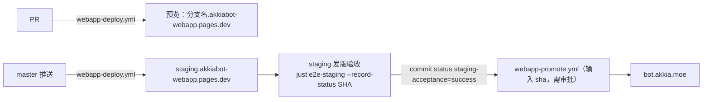

## Mini App 验证页（apps/webapp）

`apps/webapp` 是纯静态的 Telegram Mini App（Vite + React + TypeScript + Tailwind），部署到 Cloudflare Pages（生产 `https://bot.akkia.moe`）。目前只有一个页面：`/captcha?challenge=<uuid>`。

### 页面流程

1. 机器人在私聊里给被验证成员发送 Mini App 按钮，URL 为 `<WEBAPP_URL>/captcha?challenge=<id>`（见 README“入群验证”）。
2. 页面用 `@telegram-apps/sdk-react` 初始化 SDK、绑定 Telegram 主题色并调用 `ready`，取原始 `initData`。
3. 渲染 Cloudflare Turnstile 组件；拿到 token 后自动提交 `POST <VITE_API_BASE_URL>/api/v1/captcha/verify`（`challenge_id`、`init_data`、`turnstile_token`）。请求客户端使用 openapi-fetch 和 `just gen-api` 生成的类型（`src/api/client.ts`）。
4. 结果展示：
   - 成功：显示后端返回的消息，1.5 秒后关闭 Mini App；
   - 已超时（`challenge_expired`）：显示超时说明和“关闭”按钮，不提供重试（成员保持禁言，需管理员处理或退群重进）；
   - 可重试失败（`turnstile_failed`、`captcha_unavailable`、`unmute_failed`、网络错误、非预期响应、Turnstile 组件报错/过期）：显示原因和“重试”按钮，重试会重新加载 Turnstile 组件以获取新 token；
   - 其他拒绝（身份无效/过期、不是本人、已完成、非 captcha 禁言等）：显示后端消息和“关闭”按钮。
5. 页面在提交前先检查：`challenge` 不是 UUID、不在 Telegram 中打开、构建时没有配置 Turnstile site key，这三种情况直接显示错误，不渲染 Turnstile。

其他路径返回“页面不存在”。Pages 项目不放 `404.html`，因此任意未知路径（包括 `/captcha`）都会回退到根 `index.html`，由前端按 `location.pathname` 渲染。

### 构建期配置

| 变量 | 说明 |
| --- | --- |
| `VITE_API_BASE_URL` | 后端地址，生产为 `https://bot-api.akkia.moe`。为空时请求同源相对路径。 |
| `VITE_TURNSTILE_SITE_KEY` | Turnstile 站点密钥（公开值）。生产构建为空时页面显示“配置不完整”。开发服务器为空时使用 Cloudflare 的测试 key `1x00000000000000000000AA`（总是通过），该回退只存在于开发构建。 |

两者都在 `vite build` 时写入产物，修改后需要重新构建发布。

### 本地开发

```bash
just dev   # 启动 postgres / redis 和 Vite 开发服务器
```

只有开发服务器（`import.meta.env.DEV`）会加载 `src/dev/mockTelegramEnv.ts`，在普通浏览器里模拟 Telegram 环境（未签名的 initData，后端会以 `init_data_invalid` 拒绝，用于调 UI）。生产构建不包含该模块：CI 的前端 job 和发布 workflow 都会在构建后执行 `apps/webapp/scripts/check-no-dev-mock.sh`，产物中出现 mock 标记即失败。本地可用 `just build-web` 复现。

### 部署与发布（GitHub Actions + `wrangler pages deploy`）

选择在 GitHub Actions 里用 wrangler 直接上传（Direct Upload），不用 Pages 的 Git 集成，原因：构建沿用仓库锁定的 Node / pnpm 版本；发布前一定先跑 mock 检查；不需要在组织上安装 Cloudflare 的 GitHub App；部署地址作为 GitHub deployment 显示在 PR 上。

staging 与 prod 的发布入口分离（负责人于 2026-11-14 确认的分层验收，见 `AGENTS.md`）：



| 入口 | 触发 | GitHub 环境 | 上传目标 | 构建配置 |
| --- | --- | --- | --- | --- |
| `webapp-deploy.yml` | PR（前端相关路径） | `webapp-preview` | 分支预览 `<分支>.akkiabot-webapp.pages.dev` | 预发布 API + staging Turnstile |
| `webapp-deploy.yml` | 每次 master 推送、手动触发 | `webapp-preview` | 固定别名 `staging.akkiabot-webapp.pages.dev`（staging bot 的 `WEBAPP_URL`） | 同上 |
| `webapp-promote.yml` | 只能手动触发，输入 master 上的完整 sha | `webapp-production`（需审批，只接受 master 上的运行） | Pages 生产部署（`--branch=master`），即 `bot.akkia.moe` | 生产 API + prod Turnstile |

`webapp-deploy.yml` 不会发布生产。PR 分支名为 `staging` 或 `master` 时直接失败，避免覆盖这两个部署目标；没有 `CLOUDFLARE_API_TOKEN` 时（例如来自 fork 的 PR）只构建和检查，跳过上传。

**版本锁定。** `VITE_API_BASE_URL`、`VITE_TURNSTILE_SITE_KEY` 在 `vite build` 时写进产物，所以同一个 commit 要按环境各构建一次。共用的构建步骤在 `.github/actions/webapp-build`：安装锁定依赖 → 用该环境的变量构建 → 写入 `dist/version.json`（`{"sha", "environment"}`）→ 检查不含开发 mock。提升到生产时：

1. `verify` 任务检查输入是 40 位 sha、在 master 上，并且该 commit 最新的 `staging-acceptance` commit status 是 `success`。这个状态只由 staging 发版验收写入，写入前会核对 `staging.akkiabot-webapp.pages.dev/version.json` 就是该 sha（见 `docs/e2e-acceptance.md`）。
2. `deploy` 任务检出这个 sha（构建 action 也来自该 commit），并确认 `HEAD` 等于它；然后只换成生产环境变量重新构建。因此代码与 staging 验收的完全相同，差别只在环境配置。
3. 上传后对部署地址做冒烟：`/`、`/captcha?challenge=…` 返回 200，`/version.json` 的 sha 等于输入值。

生产发布与切换仍是负责人确认的操作：`webapp-production` 环境要求负责人（GitHub `AkkiaS7`）审批。智能体可以触发 `webapp-promote.yml`，但不审批生产部署。由于智能体也使用该 GitHub 账号，这条限制靠流程约束，不是技术隔离。

GitHub 配置（已于 2026-11-14 完成；token 按环境区分，dev/staging 与 prod 各用一个，见 BOT-4 中负责人的决定）：

| 位置 | 名称 | 值 / 来源 |
| --- | --- | --- |
| 仓库变量 | `CLOUDFLARE_ACCOUNT_ID` | `op://AkkiaBot/staging-cloudflare/account_id`（prod 为同一账户） |
| 仓库变量（可选） | `CLOUDFLARE_PAGES_PROJECT` | Pages 项目名，默认 `akkiabot-webapp` |
| 环境 `webapp-preview` secret | `CLOUDFLARE_API_TOKEN` | `op://AkkiaBot/staging-cloudflare/api_token`（DNS、Tunnel、Pages、Turnstile 权限） |
| 环境 `webapp-preview` 变量 | `VITE_API_BASE_URL` | `https://bot-api-staging.akkia.moe`（预发布后端） |
| 环境 `webapp-preview` 变量 | `VITE_TURNSTILE_SITE_KEY` | `op://AkkiaBot/staging-turnstile/site_key` |
| 环境 `webapp-production` secret | `CLOUDFLARE_API_TOKEN` | `op://AkkiaBot/prod-cloudflare/api_token`（负责人填写，已写入并做过只读校验） |
| 环境 `webapp-production` 保护规则 | 审批人、部署分支 | 审批人 `AkkiaS7`；只允许 `master` |
| 环境 `webapp-production` 变量 | `VITE_API_BASE_URL` | `https://bot-api.akkia.moe` |
| 环境 `webapp-production` 变量 | `VITE_TURNSTILE_SITE_KEY` | `op://AkkiaBot/prod-turnstile/site_key` |

写入 GitHub 时值一律经 stdin 传递，例如：

```bash
op read op://AkkiaBot/prod-cloudflare/api_token | gh secret set CLOUDFLARE_API_TOKEN --env webapp-production -R AkkiaLab/AkkiaBot
```

Cloudflare 侧（已用 staging token 通过 API 完成）：

1. Pages 项目 `akkiabot-webapp`（Direct Upload），生产分支 `master`。
2. 自定义域名 `bot.akkia.moe`：Pages 项目域名 + `akkia.moe` 区内 CNAME `bot` → `akkiabot-webapp.pages.dev`（代理）。
3. Turnstile widget（Managed）：`akkiabot-staging`（主机名 `akkiabot-webapp.pages.dev`，覆盖所有预览子域）、`akkiabot-prod`（`bot.akkia.moe`）。site key / secret key 存于 1Password `AkkiaBot/staging-turnstile`、`AkkiaBot/prod-turnstile`。
4. 后端：secret key 配置为后端的 `TURNSTILE_SECRET_KEY`（预发布用 `staging-turnstile`，生产用 `prod-turnstile`）；`WEBAPP_URL` 为对应前端地址，`CORS_ALLOW_ORIGINS` 包含该来源。预发布环境使用预览地址时，把该预览来源加入预发布后端的 CORS 列表。

新建 Pages 项目后，`*.akkiabot-webapp.pages.dev` 的证书需要几分钟签发，期间预览地址会 TLS 握手失败。

缓存与响应头在 `apps/webapp/public/_headers`：HTML 等默认 `Cache-Control: no-cache`，带内容哈希的 `/assets/*` 长期缓存（`immutable`）；另加 `nosniff`、`Referrer-Policy`、`Permissions-Policy`。不设置 `X-Frame-Options`，因为 Telegram Web 版在 iframe 中加载 Mini App。

### 验收清单

分层验收（`AGENTS.md`）：

- **PR**：只验证受影响部分。单元测试和构建检查由 CI 执行；PR 预览地址能打开，直接访问 `<预览地址>/captcha?challenge=<任意 uuid>` 返回页面（不是 404），在浏览器中提示“请在 Telegram 中…打开”。
- **staging 发版**：`just e2e-staging --record-status <sha>` 全量自动化验收，其中 `m7.captcha` 覆盖“入群被禁言 → 群内提示 → 私聊深链 → 打开 Mini App（Telegram 签发的真实 initData）→ 页面 → 验证接口与 CORS → 未通过 Turnstile 时保持禁言”。真实 Turnstile 挑战需要真人在浏览器中完成，工具不求解，也不使用测试 key；报告中以“未自动化”列出，不计入通过。
- **prod**：只提升通过 staging 验收的 sha，`webapp-promote.yml` 自带冒烟检查；不重复全量验收。
